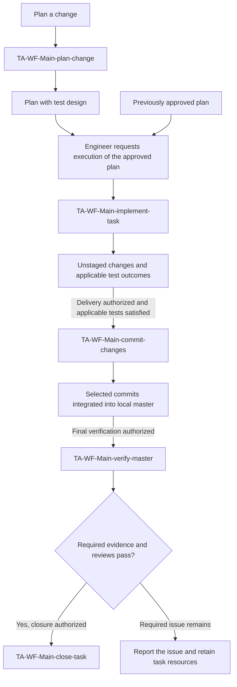
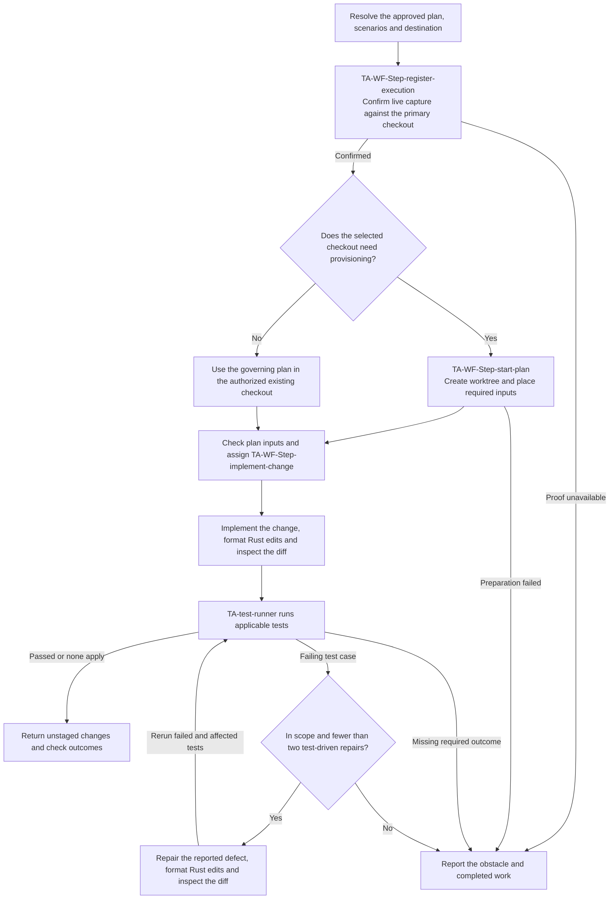
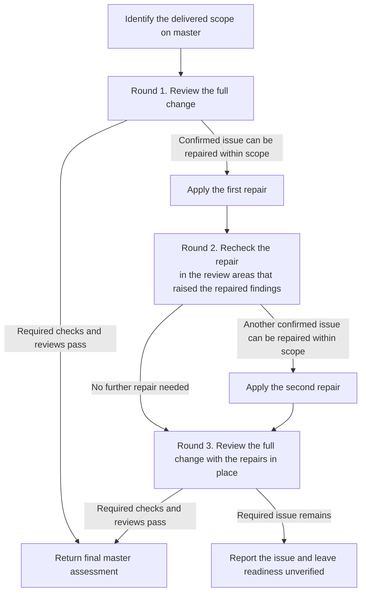
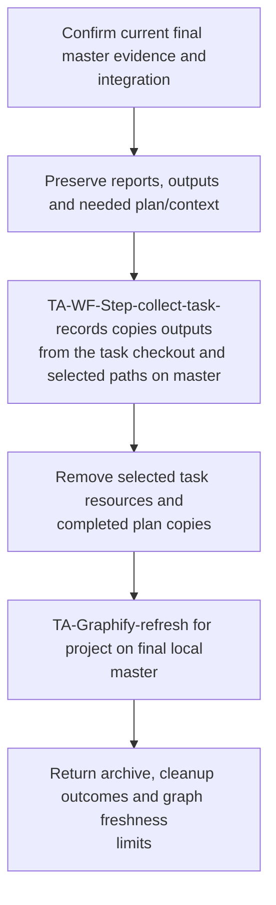
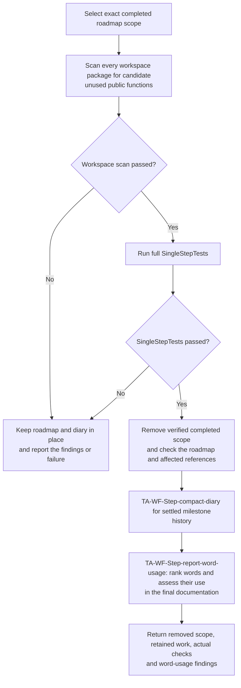
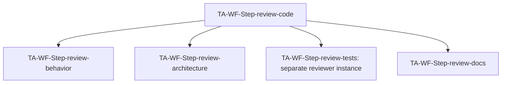

# Task workflow and skills

This guide shows how an approved plan moves through the workflow and which
skills each main operation uses. Each linked `SKILL.md` explains what the skill
needs, how to use it and where its work ends. Authorization and assignment
rules are in [AGENTS.md](../../AGENTS.md). For who performs the work, see
[agent roles](../../.codex/agents/README.md).

The engineer can select one operation or authorize a sequence in ordinary
language. The session uses skill descriptions and invocation metadata to match
the request to the applicable skills. When the engineer authorizes a sequence,
follow the order shown by the arrows. Each operation reports what happened.
Stop dependent work if a required check fails or required evidence is missing.
Findings alone do not expand the authorized scope.

## Task overview

The engineer can plan a change, execute an existing approved plan or select
a later operation directly. The arrows below apply only when the engineer
authorizes the next stage. [Milestone closure](#close-milestone) is a separate
operation, and push requires its own authorization.

## Main operations and their component skills

Component skills can also be selected independently.

### Plan change

[TA-WF-Main-plan-change](TA-WF-Main-plan-change/SKILL.md) assigns one planner
to create or amend the plan and use
[TA-WF-Step-design-tests](TA-WF-Step-design-tests/SKILL.md) in the same
assignment. The planner puts the change, acceptance criteria, scenarios and
expected observations in one draft or one requested plan file. On amendment,
they reconcile affected scenarios and retain applicable IDs. Planning ends
with that result.

### Implement task

[TA-WF-Main-implement-task](TA-WF-Main-implement-task/SKILL.md) resolves the
approved plan and destination and confirms capture against the primary
checkout. It assigns the change to the implementer. Once the implementer
returns the change and diff inspection, the runner executes the applicable tests.

A failing test case can use one of the two test-driven repairs. An
instrumented test can produce reports in the same run. The main session
reports a recorded pass and any export failure separately.

### Commit changes and integrate

[TA-WF-Main-commit-changes](TA-WF-Main-commit-changes/SKILL.md) inspects the
diff, groups and stages only the selected changes, creates commits with English
messages and integrates a task branch into local master. Use a fast-forward
when possible and a merge otherwise. Reconcile selected conflicts within scope.
A scoped commit already on master needs no merge. The result reports the actual
Git outcome and available checks. A separately selected Verify Master checks
the integrated files, including conflict resolutions.

### Verify master

[TA-WF-Main-verify-master](TA-WF-Main-verify-master/SKILL.md) owns the review
rounds below. Tests and reviews use the delivered scope directly on master.
The main session includes applicable pending files and preserves unrelated work.

Before each round, run the full English scan with validated dictionary
maintenance and commit any authorized language edits and repairs. In round 1,
run the applicable tests with coverage where supported and the required gates.
In later rounds, refresh affected results and reuse results whose inputs still
match. Independently challenge the findings and reported check failures from
each round. If a required issue needs the engineer's decision or required
evidence remains missing, report it and leave readiness unverified.

Use [Correct English](TA-WF-Step-correct-english/SKILL.md),
[Verify Commit](TA-WF-Step-verify-commit/SKILL.md) for the default verification
profile, [Review Code](TA-WF-Step-review-code/SKILL.md),
[Challenge Findings](TA-WF-Step-challenge-findings/SKILL.md) and
[Commit Changes](TA-WF-Main-commit-changes/SKILL.md) for scoped commits on master.
The master skill explains how to include affected Python or bootstrap suites
that the default profile omits after integration. Select full milestone vectors
here only when requested.

### Close task

Task closure requires successful final master evidence that covers the delivered
scope after all corrections. The operation preserves outputs before removing
the selected task resources. See
[TA-WF-Main-close-task](TA-WF-Main-close-task/SKILL.md).

Component procedures:
[collect-task-records](TA-WF-Step-collect-task-records/SKILL.md) and
[Graphify-refresh](TA-Graphify-refresh/SKILL.md).
The [artifact tool](../../tools/artifacts/README.md), `tools/worktree.ps1` and
ordinary Git and file operations preserve and remove the selected resources.
For a selected tracked plan, commit only its removal as housekeeping. Stop
closure if required evidence is missing or stale. After a partial failure,
report the completed steps so the next attempt picks up the remaining work.
Report how current the document semantics are separately from the structural
graph refresh.

### Close milestone

[TA-WF-Main-close-milestone](TA-WF-Main-close-milestone/SKILL.md) closes an exact
completed roadmap scope. It is separate from task closure and can cover work
delivered across several tasks.

The included components are
[compact-diary](TA-WF-Step-compact-diary/SKILL.md) and
[Report Word Usage](TA-WF-Step-report-word-usage/SKILL.md). The word report includes 20 ranked
candidates, an assessment of their use and suggested vocabulary exclusions. It
does not edit text or set a word-frequency pass/fail threshold. This operation
runs the full milestone profile. After a failure, the engineer directs any
repairs and commits, and a fresh milestone run must pass both checks before
the roadmap edit proceeds. The operation ends with the word-usage report.

## Three review rounds and up to two corrective passes

These rounds belong to [Verify Master](TA-WF-Main-verify-master/SKILL.md).
Each round checks English before reviewing the evidence. After a correction,
commit the selected changes directly on master and refresh affected test,
coverage and gate results.

| Round | Scope | What follows |
| --- | --- | --- |
| 1. Initial review | All applicable independent assignments assess the delivered change and affected interactions | Finish when required evidence and findings permit it. Send supported in-scope repairs to the implementer. |
| 2. Targeted reassessment | Assign fresh reviewers only to the review areas that raised the repaired findings. They check the repairs and affected interactions. Also include the tests reviewer when affected assertions or refreshed coverage need reassessment. | Use the remaining corrective pass for a supported issue within scope. Proceed to the full review after corrective work. |
| 3. Final full review | All initial assignments and any newly affected scope review the delivered change with corrections applied | Reuse current test and coverage data when inputs match. Return any required issue that remains. |

When no reviewer needs to reassess a repair or inspect updated coverage and
assertions, round 2 can assess the rerun checks alone. Challenge findings and
reported failures independently in each round. A failed check or missing
required evidence leaves readiness unverified.

### What review-code includes

[TA-WF-Step-review-code](TA-WF-Step-review-code/SKILL.md) coordinates independent
assessments chosen from the actual change:

| Component | Scope when selected |
| --- | --- |
| [review-behavior](TA-WF-Step-review-behavior/SKILL.md) | Behavior, specification compliance and affected interactions; selected stage-wide review includes unchanged affected code and the full static semantic check |
| [review-architecture](TA-WF-Step-review-architecture/SKILL.md) | Architecture, authoritative definitions, ownership and complete internal migrations |
| [review-tests](TA-WF-Step-review-tests/SKILL.md) | Assertions, meaningful missing scenarios, supplied coverage, verification gates and evidence freshness; code/test changes receive a separate reviewer instance |
| [review-docs](TA-WF-Step-review-docs/SKILL.md) | Affected Design documents, requirements, instruction ownership and retained knowledge, including the full Design link/metadata audit |

The diagram shows the available assignments. Select the applicable ones and
keep the narrower selection in round 2. Reviewers report findings without
making repairs. An independent assessment of their claims informs the choice
of repairs. See [challenge-findings](TA-WF-Step-challenge-findings/SKILL.md).
The test runner collects coverage, the tests reviewer assesses it and the
implementer writes the selected tests. Deciding which tests to add takes
evidence beyond the coverage percentage.

## Other selected operations

These capabilities support an assigned task or run as selected standalone work:

| Need | Entry point |
| --- | --- |
| Confirm live capture for a selected thread | [TA-WF-Step-register-execution](TA-WF-Step-register-execution/SKILL.md) |
| Provision a selected task worktree | [TA-WF-Step-start-plan](TA-WF-Step-start-plan/SKILL.md) |
| Design tests for agreed requirements | [TA-WF-Step-design-tests](TA-WF-Step-design-tests/SKILL.md) |
| Assess, author or restructure documentation | [TA-WF-Step-update-docs](TA-WF-Step-update-docs/SKILL.md) |
| Capture environment inventory in an existing execution archive | [TA-WF-Step-capture-environment](TA-WF-Step-capture-environment/SKILL.md) |
| Research manuals, physical measurements or reference models | [TA-Hardware-research](TA-Hardware-research/SKILL.md) |
| Investigate emulation costs and optimization candidates | [TA-profile-emulation](TA-profile-emulation/SKILL.md) |
| Navigate an explicitly selected existing graph | [TA-Graphify-query](TA-Graphify-query/SKILL.md), [explain-symbol](TA-Graphify-explain-symbol/SKILL.md), [find-path](TA-Graphify-find-path/SKILL.md) |
| Refresh graph structure or extract selected document semantics | [TA-Graphify-refresh](TA-Graphify-refresh/SKILL.md), [extract-semantics](TA-Graphify-extract-semantics/SKILL.md) |
| Index explicitly accepted Amiga documentation | [TA-RAG-index-amiga](TA-RAG-index-amiga/SKILL.md) |
| Capture an existing supported GUI scenario | [TA-capture-gui-screenshot](TA-capture-gui-screenshot/SKILL.md) |
| Implement selected PowerShell tooling | [TA-write-powershell](TA-write-powershell/SKILL.md) |

The [knowledge tools guide](../references/knowledge-tools.md) explains when graph
navigation, RAG retrieval, hardware research or screenshots help an assignment.
Discovery does not itself select indexing or graph refresh. `TA-Graphify-`,
`TA-RAG-` and `TA-Hardware-` group specialist skills by domain; these names identify
skills, not agent roles.

## Results and tool references

Agents send a written account and JSON to the main session. The engineer
receives a plain-language summary of the outcome, relevant checks and
unfinished work, with an optional link to an existing saved result.
[Result contract](../references/workflow-contract.md#inputs-and-outputs) ·
[Handoff schema](../../tools/workflow/result.schema.json)

Use [verification commands](../../tools/verification/README.md) for actual tests,
quality checks and coverage; full milestone tests are also available without
closing a roadmap item. The verifier reports executed checks and does not publish
Git changes or reuse a previous passing verdict. See the
[capture guide](../../tools/workflow/capture/README.md) for telemetry and execution
archives and the [artifact guide](../../tools/artifacts/README.md) for preserving
local outputs before cleanup. Native test reports normally already live in the
primary checkout's ignored `.agent/task-archives/` directory.
