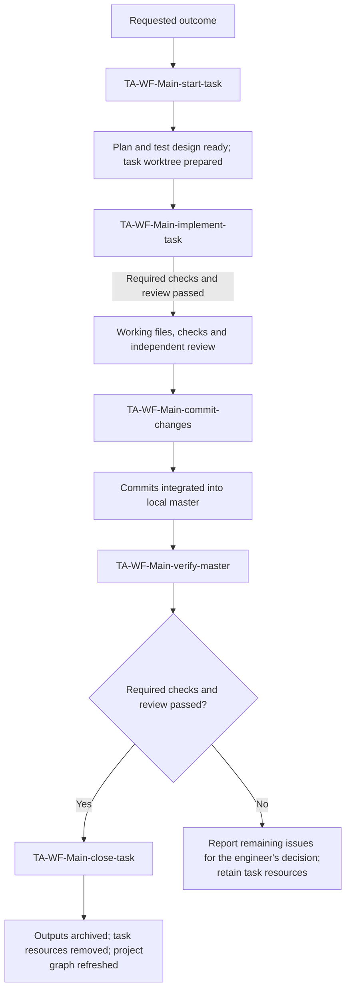
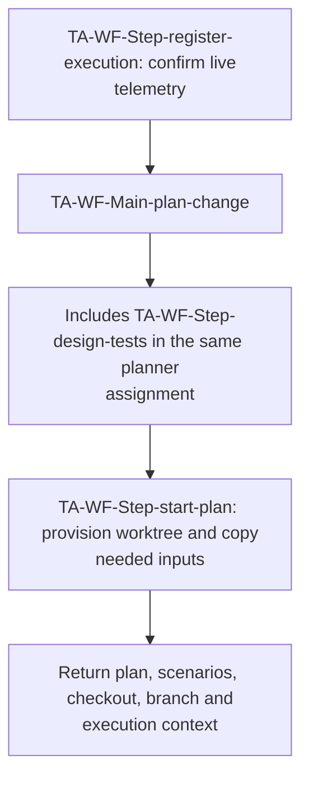
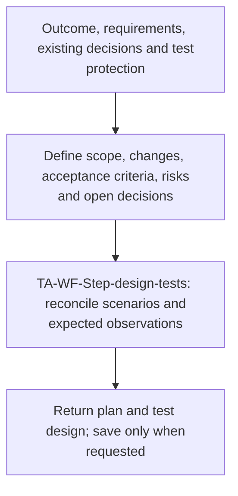
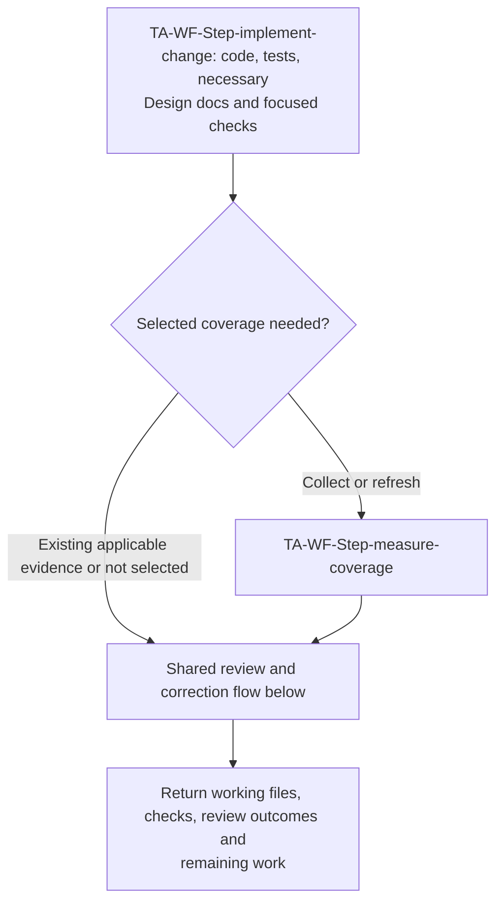
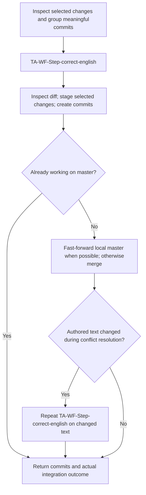
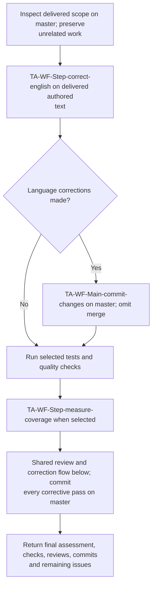
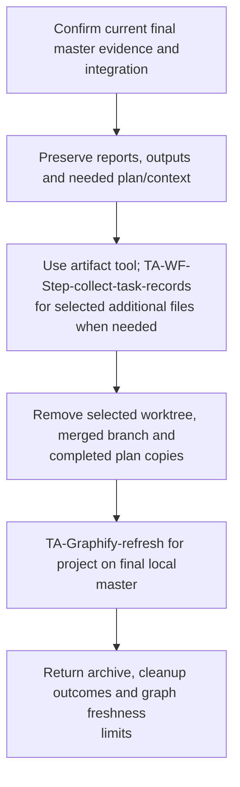
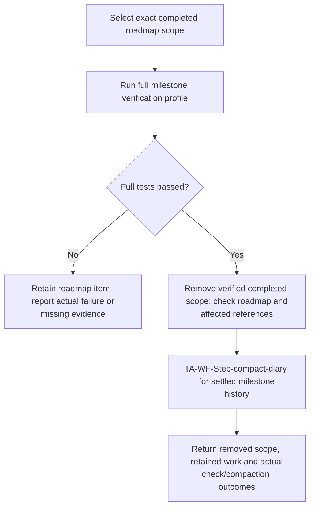
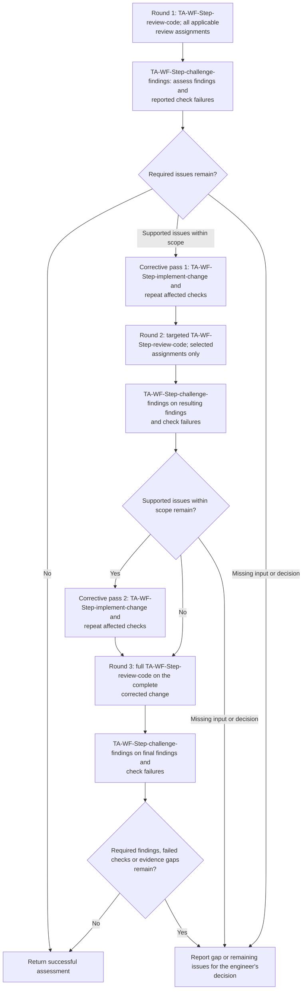
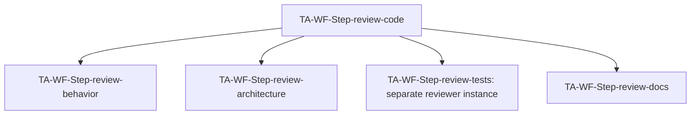

# Task workflow and skills

This guide maps a task from initialization to closure and shows which skills each
main operation uses. Follow the linked `SKILL.md` for its inputs, procedure and
stopping boundary. [AGENTS.md](../../AGENTS.md) owns authorization and assignment
policy; [agent roles](../../.codex/agents/README.md) explain who performs the work.

The engineer can select one operation or authorize a sequence in ordinary language.
Arrows between main operations show process order, not automatic invocation.
Implicit skill discovery uses descriptions and invocation metadata.
Each operation returns its actual outcome; failed or missing required evidence
stops dependent work. Findings do not authorize changes outside the selected scope.

## Task overview

Standalone [planning](#plan-change) produces a plan and test design without
provisioning a worktree. Initialization can reuse existing approved inputs.
[Milestone closure](#close-milestone) is a separate operation. Push is outside
these task stages.

## Main operations and their component skills

Names in diagrams are exact skill names. Linked lists below each diagram provide
the owning procedures. Direct Git and tool actions are labeled as actions rather
than skills. `TA-WF-Main-` groups main workflow operations; `TA-WF-Step-` groups
their component operations, which can also be selected separately.

### Start task

[TA-WF-Main-start-task](TA-WF-Main-start-task/SKILL.md) initializes the selected
task and stops before implementation. The main session handles registration and
provisioning; one planner owns the plan and test design together.

Component procedures:
[register-execution](TA-WF-Step-register-execution/SKILL.md),
[plan-change](TA-WF-Main-plan-change/SKILL.md),
[design-tests](TA-WF-Step-design-tests/SKILL.md),
[start-plan](TA-WF-Step-start-plan/SKILL.md).

### Plan change

[TA-WF-Main-plan-change](TA-WF-Main-plan-change/SKILL.md) creates or amends a plan,
both independently and within task initialization. Every revision reconciles the
test design; an editorial amendment can retain scenarios that remain valid.
Planning defines observations and expected results; implementation writes the
executable tests.

The included [design-tests](TA-WF-Step-design-tests/SKILL.md) step runs in the same
planner assignment. Planning stops before implementation, verification and worktree
provisioning.

### Implement task

[TA-WF-Main-implement-task](TA-WF-Main-implement-task/SKILL.md) works in the task
worktree. Its output is source, tests and necessary documentation as working files,
with actual check and review results. It stops before staging, commits and merge.

Component procedures:
[implement-change](TA-WF-Step-implement-change/SKILL.md),
[measure-coverage](TA-WF-Step-measure-coverage/SKILL.md) when selected,
[review-code](TA-WF-Step-review-code/SKILL.md),
[challenge-findings](TA-WF-Step-challenge-findings/SKILL.md).
The [shared review flow](#three-review-rounds-and-up-to-two-corrective-passes)
defines the review rounds and corrective passes. Corrections use
`implement-change` again. Commit-time English checks belong to the
selected commit operation unless expressly included in implementation.

### Commit changes and integrate

[TA-WF-Main-commit-changes](TA-WF-Main-commit-changes/SKILL.md) groups the selected
work into meaningful commits and integrates it into local master. A commit or
merge alone does not establish that tests passed on master.

The component skill is
[correct-english](TA-WF-Step-correct-english/SKILL.md); ordinary Git commands perform
commits and integration. Genuine behavior decisions or unsafe interference stop
dependent integration. This operation stops before final master verification,
cleanup and push. A diary entry is included only when it is part of the selected
work or separately requested.

### Verify master

[TA-WF-Main-verify-master](TA-WF-Main-verify-master/SKILL.md) tests and reviews the
integrated change directly on master while the task plan and resources remain
available. It includes scoped corrective commits when needed.

Component procedures:
[correct-english](TA-WF-Step-correct-english/SKILL.md),
[verify-commit](TA-WF-Step-verify-commit/SKILL.md) for the default test profile,
[measure-coverage](TA-WF-Step-measure-coverage/SKILL.md) when selected,
[review-code](TA-WF-Step-review-code/SKILL.md),
[challenge-findings](TA-WF-Step-challenge-findings/SKILL.md),
[implement-change](TA-WF-Step-implement-change/SKILL.md) for repairs and
[commit-changes](TA-WF-Main-commit-changes/SKILL.md) for scoped commits on master.

The [shared review flow](#three-review-rounds-and-up-to-two-corrective-passes)
defines the review rounds and corrective passes. Without a narrower test selection,
use the existing `commit` verification profile.
Inspect its selection and explicitly run affected Python/bootstrap suites that
working-file detection would miss after integration. Full milestone vectors run
here only when expressly selected. Failed required checks or review leave this
assessment incomplete and stop task closure; integration is not rolled back.

### Close task

[TA-WF-Main-close-task](TA-WF-Main-close-task/SKILL.md) consumes successful final
master evidence covering the delivered scope after all corrections. It preserves
outputs before removing the selected task resources.

Component procedures:
[collect-task-records](TA-WF-Step-collect-task-records/SKILL.md) when needed and
[Graphify-refresh](TA-Graphify-refresh/SKILL.md).
The [artifact tool](../../tools/artifacts/README.md), `tools/worktree.ps1` and
ordinary Git/file operations perform preservation and removal. Any selected
tracked-plan removal receives only its scoped housekeeping commit. Missing or
stale required evidence stops closure; a partial failure reports the completed
steps so resumption performs only the remaining work. Structural graph refresh
leaves document-semantic freshness as a separate observation.

### Close milestone

[TA-WF-Main-close-milestone](TA-WF-Main-close-milestone/SKILL.md) closes an exact
completed roadmap scope. It is separate from task closure and can cover work
delivered across several tasks.

The included component is
[compact-diary](TA-WF-Step-compact-diary/SKILL.md). This operation runs the existing
full milestone test profile, including full SingleStep selection. It adds no code
review, implementation, commits, merge, push or worktree cleanup.

## Three review rounds and up to two corrective passes

Both implementation and master verification use the flow below. Each invocation
has its own rounds and corrective passes. The initial implementation or assessment
does not count as a corrective pass. New findings do not reset the count.

| Round | What is assessed | Who participates | What follows |
| --- | --- | --- | --- |
| 1: initial review | The complete selected change and affected interactions, with actual check results | All applicable independent reviewer assignments selected for this change | Finish if no required issues remain; otherwise select supported repairs within scope or report a decision gap |
| 2: targeted reassessment | Findings upheld by the challenge and selected for repair, their corrections and affected interactions | Only the round 1 assignments responsible for those findings, in fresh independent contexts | Make a second corrective pass if supported issues remain; otherwise proceed directly to round 3 |
| 3: final full review | The complete corrected change and affected interactions, with current checks and selected coverage | Every round 1 assignment, including those previously without findings, plus any newly affected scope | Finish if required evidence and findings permit it; otherwise return to the engineer without another repair or review round |

Round 2 may contain only assessment of rerun checks when no reviewer assignments
qualify for targeted reassessment. Round 3 is required whenever corrective work was
needed after round 1, even if round 2 is clear and only one corrective pass was used.
Missing requirements, protected-change approval or work outside the selected scope
return to the engineer before dependent repairs. A challenge decision cannot turn
a failed or missing required check into a pass.

Corrections can include code, necessary documentation and meaningful tests or
assertions for already approved behavior. Refresh affected selected coverage when
needed to substantiate protection claims after code/test changes. During
implementation, corrections stay as working files in the task worktree. During
master verification, each corrective pass includes English checks and scoped
`TA-WF-Main-commit-changes` commits directly on master before the next review.

### What review-code includes

[TA-WF-Step-review-code](TA-WF-Step-review-code/SKILL.md) coordinates independent
assessments chosen from the actual change:

| Component | Scope when selected |
| --- | --- |
| [review-behavior](TA-WF-Step-review-behavior/SKILL.md) | Behavior, specification compliance and affected interactions; selected stage-wide review includes unchanged affected code and the full static semantic check |
| [review-architecture](TA-WF-Step-review-architecture/SKILL.md) | Architecture, authoritative definitions, ownership and complete internal migrations |
| [review-tests](TA-WF-Step-review-tests/SKILL.md) | Assertions, meaningful missing scenarios, supplied coverage, verification gates and evidence freshness; code/test changes receive a separate reviewer instance |
| [review-docs](TA-WF-Step-review-docs/SKILL.md) | Affected Design documents, requirements, instruction ownership and retained knowledge, including the full Design link/metadata audit |

The diagram shows available assignments, not a mandatory four-reviewer batch.
Round 2 retains its narrower selection. Reviewers report findings without repairs;
the [challenge-findings](TA-WF-Step-challenge-findings/SKILL.md) step independently
assesses the reported claims before repairs are selected. The runner collects
coverage; the tests reviewer assesses it; the implementer writes selected tests.
A percentage alone does not decide which tests to add.

## Other selected operations

These capabilities support an assigned task or run as selected standalone work:

| Need | Entry point |
| --- | --- |
| Assess, author or restructure documentation | [TA-WF-Step-update-docs](TA-WF-Step-update-docs/SKILL.md) |
| Capture environment inventory in an existing execution archive | [TA-WF-Step-capture-environment](TA-WF-Step-capture-environment/SKILL.md) |
| Research manuals, physical measurements or reference models | [TA-Hardware-research](TA-Hardware-research/SKILL.md) |
| Investigate emulation costs and optimization candidates | [TA-profile-emulation](TA-profile-emulation/SKILL.md) |
| Navigate an explicitly selected existing graph | [TA-Graphify-query](TA-Graphify-query/SKILL.md), [explain-symbol](TA-Graphify-explain-symbol/SKILL.md), [find-path](TA-Graphify-find-path/SKILL.md) |
| Refresh graph structure or extract selected document semantics | [TA-Graphify-refresh](TA-Graphify-refresh/SKILL.md), [extract-semantics](TA-Graphify-extract-semantics/SKILL.md) |
| Index explicitly accepted Amiga documentation | [TA-RAG-index-amiga](TA-RAG-index-amiga/SKILL.md) |
| Capture an existing supported GUI scenario | [TA-capture-gui-screenshot](TA-capture-gui-screenshot/SKILL.md) |
| Implement selected PowerShell tooling | [TA-write-powershell](TA-write-powershell/SKILL.md) |

The [knowledge tools guide](../references/knowledge-tools.md) explains when graph
navigation, RAG retrieval, hardware research or screenshots help an assignment.
Discovery does not itself select indexing or graph refresh. `TA-Graphify-`,
`TA-RAG-` and `TA-Hardware-` group specialist skills by domain; these names identify
skills, not agent roles.

## Results and tool references

Every skill returns text and JSON under the
[result contract](../references/workflow-contract.md), including actual checks,
findings and remaining work. The [schema](../../tools/workflow/result.schema.json)
describes the format; it does not authorize the next stage or establish readiness.
No handoff ledger, transition matrix, round manifest, candidate seal or matching
Markdown artifact is required.

Use [verification commands](../../tools/verification/README.md) for actual tests,
quality checks and coverage; full milestone tests are also available without
closing a roadmap item. The verifier reports executed checks and does not publish
Git changes or reuse a previous passing verdict. See the
[capture guide](../../tools/workflow/capture/README.md) for telemetry and execution
archives and the [artifact guide](../../tools/artifacts/README.md) for preserving
local outputs before cleanup. Native test reports normally already live in the
primary checkout's ignored `.agent/task-archives/` directory.
