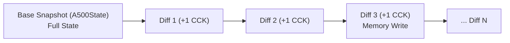
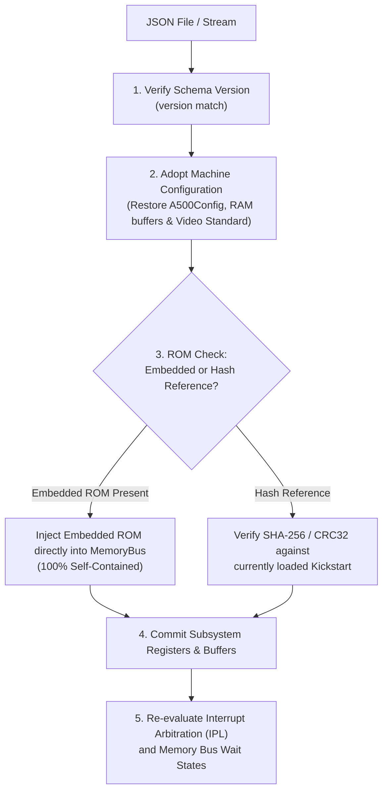

# Amiga 500 Save State Architecture & Serialization Specification

> [!NOTE]
> System ownership principles and decoupling constraints are defined in [AGENTS.md](../../../../AGENTS.md) and [General Architecture.md](../General%20Architecture.md).
> Master clock synchronization is detailed in [Machine Loop.md](../Machine%20Loop.md).
> Memory layout and low-memory overlay rules are specified in [MemoryBus.md](../MemoryBus.md). Machine state serialization is driven by [Machine Loop.md](../Machine%20Loop.md). Subsystem state schemas are defined in [CPU Motorola M68000.md](../CPU%20Motorola%20M68000.md), [Agnus.md](../Agnus.md), [Denise.md](../Denise.md), [Paula.md](../Paula.md), [CIA.md](../CIA.md), and [RTC.md](../RTC.md).

---

## 1. Architectural Principles

1. **Decoupled Snapshot Structs:**
   - Save state data structures are pure value containers (`Clone`, `Debug`, `PartialEq`, `Serialize`, `Deserialize`).
   - They contain zero runtime host handles, window pointers, audio device context handles, or open file descriptors.
2. **Zero-Allocation Hot Path:**
   - Regular emulation stepping (`step_cck()`, `step_frame()`) never creates, updates, or allocates save state objects.
   - Snapshots are synthesized on demand via public machine methods: `a500.save_state() -> A500State` and restored via `a500.load_state(&state) -> Result<(), SaveStateError>`.
3. **Deterministic Round-Trip Verification:**
   - Taking a snapshot at cycle $T$, restoring it into a fresh machine instance, and stepping $N$ cycles must produce bit-for-bit identical hardware registers and memory contents as stepping continuously without saving.
4. **Self-Contained vs. Referenced ROM Modes:**
   - Because a Kickstart ROM is only 256 KB (or 512 KB) and compresses down to ~150 KB, save states can optionally embed the entire ROM image directly. This provides 100% standalone portability across different computers without requiring external ROM files.
   - Alternatively, a lightweight reference mode stores the CRC32 checksum of the Kickstart ROM.
5. **Direct Chip Value Containment:**
   - Unlike `Cpu` which isolates register snapshots in `CpuState` for external test harnesses (SingleStepTests), custom chips (`Copper`, `Blitter`, `Agnus`, `Denise`, `Paula`, `Cia`) are already flat value containers with zero circular pointers. They are themselves the canonical serializable state records, avoiding duplicate wrapper structs.

Snapshot JSON must contain the serialized non-`Option` fields of the current schema; missing fields fail deserialization. `Option` fields may be `null` or absent, while fields skipped by Serde are reconstructed at load time. The header still uses format version 1, but matching that number alone does not guarantee that an older version-1 snapshot has every field required by the current schema.

---

## 2. Full Snapshot Contents

`A500State` contains the master CCK count and the active machine configuration alongside the CPU state, physical memory, RTC, Agnus, Denise, Paula, both CIAs, the floppy controller, keyboard, and game ports. Its `SaveStateHeader` carries the schema version, creation timestamp, and PNG preview. The living field definitions are in [save_state.rs](../../../../crates/machine_loop/src/save_state.rs), with subsystem state described in the linked specifications above.

---

## 3. Differential Save States (`A500DiffState`)

A lightweight differential state model is proposed for continuous rewind, time-travel debugging, and cycle-by-cycle inspection.

### 3.1 Why Diffs Can Be Small

A diff records changed subsystem values and memory writes instead of copying every memory buffer each CCK. Its size depends on the changes made during that interval.

### 3.2 Proposed Differential State

A differential snapshot would identify its base and target CCKs, mark the subsystems with changes, and carry only their changed values. Each memory-word entry would record its physical address and both the old and new values so the change could be applied in either direction. This model has no implementation in the current machine state API.

### 3.3 Binary Wire Format for Diffs (Compact Packed Stream)

The proposed packed binary format for an `A500DiffState` is:

| Offset | Size | Field | Description |
| :---: | :---: | :--- | :--- |
| **`$00`** | 4 B | `magic` | Identifier `b"DIFF"` |
| **`$04`** | 8 B | `base_cycle` | 64-bit base Color Clock cycle |
| **`$0C`** | 2 B | `delta_cck` | Cycles elapsed ($target - base$, typically $1$) |
| **`$0E`** | 1 B | `flags` | Bitflags indicating which subsystems have deltas |
| **`...`** | Var | Subsystem payloads | Serialized only for flags with bit set to `1` |
| **`...`** | 2 B | `mem_count` | Number of modified memory words ($N$) |
| **`...`** | $N \times 7$ B | Memory entries | Array of `[addr: u24, new_val: u16, old_val: u16]` |

- **Illustrative Single-CCK Footprint:**
  - If no memory write occurred: Header ($14$ B) + Flags ($1$ B) + CPU PC change ($5$ B) + $0$ memory entries ($2$ B) = **$22$ Bytes**.
  - If a memory write occurred: $22\ \text{Bytes} + 7\ \text{Bytes} = \mathbf{29\ \text{Bytes}}$.
  - Actual size depends on the number and type of changed subsystem fields.

### 3.4 Forward Application and Rewind

Applying a diff would first require the snapshot's CCK to match the diff's base CCK; rewinding would require a match with its target CCK. Both directions must update every changed subsystem and memory word before setting the destination CCK. A memory-only rollback would not restore the full machine state.

---

## 4. Full Snapshot Validation Pipeline

When restoring a full keyframe snapshot (`A500State`), the emulator executes the following validation steps:

---

## 5. Reference Documentation & Upstream Ground Truth

- [vAmiga Snapshot Component Implementation](../../../../ref_src/vAmiga-4.5/Core/Media/Snapshot.cpp): Snapshot serializer for Amiga hardware state, block headers, and uncompressed RAM payloads.
- [CPU State Snapshot Implementation Source](../../../../crates/cpu/src/state.rs): Living Rust `CpuState` data structures implementing Serde serialization and deserialization.
