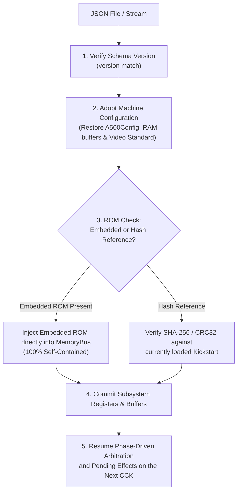

# Amiga 500 Save State Architecture & Serialization Specification

> [!NOTE]
> System ownership principles and decoupling constraints are defined in [AGENTS.md](../../../../AGENTS.md) and [General Architecture.md](../General%20Architecture.md).
> Master clock synchronization is detailed in [Machine Loop.md](../Machine%20Loop.md).
> Memory layout and low-memory overlay rules are specified in [MemoryBus.md](../MemoryBus.md). Machine state serialization is driven by [Machine Loop.md](../Machine%20Loop.md). Subsystem state schemas are defined in [CPU Motorola M68000.md](../CPU%20Motorola%20M68000.md), [Agnus.md](../Agnus.md), [Denise.md](../Denise.md), [Paula.md](../Paula.md), [CIA.md](../CIA.md), and [RTC.md](../RTC.md).

---

## 1. Architectural Principles

1. **Decoupled Snapshot Structs:**
   - Save state data structures are pure value containers (`Clone`, `Debug`, `PartialEq`, `Serialize`, `Deserialize`).
   - They contain zero runtime host handles, window pointers, audio device context handles, or open file descriptors.
2. **Zero-Allocation Hot Path:**
   - Regular emulation stepping (`step_cck()`, `step_frame()`) never creates, updates, or allocates save state objects.
   - Snapshots are synthesized on demand via public machine methods: `a500.save_state() -> A500State` and restored via `a500.load_state(&state) -> Result<(), SaveStateError>`.
3. **Deterministic Round-Trip Verification:**
   - Taking a snapshot at cycle $T$, restoring it into a fresh machine instance, and stepping $N$ cycles must produce bit-for-bit identical hardware registers and memory contents as stepping continuously without saving.
4. **Self-Contained vs. Referenced ROM Modes:**
   - Because a Kickstart ROM is only 256 KB (or 512 KB) and compresses down to ~150 KB, save states can optionally embed the entire ROM image directly. This provides 100% standalone portability across different computers without requiring external ROM files.
   - Alternatively, a lightweight reference mode stores the CRC32 checksum of the Kickstart ROM.
5. **Direct Chip Value Containment:**
   - Unlike `Cpu` which isolates register snapshots in `CpuState` for external test harnesses (SingleStepTests), custom chips (`Copper`, `Blitter`, `Agnus`, `Denise`, `Paula`, `Cia`) are already flat value containers with zero circular pointers. They are themselves the canonical serializable state records, avoiding duplicate wrapper structs.

The snapshot format follows the current state structures and may change during development. CIA state includes chip-local queued register identifiers, E-clock phase, the pending bus synchronization countdown and pending TOD latch effects.

---

## 2. Full Snapshot Contents

`A500State` contains the master CCK count and the active machine configuration alongside the CPU state, physical memory, RTC, Agnus, Denise, Paula, both CIAs, the floppy controller, keyboard, and game ports. Its `SaveStateHeader` carries the schema version, creation timestamp, and PNG preview. Pending write/read effects and unconsumed outputs belong to the chip values. Restoring must retain them without routing output events during loading; their next action occurs at the same modeled phase as uninterrupted execution. The living field definitions are in [save_state.rs](../../../../crates/machine_loop/src/save_state.rs), with subsystem state described in the linked specifications above.

---

## 3. Differential Save States (`A500DiffState`)

Differential full-machine rewind remains a design proposal; its pending work
and proposed format are collected in the
[debugger work](../../../../ROADMAP.md#debugger-execution-control).

---

## 4. Full Snapshot Validation Pipeline

When restoring a full keyframe snapshot (`A500State`), the emulator executes the following validation steps:

---

## 5. Reference Documentation & Upstream Ground Truth

- [vAmiga Snapshot Component Implementation](../../../../ref_src/vAmiga/Core/Media/Snapshot.cpp): Snapshot serializer for Amiga hardware state, block headers, and uncompressed RAM payloads.
- [CPU State Snapshot Implementation Source](../../../../crates/cpu/src/state.rs): Living Rust `CpuState` data structures implementing Serde serialization and deserialization.
