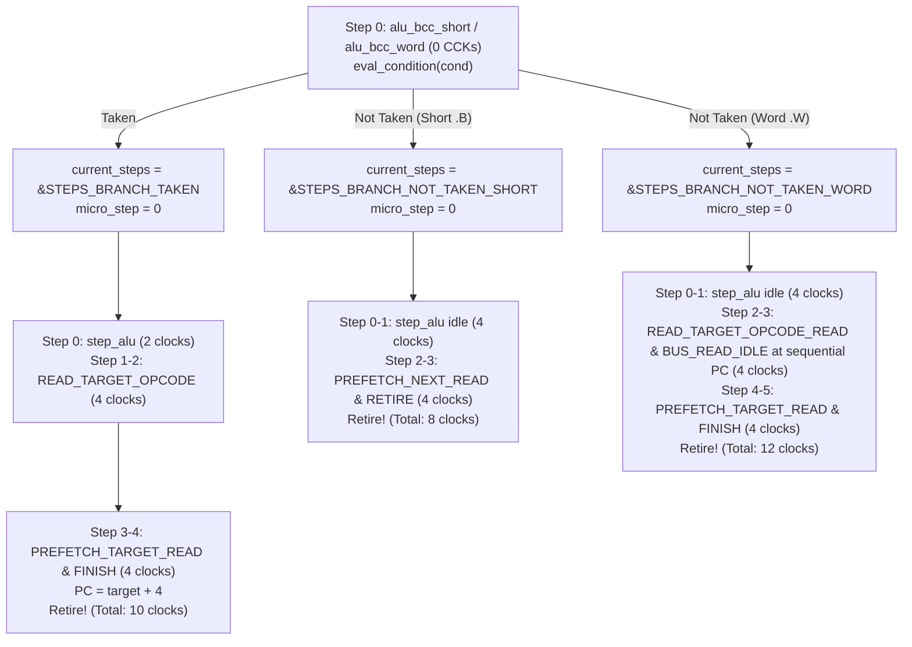
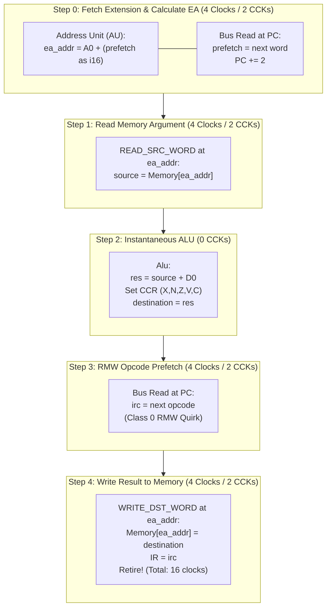
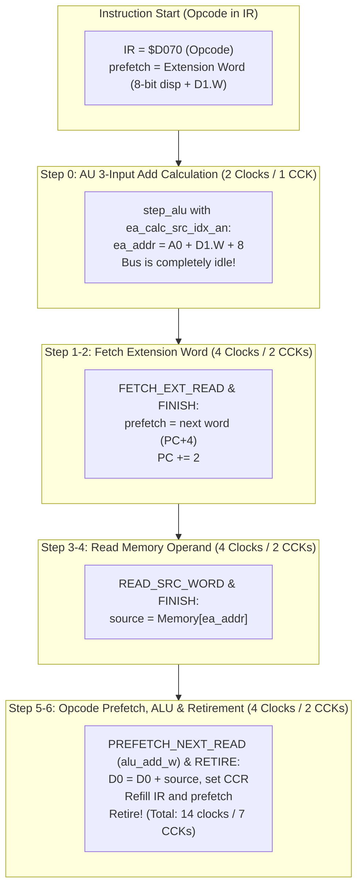
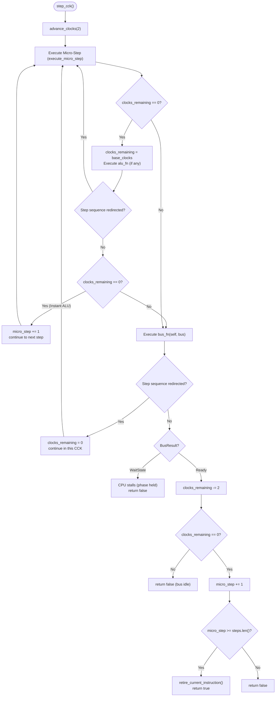

# Architecture Specification: M68000 Cycle-Exact Micro-Step State Machine

- **Parent Specification:** [CPU Motorola M68000.md](CPU%20Motorola%20M68000.md)
- **Module Location:** `crates/cpu/`
- **Execution Model:** Cycle-exact micro-operations mapped to Color Clock phases (**CCK1** and **CCK2**).
- **Bus Interface:** Interacts with memory strictly via [MemoryBus.md](MemoryBus.md), handling `BusResult::WaitState` and executing direct 2-phase CCK read/write transactions (`step_bus_read_src_word`, `step_bus_write_dst_word`, etc.).
- **Engineering Guidelines:** Follow systems rules in [AGENTS.md](../../../AGENTS.md) (zero custom macros, zero const-generic handlers, wrapping arithmetic, Big-Endian decoding, zero panics).
- **Test Validation:** Verified via [CPU SingleStepTests.md](Verification/CPU%20SingleStepTests.md) and skill `m68k-singlestep-test`.

---

## 1. Core Architecture & Execution Model

This document defines the architectural blueprint for the cycle-exact Motorola 68000 CPU emulator core based on the **Micro-Step State Machine Engine**.

The architecture mirrors the physical two-level microcode design of the Motorola 68000 silicon (the Stritter & Tredennick microcode patent):
1. **Instruction Sequencer (Macro-Level / Microrom)**: The 16-bit opcode word (`IR`) selects a static, compile-time blueprint of atomic micro-steps.
2. **Execution Unit & Bus Controller (Micro-Level / Nanorom)**: Drives the physical bus lines (`_AS`, `_UDS`, `_LDS`), Color Clock phases (**CCK1** and **CCK2**), dynamic ALU calculation delays, memory write decomposition, two-word pipeline refills, and Agnus DMA wait-state contention.

### Core Architecture Invariants
1. **The 65,536 Static Table**:
   Because immediate values, displacements, and 32-bit addresses are fetched dynamically from memory during execution, **the micro-step sequence is a pure, immutable function of the 16-bit opcode word (`IR`)**. Exactly 65,536 static entries cover 100% of the instruction set.
2. **Zero Runtime Heap Allocation**:
   The entire micro-step table is static `const` data embedded in the host binary (`.rodata`). It requires **0 bytes of dynamic heap allocation** (`Vec`, `Box`, `malloc`) during runtime.
3. **Specialized Atomic Micro-Step Handlers (Zero-Branch Direct Dispatch)**:
   Transfer size (Byte vs. Word vs. 32-bit Long decomposition) is **specialized directly into atomic `BusFn` function pointers** (`Cpu::step_bus_read_byte`, `Cpu::step_bus_read_word`, `Cpu::step_bus_write_byte`, `Cpu::step_bus_write_word`, `Cpu::step_bus_write_long_high`, `Cpu::step_bus_write_long_low`). This eliminates nested `match size` branches and dynamic `match step.action` switches in the hot CCK execution loop, maximizing host CPU execution throughput.
4. **Pre-Allocated CPU-Level Prefetch Registers**:
   `prefetch: u16` and `ir: u16` are fixed fields inside `CpuState` (modeling hardware registers `IR` and `IRD`), paired with `irc: u16` in `CpuMicroState` (hardware `IRC`). Zero dynamic queues.
5. **Parametric, Bus-Free ALU Function Pointers (`AluFn`)**:
   ALU steps do **not** take `MemoryBus`. By the time the ALU executes, all operands have already arrived in `CpuState` (`prefetch`, `d[]/a[]`) or `CpuMicroState` (`source`, `destination`, `addr1`, `addr2`). ALU functions take `(&mut CpuState, reg_src: u8, reg_dst: u8)`. This parameterization collapses 8–64 repetitive opcode functions into **one shared, elegant function per operation**.
6. **Fused CCK ALU Micro-Operations (Zero-Overhead Internal Operations)**:
   ALU calculations, condition code flag updates, and Effective Address arithmetic are fused directly onto native 2-clock Color Clock phases (`MicroStep.alu_fn`) where operand data has arrived (e.g. CCK2 read idle `BUS_READ_IDLE`, CCK1 extension fetch, or internal 2-clock processing phases). This eliminates separate 0-clock dispatch steps and redundant state machine iterations while guaranteeing 100% cycle-exact execution, Address Error verification, and Chip RAM DMA contention timing. Standalone 0-clock micro-steps (`base_clocks: 0`) are reserved exclusively for dynamic countdown delay loops (`clocks_remaining`) or single-instruction branch slice trampolines (`Bcc`/`DBcc`/`Scc`).
7. **Data Output Buffer (`state.micro.destination: u32`) & Exact Write Strobe Preservation**:
   Results destined for memory are held in `state.micro.destination: u32` (hardware `DOB`). Memory writes strictly respect 68000 bus widths:
   - **`WRITE_DST_BYTE`** (`Cpu::step_bus_write_dst_byte`): Drives $\overline{\text{UDS}}$ (even address, high byte) or $\overline{\text{LDS}}$ (odd address, low byte). The unaddressed byte in the 16-bit memory cell is **strictly preserved**.
   - **`WRITE_DST_WORD`** (`Cpu::step_bus_write_dst_word`): Drives both $\overline{\text{UDS}}$ and $\overline{\text{LDS}}$ simultaneously on even address boundaries.
   - **`WRITE_DST_LONG_HIGH` & `WRITE_DST_LONG_LOW`**: Two 16-bit Word bus write cycles; their order follows the instruction class.
8. **Two-Word Pipeline Refill for Control Flow (`JMP`, `JSR`, `RTS`, `Bcc`)**:
   When program execution flow changes, the prefetch stream is flushed and refilled from the target address via two sequential program-space read bus cycles (`Cpu::step_bus_read_target_opcode_read` and `Cpu::step_prefetch_target_finish`).
9. **Decoupled Internal Delay Countdown**:
   Variable-cycle operations calculate their result instantly, compute the hardware cycle penalty, and set `cpu.state.micro.clocks_remaining`. The host ticks down this counter by 2 clocks per CCK, leaving the external bus completely idle for Amiga custom chips (Copper, Blitter, Denise).
10. **Automatic Self-Modifying Code (SMC) Immunity**:
    Because opcodes directly index the static 65,536 table upon prefetch, and operands are read live from memory, **the engine requires zero bus snooping, zero page dirty tracking, and zero cache invalidation**.
11. **Cached Slice Pointer Dispatch (`current_steps: &'static [MicroStep]`)**:
    Upon opcode prefetch and retirement, `state.micro.current_steps` caches the slice pointer directly from `OPCODE_DESCRIPTOR_TABLE[ir]`. All subsequent CCK ticks during the instruction index `current_steps[micro_step]` directly, completely eliminating 65,536-entry table lookups in the hot execution loop.
12. **Dynamic Transfer Loop for Block Operations (`MOVEM`)**:
    `MOVEM` register count (0 to 16) is dynamically driven by the 16-bit extension mask in `state.micro.movem_mask` via `crate::instructions::movem::execute_movem_transfer`. Each set bit performs an atomic bus cycle and advances the mask, looping with 0 heap allocation and exact cycle timing.
13. **Cycle-Exact Hardware Exception Stacking**:
    Group 0 (Address/Bus Error) and Group 1/2 (Interrupts/Traps) exception stacking are modeled as dedicated compiled micro-sequences (`STEPS_ADDRESS_ERROR`, `STEPS_INTERRUPT`, `STEPS_PRIVILEGE_VIOLATION`, `STEPS_ZERO_DIVIDE`). Stack writes and vector reads interact with `dyn AddressBus` and experience Chip RAM DMA wait states identical to real hardware.

### 1.1 The Microcode Archetype Baseline Architecture

To accelerate core refactoring, DMA contention modeling, and machine loop integration, the M68000 microcode engine is structured around **Microcode Archetypes**.

Instead of maintaining dozens of isomorphic instruction duplicates (such as `SUB` which mirrors `ADD`, `OR`/`AND`/`EOR` which share identical addressing and bus structures, or bit manipulation/shift variants), the core maintains 16 primary archetype modules that provide **100% structural representation** of all M68000 hardware bus cycles, addressing modes, and internal execution flows:

| Archetype Domain | Active Representative Modules | Hardware Mechanics Covered |
| :--- | :--- | :--- |
| **ALU & Arithmetic** | `add.rs`, `adda.rs`, `addi.rs`, `addq.rs`, `addx.rs`, `sub.rs`, `suba.rs`, `subi.rs`, `subq.rs`, `subx.rs`, `not.rs` | 2-phase operand read, RMW memory write-back, address register sign-extension, immediate latching, multi-precision extend (`X`) flag propagation, subtractive borrow/overflow evaluation, and bitwise complement. |
| **Bit & Shifts** | `bset.rs`, `asl.rs` | Read-Modify-Write bit cycles (static immediate & dynamic register-addressed), memory word shifts, register count-dependent loop delays, and condition evaluation. |
| **Data Movement** | `move_w.rs`, `movea.rs`, `moveq.rs`, `movem.rs` | Standard word transfers, address register loading, quick sign-extended immediates, and dynamic multi-register block transfers across arbitrary register lists. |
| **Memory Comparison** | `cmpm.rs` | Dual postincrement memory operand sequencing without destination write-back. |
| **Branch & Stack** | `bra.rs`, `bsr.rs`, `bcc.rs`, `pea.rs`, `jmp.rs`, `jsr.rs`, `rts.rs` | Short/long branches, subroutine return address stacking, stack popping, and 2-word pipeline refill across non-sequential Program Space addresses. |
| **Exceptions & System** | `nop.rs`, `trap.rs`, `system.rs` | Pipeline idling, software vector traps, supervisor stack frame generation, and status register manipulation. |

Derived and isomorphic instructions (`SUB*` [completed in Batch 1.1], `AND*`, `OR*`, `EOR*`, `CMP*`, `ASR`/`LS*`/`RO*`, `BTST`/`BCLR`/`BCHG`, `MOVE.B`/`MOVE.L`) inherit their micro-step sequences directly from these blueprints and are re-introduced in distinct, test-validated batches (see `ROADMAP.md` Step 1).

---
## 2. Data Structures & Type Definitions

The microcode data structures and static lookup tables are implemented in [`crates/cpu/src/micro/`](../../../crates/cpu/src/micro/).

### 2.1 The `AluFn` Function Pointer (Pure Internal CPU Operation)

Because all memory operands are already latched into `CpuState` (`prefetch`, `d[]/a[]`) or `CpuMicroState` (`source`, `destination`, `addr1`, `addr2`) before the ALU step runs, `AluFn` does **not** take `MemoryBus`. ALU handlers execute purely internally, operating directly on `CpuState` with pre-decoded register indices:
- Signature: `fn(state: &mut CpuState, reg_src: u8, reg_dst: u8)`
- Implementation: [`crates/cpu/src/micro/engine.rs`](../../../crates/cpu/src/micro/engine.rs) and [`crates/cpu/src/micro/types.rs`](../../../crates/cpu/src/micro/types.rs).

### 2.2 The `MicroStep` Descriptor (Stateless & Cache-Dense)

Each micro-step is an immutable, cache-dense `Copy` struct in `.rodata`:
- `bus_fn`: Optional direct atomic execution function pointer (`Option<BusFn>`, where `BusFn = fn(cpu: &mut Cpu, bus: &mut dyn AddressBus) -> BusResult<()>`). When `None`, the CPU loop directly executes `BusResult::Ready(())` with zero function pointer call overhead or BTB branch misprediction penalty.
- `alu_fn`: Optional function pointer to pure internal ALU logic (`Option<AluFn>`).
- `base_clocks`: Base CPU clocks consumed (2 for 1 CCK micro-steps, 0 for instantaneous ALU / branch evaluation).

Pre-decoded register indices (`reg_src`, `reg_dst`) are held once per opcode in `OpcodeDescriptor` and cached into `state.micro.reg_src` / `reg_dst`.

### 2.3 Specialized 2-Clock Atomic Micro-Step Handlers (`BusFn`)

By decomposing 4-clock bus cycles into native 2-clock slices ($1\ \text{MicroStep} = 1\ \text{Color Clock / CCK} = 2\ \text{CPU clocks}$), the execution core eliminates runtime size checks (`match size`) and dynamic action matching:

| Category | Primitives (CCK1 / CCK2 Slices) | Hardware Operation & Bus Semantics |
| :--- | :--- | :--- |
| **Operand Reads (Data Space)** | `step_bus_read_src_word`, `step_bus_read_src_byte`, `step_bus_read_dst_word`, `step_bus_read_dst_byte`, `step_bus_read_src_long_high`, `step_bus_read_src_long_low`, `step_bus_read_dst_long_high`, `step_bus_read_dst_long_low` | **CCK1**: Reads from `ea_addr`. Stalls if Chip RAM blocked. Latches into `source`/`destination`.<br>**CCK2** (`BUS_READ_IDLE`): Physical bus free for Agnus DMA (`bus_fn: None`). |
| **Dual Staged Operands (Data Space)** | `step_bus_read_addr1_byte`, `step_bus_read_addr1_word`, `step_bus_read_addr1_long_high`, `step_bus_read_addr1_long_low`, `step_bus_read_addr2_byte`, `step_bus_read_addr2_word`, `step_bus_read_addr2_long_high`, `step_bus_read_addr2_long_low`, `step_bus_write_addr2_byte`, `step_bus_write_addr2_word` | Dedicated 2-clock bus handlers operating directly over dual staging registers `addr1` and `addr2` for dual-memory instructions (`CMPM`, `ABCD`, `SBCD`, `ADDX`, `SUBX`). |
| **Operand Writes (Data Space)** | `BUS_WRITE_IDLE`, `WRITE_DST_IDLE`, `step_bus_write_dst_word`, `step_bus_write_dst_byte`, `step_bus_write_dst_long_high`, `step_bus_write_dst_long_low` | **CCK1**: Internal setup; physical bus free for Agnus DMA. `WRITE_DST_IDLE` checks word alignment before a MOVE store and starts Address Error in the rejected setup CCK.<br>**CCK2**: Drives data from `destination` to memory. Stalls if wait states asserted. Retires if final step. |
| **Stack Operations (Data Space)** | `step_bus_push_stack_high_idle`, `step_bus_push_stack_high_write`, `step_bus_push_stack_low_write`, `step_bus_pop_stack_high_read`, `step_bus_pop_stack_high_finish`, `step_bus_pop_stack_low_read`, `step_bus_pop_stack_low_finish` | Stack reads and pushes over `SP` ($A_7$). Validates address alignment, adjusts SP, and transfers high/low words across CCK1/CCK2 phases. |
| **Prefetch & Refill (Program Space)** | `step_fetch_extension_read`, `step_fetch_extension_finish`, `step_prefetch_irc_read`, `step_prefetch_irc_finish`, `step_prefetch_next_read`, `BUS_READ_IDLE`, `step_bus_read_target_opcode_read`, `step_prefetch_target_read`, `step_prefetch_target_finish` | Reads from `pc` or branch target in Program Space ($FC_2$ / $FC_6$). Refills pipeline across 2-clock phases and manages standard or target retirement. |
| **Internal & Exceptions** | ALU callbacks (`AluFn`), `ALU_IDLE_*`, `step_bus_write_trap_*`, `step_bus_write_aerr_*`, `step_bus_read_vector_*` | Instantaneous (0 CCK) internal operations, CCR updates, condition evaluation, and 2-phase CCK bus primitives for exception processing. Pure ALU steps utilize `bus_fn: None`. |

Handlers are organized cleanly across [`crates/cpu/src/micro/step_execution.rs`](../../../crates/cpu/src/micro/step_execution.rs) and [`crates/cpu/src/micro/step_control.rs`](../../../crates/cpu/src/micro/step_control.rs).

### 2.4 CPU Micro-State Storage (`CpuMicroState`)

Embedded in `CpuState` to track sub-cycle progress across Color Clock phases with zero intermediate buffers:
- `source`: Explicit 32-bit storage for ALU source operand (incoming bus data is stored directly here on CCK1).
- `destination`: Explicit 32-bit storage for ALU destination operand and write-back data (bus write cycles read directly from here).
- `irc`: Instruction Register Capture — physical 68000 prefetch latch holding prefetched opcodes before retirement into IR.
- `ea_addr`: Resolved effective memory address for operands or branch/jump targets.
- `addr1`: Dual Staging Register 1 ($X_1$) — pre-staged address for multi-phase and dual-memory transfers (e.g. source EA or high-word split EA in `CMPM`, `ABCD`, `SBCD`, `ADDX`, `SUBX`).
- `addr2`: Dual Staging Register 2 ($X_2$) — pre-staged address for multi-phase transfers (e.g. destination EA or low-word split EA).
- `ea_high`: High word of 32-bit absolute addresses (`(xxx).L`) or high address for split accesses.
- `movem_mask`: 16-bit register transfer mask for `MOVEM`.
- `movem_state`: Multi-cycle transfer progress state for `MOVEM` (bit 0 tracks CCK1 vs CCK2 sub-phase).
- `clocks_remaining`: Clocks remaining for the active micro-step countdown (0 when completed or between steps, decrements by 2 on each CCK).
- `current_steps`: Cached slice pointer to active opcode's compiled micro-step sequence (`&'static [MicroStep]`).
- `micro_step`: Step index within the current instruction's micro-operation sequence.
- `reg_src`, `reg_dst`: Pre-decoded register indices ($0..7$ for $D_n / A_n$).
- `target_refill`: Indicates whether instruction retirement must perform a branch/jump target refill.
- `prefetch_retired`: Indicates whether prefetch pipeline has already retired into IR during microcode execution.
- `fault_addr`: Latched memory address that triggered Group 0 Address Error / Bus Error exception.
- `info_word`: 16-bit Internal Information Word ($R/\overline{W}$, $I/N$, Function Code bits $FC_0-FC_2$) for 7-word exception frame.
- `ssp_base`: Base supervisor stack pointer snapshot at the start of exception frame stacking.

### 2.5 The 65,536 Static Dispatch Universe (`OPCODE_DESCRIPTOR_TABLE`)

- Embedded in host `.rodata` via [`crates/cpu/src/micro/dispatch_table.rs`](../../../crates/cpu/src/micro/dispatch_table.rs).
- Exactly 65,536 `OpcodeDescriptor` entries mapping every 16-bit opcode word directly to its pre-compiled `&'static [MicroStep]` sequence and pre-decoded register indices (`reg_src`, `reg_dst`).
- Requires **zero dynamic heap allocations** (`0` bytes allocated at runtime).

### 2.6 Addressing Mode Naming Convention & Canonical Module Layout

#### Canonical Addressing Mode Identifiers
To maintain rigorous execution efficiency and consistency with the Motorola M68000 Programmer's Reference Manual, static micro-step array slices and effective address functions follow standardized addressing mode identifiers:

| Suffix | M68000 Addressing Mode | Syntax | Hardware Semantics |
| :--- | :--- | :--- | :--- |
| `DN` | Data Register Direct | `Dn` | Operand resides directly in $D_0 \dots D_7$. |
| `AN` | Address Register Direct | `An` | Operand resides directly in $A_0 \dots A_7$. |
| `AI` | Address Register Indirect | `(An)` | Base pointer in $A_n$, zero displacement. |
| `PI` | Address Register Indirect with Postincrement | `(An)+` | Access memory at $A_n$, post-advance $A_n$ by operand size. |
| `PD` | Address Register Indirect with Predecrement | `-(An)` | Pre-decrement $A_n$ by operand size, access memory at updated $A_n$. |
| `D16_AN` | Address Register Indirect with Displacement | `(d16, An)` | 16-bit signed displacement fetched from PC stream added to $A_n$. |
| `IDX_AN` | Address Register Indirect with Index | `(d8, An, Xn)` | 8-bit signed displacement + index register ($D_n/A_n$) added to $A_n$. Consumes 2 clocks internal delay. |
| `ABSW` | Absolute Short | `(xxx).W` | 16-bit sign-extended absolute memory address. |
| `ABSL` | Absolute Long | `(xxx).L` | 32-bit absolute memory address fetched via 2 extension reads. |
| `D16_PC` | Program Counter Indirect with Displacement | `(d16, PC)` | 16-bit signed displacement added to base PC. Program Space read ($FC_2/FC_6$). |
| `IDX_PC` | Program Counter Indirect with Index | `(d8, PC, Xn)` | 8-bit signed displacement + index register added to base PC. Consumes 2 clocks internal delay. |
| `IMM` | Immediate Data | `#<data>` | Operand embedded in instruction stream at PC. |

Composite array names follow the strict convention `STEPS_<MNEMONIC>_<SIZE>_<SRC>_<DST>` (or `STEPS_<MNEMONIC>_<SRC>_<DST>` if size is inherent, and `STEPS_<MNEMONIC>_<MODE>` for single-operand instructions like `JMP` or `NOT`).

#### Standardized Common Micro-Step Constants (`crates/cpu/src/micro/common.rs`)
All instruction modules reuse shared atomic Color Clock micro-step primitives rather than duplicating local slice definitions:
- **Bus & Internal Idle Primitives:** `BUS_WRITE_IDLE` (CCK1 write setup / bus idle), `BUS_READ_IDLE` (CCK2 read completion / bus idle), `ALU_IDLE` (internal processing 2-clock delay / bus idle), `ALU_IDLE_4CLK` (4-clock internal execution delay / bus idle), `ALU_IDLE_8CLK` (8-clock internal exception delay / bus idle), `ALU_IDLE_128CLK` (128-clock `RESET` bus idle delay).
- **Operand Writes:** `WRITE_DST_BYTE`, `WRITE_DST_WORD`, `WRITE_DST_LONG_HIGH`, `WRITE_DST_LONG_LOW`.
- **Operand Reads:** `READ_SRC_BYTE`, `READ_SRC_WORD`, `READ_SRC_LONG_HIGH`, `READ_SRC_LONG_LOW`, `READ_DST_BYTE`, `READ_DST_WORD`, `READ_DST_LONG_HIGH`, `READ_DST_LONG_LOW`, `BUS_READ_IDLE` (shared CCK2 idle completion).
- **Dual Staged Address Reads & Writes:** `READ_ADDR1_BYTE`, `READ_ADDR1_WORD`, `READ_ADDR1_LONG_HIGH`, `READ_ADDR1_LONG_LOW`, `READ_ADDR2_BYTE`, `READ_ADDR2_WORD`, `READ_ADDR2_LONG_HIGH`, `READ_ADDR2_LONG_LOW`, `WRITE_ADDR2_BYTE`, `WRITE_ADDR2_WORD`, `WRITE_ADDR2_PD_LONG_HIGH`, `WRITE_ADDR2_PD_LONG_LOW`.
- **Prefetch & Extension:** `FETCH_EXT_READ`, `FETCH_EXT_FINISH`, `PREFETCH_IRC_READ`, `PREFETCH_IRC_FINISH`, `PREFETCH_NEXT_READ`, `BUS_READ_IDLE` (prefetch next finish / retirement).
- **Control Flow Refills:** `READ_TARGET_OPCODE_READ`, `BUS_READ_IDLE` (target opcode read finish), `PREFETCH_TARGET_READ`, `PREFETCH_TARGET_FINISH`.
- **Stack Operations:** `PUSH_STACK_HIGH_IDLE` (CCK1 push setup / bus idle), `PUSH_STACK_HIGH_WRITE`, `PUSH_STACK_LOW_WRITE`, `POP_STACK_HIGH_READ`, `POP_STACK_HIGH_FINISH`, `POP_STACK_LOW_READ`, `POP_STACK_LOW_FINISH`.
- **Exception Push Setup:** `EXCEPTION_PUSH_PCLO_IDLE`, `EXCEPTION_PUSH_SR_IDLE`, `EXCEPTION_PUSH_PCHI_IDLE`, `AERR_PUSH_*_IDLE` (CCK1 exception push setup / bus idle).

#### Canonical Layout for Instruction Modules
To maintain structural consistency and clean codebase navigation across all instruction files, every module adheres to the standard sequence:
1. **Module Doc Comment:** High-level summary of mnemonic, addressing modes, and timing.
2. **Imports:** Imports from `crate::micro::common::*`, `crate::core::*`, `crate::micro::ea`.
3. **Leaf ALU Functions:** Direct arithmetic/logic helpers (`#[inline(always)] fn add_w(...)`, `sub_b(...)`) called directly by ALU callbacks to execute branchless wrapping math and CCR flag updates.
4. **Micro-Step ALU Callbacks (`AluFn`):** Functor callbacks (`fn alu_...`) stored as function pointers in `MicroStep.alu_fn`, dispatched dynamically via the micro-step engine.
5. **Specialized Micro-Step Handlers (`BusFn`):** Instruction-specific bus/execution handlers (if any required).
6. **Static Micro-Step Arrays:** `pub static STEPS_...: [MicroStep; N] = [...]`, ordered strictly by canonical addressing mode progression (`DN`, `AN`, `AI`, `PI`, `PD`, `D16_AN`, `IDX_AN`, `ABSW`, `ABSL`, `D16_PC`, `IDX_PC`, `IMM`). Internal ALU logic and effective address calculations are fused directly onto 2-clock micro-step primitives (`alu_fn`), eliminating zero-clock dispatch overhead.
7. **Opcode Decoder:** Fast compile-time function `pub const fn decode_..._steps(...) -> Option<&'static [MicroStep]>`.

---

## 3. Parametric ALU Handlers: 8x Code Reduction

Passing `reg_src` and `reg_dst` into `AluFn` collapses code duplication across all register combinations without using forbidden macros or const-generics:
1. **Register Destinations:** The ALU reads `state.d_byte(reg_dst)` or `state.d_word(reg_dst)`, evaluates condition codes via branchless CCR setters, and writes directly back to the register.
2. **Memory Destinations:** When targeting memory (e.g. `ORI.B #$42, (A0)`), the ALU reads `state.micro.destination`, evaluates condition codes, and stores the result directly back into `state.micro.destination` for the subsequent write bus cycle.
3. **Effective Address Arithmetic:** Because `Alu` micro-steps consume 0 CCKs, effective address calculations (such as `(d16, An)` or `(d8, An, Xn)`) use the identical `AluFn` mechanism to compute and store addresses in `state.micro.ea_addr`.

All specialized ALU and instruction handlers reside directly under [`crates/cpu/src/instructions/`](../../../crates/cpu/src/instructions/).

---

## 4. Memory Bus Operations & Strobe Semantics

### 4.1 Direct 2-Phase Bus Architecture (Zero Dynamic Strobe Boilerplate)

On the Amiga 500, the 4-clock M68000 bus cycle maps to **two Color Clock phases (CCK1 and CCK2)**. Amiga Chip DRAM accesses complete in 1 CCK (280 ns), interleaving bus access 50/50 between the CPU and Agnus DMA:

```
            ┌──────────────────────┬──────────────────────┐
            │     CCK1 (S0–S3)     │     CCK2 (S4–S7)     │
────────────┼──────────────────────┼──────────────────────┤
 READ Cycle │ Read to target reg   │ CPU idle / DMA slot  │
────────────┼──────────────────────┼──────────────────────┤
 WRITE Cycle│ CPU setup (idle bus) │ Write to DRAM / Wait │
────────────┴──────────────────────┴──────────────────────┘
```

- **READ Cycles (`READ_SRC_BYTE`, `READ_SRC_WORD`, `READ_SRC_LONG_HIGH`, `READ_SRC_LONG_LOW`, `FETCH_EXT_READ`, `PREFETCH_NEXT_READ`):**
  - **CCK1 (S0–S3):** Bus read attempt via `bus.read_word(addr)` or `bus.read_byte(addr)`. If `BusResult::WaitState` $\to$ insert wait state (CPU stalls in CCK1). If `BusResult::Ready(data)` $\to$ stores data directly into `source`, `destination`, `prefetch`, or `irc`, advancing `phase = CCK2`.
  - **CCK2 (S4–S7):** **Do nothing on the bus!** Physical Chip RAM is already released for custom chip DMA (Blitter, Copper). The CPU records the transaction directly from the target register, finishes the 4-clock cycle (or prefetch retirement), and advances to the next micro-step (`phase = CCK1`).
- **WRITE Cycles (`WRITE_DST_BYTE`, `WRITE_DST_WORD`, `WRITE_DST_LONG_HIGH`, `WRITE_DST_LONG_LOW`, `PUSH_STACK_HIGH_WRITE`, `PUSH_STACK_LOW_WRITE`):**
  - **CCK1 (S0–S3):** **CPU does not touch the bus!** Internal address propagation only. Chip RAM remains completely free for Agnus DMA. Advances `phase = CCK2`.
  - **CCK2 (S4–S7):** Bus write attempt via `bus.write_word(addr, val)` or `bus.write_byte(addr, val)` reading directly from `state.micro.destination`. If `BusResult::WaitState` (Gary withholds $\overline{\text{DTACK}}$) $\to$ insert wait state (CPU stalls in CCK2). Once `BusResult::Ready(())` $\to$ write is committed to `bus`, recording the transaction and advancing to the next micro-step (`phase = CCK1`).

Byte strobes ($\overline{\text{UDS}}$ / $\overline{\text{LDS}}$) are derived natively by `bus.read_byte(addr)` / `bus.write_byte(addr, val)` from `addr & 1`. **The CPU core eliminates all manual strobe calculations, `BusCycle` allocations, and intermediate latch buffering.**

#### Execution Dispatch Implementation
The 2-phase Color Clock stepping logic is implemented via dedicated, single-purpose helper functions (`step_bus_read_byte`, `step_bus_read_word`, `step_bus_write_byte`, `step_bus_write_word`, etc.) in [`crates/cpu/src/micro/engine.rs`](../../../crates/cpu/src/micro/engine.rs). Each helper executes the exact CCK1/CCK2 protocol with zero branch cascading and zero heap allocation.

### 4.2 Byte Strobe Activation & Byte Preservation

During an 8-bit Byte write operation (`BusWriteByte`):
1. **Even Byte Address (`ea_addr & 1 == 0`)**:
   - $\overline{\text{UDS}}$ asserts low ($0$); $\overline{\text{LDS}}$ remains negated ($1$).
   - The data byte is driven on $D_8 \dots D_{15}$.
   - The memory array writes **only into the high byte** of the addressed 16-bit word cell.
   - **The low byte in the 16-bit word cell is strictly PRESERVED and unaltered.**
2. **Odd Byte Address (`ea_addr & 1 == 1`)**:
   - $\overline{\text{LDS}}$ asserts low ($0$); $\overline{\text{UDS}}$ remains negated ($1$).
   - The data byte is driven on $D_0 \dots D_7$.
   - The memory array writes **only into the low byte** of the addressed 16-bit word cell.
   - **The high byte in the 16-bit word cell is strictly PRESERVED and unaltered.**
3. **Hardware Pin Duplication**:
   - In physical 68000 silicon, the CPU duplicates the byte on both bus halves ($D_{15..8} = \text{byte}$ and $D_{7..0} = \text{byte}$). The RAM chips use $\overline{\text{UDS}}/\overline{\text{LDS}}$ as write-enable qualifiers.
4. **Zero Address Errors on Byte Accesses**:
   - Unlike Word or Long accesses, Byte accesses **never generate an Address Error** on odd addresses. Odd byte reads and writes are 100% legal.

### 4.3 32-Bit Long Decomposition: Why Long Stores Decompose into Two Words

On the Motorola 68000, **a 32-bit transfer physically does not exist on the external bus**. The data bus has only 16 pins ($D_0 \dots D_{15}$).
Therefore, a 32-bit (Long) read or write is **strictly composed of two 16-bit Word bus cycles**:
- **`WRITE_DST_LONG_HIGH`**: Writes a **16-bit Word** containing the upper 16 bits of `state.micro.destination` to `ea_addr`.
- **`WRITE_DST_LONG_LOW`**: Writes a **16-bit Word** containing the lower 16 bits of `state.micro.destination` to `ea_addr + 2`.

Each cycle is an independent 4-clock / 2-CCK bus transaction that can stall on Agnus DMA contention in Chip RAM.

Word handlers select addresses; the class sequence determines transfer order.
[Class 5 long RMW](#long-arithmetic-and-unary-read-modify-write-variants) writes
low then high.

### 4.4 Operation Comparison Matrix

| Action | Physical Bus Size | Target Address | Data Source / Destination | $\overline{\text{UDS}}$ / $\overline{\text{LDS}}$ | Preservation Behavior |
| :--- | :---: | :--- | :--- | :---: | :--- |
| **`READ_SRC_BYTE`** | 8-bit Byte | `ea_addr` | `source = byte` | Parity | Read-only |
| **`READ_SRC_WORD`** | 16-bit Word | `ea_addr` | `source = word` | Both active | Read-only (Address error if odd) |
| **`READ_SRC_LONG_HIGH`** | 16-bit Word | `ea_addr` | `source = word << 16` | Both active | Read-only (Address error if odd) |
| **`READ_SRC_LONG_LOW`** | 16-bit Word | `ea_addr + 2` | `source = (source & 0xFFFF_0000) \| word` | Both active | Read-only (Address error if odd) |
| **`WRITE_DST_BYTE`** | 8-bit Byte | `ea_addr` | `(destination & 0xFF) as u8` | Parity | **Unaddressed byte preserved!** |
| **`WRITE_DST_WORD`** | 16-bit Word | `ea_addr` | `(destination & 0xFFFF) as u16` | Both active | Entire 16-bit cell overwritten |
| **`WRITE_DST_LONG_HIGH`** | 16-bit Word | `ea_addr` | `((destination >> 16) & 0xFFFF) as u16` | Both active | Upper 16-bit cell overwritten |
| **`WRITE_DST_LONG_LOW`** | 16-bit Word | `ea_addr + 2` | `(destination & 0xFFFF) as u16` | Both active | Lower 16-bit cell overwritten |

### 4.5 Function Codes (FC0–FC2) & Special Status Word (SSW) Encoding

On physical M68000 silicon, the CPU outputs 3 Function Code lines to qualify address space on every bus cycle:

| FC2 | FC1 | FC0 | Address Space Type | Usage in Emulator |
| :---: | :---: | :---: | :--- | :--- |
| 0 | 0 | 1 | **User Data** (`FC_UD`) | Data space read/write when `SR.S == 0` |
| 0 | 1 | 0 | **User Program** (`FC_UP`) | Opcode/extension fetch when `SR.S == 0` |
| 1 | 0 | 1 | **Supervisor Data** (`FC_SD`) | Data space read/write and stack pushes when `SR.S == 1` |
| 1 | 1 | 0 | **Supervisor Program** (`FC_SP`) | Opcode/extension fetch when `SR.S == 1` |
| 1 | 1 | 1 | **CPU Space / IACK** | Interrupt Acknowledge cycle |

#### Special Status Word (SSW) Format during Group 0 Exceptions:
When an Address Error or Bus Error occurs, word 0 of the 7-word stack frame (`SP - 2`) stores the diagnostic Special Status Word:
```
Bit:   15..5     4      3      2     1     0
Field: Unused   R/W    I/N    FC2   FC1   FC0
```
- **Bits 0–2 (FC0–FC2)**: The Function Code of the bus cycle that faulted.
- **Bit 3 (I/N)**: `0` if fault occurred during instruction processing; `1` if during instruction prefetch.
- **Bit 4 (R/W)**: `1` if read cycle; `0` if write cycle.
- **Bits 5–15**: Reserved / floating bus lines.

---

## 5. Control Flow, Pipeline Refill & Complex Addressing

### 5.1 The Two-Word Pipeline Refill

Sequential prefetch uses `common::PREFETCH_NEXT_READ` and `common::BUS_READ_IDLE`.
Instruction retirement shifts `ir = prefetch`, `prefetch = irc`, and `pc += 2`.
The class sequence determines whether retirement follows prefetch immediately or
waits for remaining internal clocks or writeback.

When control flow changes (`JMP`, `JSR`, `RTS`, `BRA`, taken `Bcc`):
- The existing prefetch pipeline contents are **flushed**.
- The CPU must perform a **two-word pipeline refill** directly from the new target address in Program Space (`FC2` User / `FC6` Supervisor):
  1. **Refill Bus Cycle 1 (`READ_TARGET_OPCODE_READ` & `BUS_READ_IDLE`)**:
     - Bus read from `ea_addr` (4 CPU clocks / 2 CCKs).
     - Data is latched into `state.micro.irc` (the new opcode).
  2. **Refill Bus Cycle 2 (`PREFETCH_TARGET_READ` & `PREFETCH_TARGET_FINISH`)**:
     - Bus read from `ea_addr + 2` (4 CPU clocks / 2 CCKs).
     - Data is latched into `state.prefetch`.
     - `state.ir` is loaded with `irc`.
     - `state.pc` is initialized to `ea_addr + 4`.
     - Instruction retires with target refill (`target_refill = true`, `step_cck` returns `true`).

`BRA`, taken `Bcc`/`DBcc`, `BSR`, `JMP`, `JSR`, `RTS`, `RTR` and `RTE` use
`READ_CONTROL_TARGET_OPCODE_READ` for the first read. Its successful transfer
uses the same [shared read phases](#23-specialized-2-clock-atomic-micro-step-handlers-busfn).
An odd target begins Address Error without a target memory callback: the frame
captures `target - 4` as PC, the full target as the fault address, and sets bit 3
(instruction-not) alongside the program-space function code. `RTE` restores SR
before this check, so the saved status and function code follow the restored mode.
`BSR` completes both return-address writes before checking target alignment;
`JSR` checks the target before those writes. Untaken branches retain their
sequential stream without checking the unused branch destination.

### 5.2 `JMP <ea>` (Jump to Effective Address)

- **Target Address Calculation**:
  - `(An)`: 0 internal clocks.
  - `(d16, An)`, `(xxx).w`, `(d16, PC)`: 2 internal clocks.
  - `(d8, An, Xn)`, `(d8, PC, Xn)`: 6 internal clocks.
  - `(xxx).l`: 1 extension read bus cycle (`FETCH_EXT_READ` & `FETCH_EXT_FINISH`, 4 clocks).
- **Execution Flow**:
  1. Calculate target into `ea_addr`.
  2. Verify `(ea_addr & 1) == 0`. If odd, trigger **Address Error (Vector 3)** immediately!
  3. Execute `READ_CONTROL_TARGET_OPCODE_READ` at `ea_addr`.
  4. Execute `PREFETCH_TARGET_READ` & `PREFETCH_TARGET_FINISH` at `ea_addr + 2`.
- **Total Time**:
  - `JMP (An)`: Exactly 8 CPU clocks (4 CCKs).
  - `JMP (xxx).L`: Exactly 12 CPU clocks (6 CCKs).

### 5.3 `JSR <ea>` (Jump to Subroutine)

- **Execution Flow**:
  1. Calculate target into `ea_addr`. Verify `(ea_addr & 1) == 0`.
  2. Determine return address `return_pc = base_pc + extension_words`.
  3. Read the target opcode into `irc`, before touching the stack.
  4. Latch `destination = return_pc`. Decrement `SP = SP - 4` and check stack alignment.
  5. Push Return Address:
     - `PUSH_STACK_HIGH_WRITE`: Write `(destination >> 16) as u16` to `SP` (4 clocks).
     - `PUSH_STACK_LOW_WRITE`: Write `(destination & 0xFFFF) as u16` to `SP + 2` (4 clocks).
  6. Complete the target refill:
     - `PREFETCH_TARGET_READ` & `PREFETCH_TARGET_FINISH` at `ea_addr + 2` (4 clocks).
- **Total Time**:
  - `JSR (An)`: Exactly 16 CPU clocks (8 CCKs: 2 stack writes + 2 prefetch reads).
  - `JSR (xxx).L`: Exactly 20 CPU clocks (10 CCKs: 1 extension read + 2 stack writes + 2 prefetch reads).

### 5.4 `RTS` (Return from Subroutine)

- **Fixed Timing**: Exactly 16 CPU clocks (8 CCKs: 2 stack pop reads + 2 prefetch reads).
- **Execution Flow**:
  1. Pop High Word: `POP_STACK_HIGH_READ` reads word from `(SP)` into upper 16 bits of `ea_addr` (4 clocks).
  2. Pop Low Word: `POP_STACK_LOW_READ` reads word from `(SP + 2)` into lower 16 bits of `ea_addr`, and updates `SP = SP + 4` (4 clocks).
  3. Verify `(ea_addr & 1) == 0`. If odd, trigger **Address Error (Vector 3)**!
  4. Execute Two-Word Refill:
     - `READ_CONTROL_TARGET_OPCODE_READ` at `ea_addr` (4 clocks).
     - `PREFETCH_TARGET_READ` & `PREFETCH_TARGET_FINISH` at `ea_addr + 2` (4 clocks).

### 5.5 `Bcc` (Conditional Branch State Machine: Taken vs Not-Taken)

Conditional branches (`BEQ`, `BNE`, `BGT`, `BLT`, etc.) introduce dynamic runtime branching based on the Condition Code Register (CCR):



---

### 5.6 Effective Address Calculation with Extension Word Prefetch (Memory RMW: `ADD.W Dn, (d16, An)`)

A common architectural question is: **How does the CPU handle operations where arguments are read from memory, the address requires displacement/extension words, and the result is written back to memory?**

Consider **`ADD.W D0, (d16, A0)`** (Add data register `D0` to memory operand at `(A0 + d16)`, storing result at `(A0 + d16)`).



#### Detailed Clock-by-Clock Cycle Breakdown:
1. **The Prefetch Reality at Instruction Start**:
   - The opcode `$D168` is in `IR`.
   - Because the *previous* instruction concluded with an opcode prefetch, **the displacement word `d16` is ALREADY resident in `state.prefetch` with 0 latency!**
2. **Step 0: `FetchExtension` with `ea_calc_d16_an` (4 clocks / 2 CCKs)**:
   - The AU calculates: `ea_addr = A0.wrapping_add((prefetch as i16) as u32)`.
   - The bus controller fetches the next word from `PC` into `prefetch` (advancing `PC += 2`).
3. **Step 1: `READ_SRC_WORD` (4 clocks / 2 CCKs)**:
   - Reads the 16-bit word from memory at `ea_addr` into `state.micro.source`.
4. **Step 2: `Alu` (`alu_add_rmw_w`) (0 CCKs Instantaneous)**:
   - Computes `res = source.wrapping_add(D0)`.
   - Evaluates and updates CCR condition code flags ($X, N, Z, V, C$).
   - Latches `state.micro.destination = res as u32`.
5. **Step 3: `PREFETCH_IRC_READ` & `PREFETCH_IRC_FINISH` (4 clocks / 2 CCKs)**:
   - **Hardware Silicon Quirk (Class 0 RMW)**: The MC68000 executes the next instruction opcode prefetch *before* writing the modified operand back to memory!
   - Fetches the next opcode from `PC` into `state.micro.irc`, advancing `PC += 2`.
6. **Step 4: `WRITE_DST_WORD` (4 clocks / 2 CCKs)**:
   - Drives 16-bit word `(destination & 0xFFFF)` to `ea_addr`.
   - Overwrites the destination cell in memory.
   - Shifts `IR = irc`, and completes instruction retirement!

**Total Execution Time**: Exactly **16 CPU clocks (8 CCKs)** (matching Motorola 68000 hardware: 12 clocks base + 4 clocks for `d16` addressing mode).

---

### 5.7 Indexed Addressing with Internal Calculation Clocks (`ADD.W (8, A0, D1.W), D0`)

When an instruction uses **Address Register Indirect with Index and 8-Bit Displacement** (`(d8, An, Xn)`):
1. The extension word specifies the 8-bit signed displacement and index register (`D1.W`).
2. The address calculation requires a 3-input addition: `ea_addr = An + Xn + disp8`.
3. In physical MC68000 silicon, this 3-input addition consumes **2 internal CPU clock cycles** ($N_{internal} = 2$ clocks / 1 CCK) with zero external bus activity.

#### Example Execution Trace: `ADD.W (8, A0, D1.W), D0` (Opcode `$D070`)
- **Total Duration**: Exactly **14 CPU clocks (7 CCKs)** (8 clocks base + 6 clocks for index mode: 4 bus clocks + 2 internal clocks).



| Step | Action | Clocks | Description / Bus Transaction |
| :---: | :--- | :---: | :--- |
| **0** | `step_alu`<br/>*(with `ea_calc_src_idx_an`)* | 2 (1 CCK) | AU decodes `prefetch`: extracts `disp8 = +8`, `Xn = D1.W`, and sets `ea_addr = A0 + D1.W + 8`. Consumes 2 clocks (1 CCK) idle AU addition. |
| **1-2** | `FETCH_EXT_READ`<br/>`FETCH_EXT_FINISH` | 4 (2 CCKs) | Reads extension word from `PC` into `prefetch`, `PC += 2`. |
| **3-4** | `READ_SRC_WORD`<br/>`BUS_READ_IDLE` | 4 (2 CCKs) | Reads 16-bit operand from `ea_addr` into `source`. |
| **5-6** | `PREFETCH_NEXT_READ`<br/>`BUS_READ_IDLE` | 4 (2 CCKs) | Computes `D0 = D0 + source`, sets CCR flags, refills `IR` and `prefetch`, and retires! |

**Total Duration**: $2\ (\text{EA Idle}) + 4\ (\text{FETCH\_EXT}) + 4\ (\text{READ\_SRC}) + 4\ (\text{PREFETCH\_NEXT}) = \mathbf{14\ \text{CPU clocks}}\ (7\ \text{CCKs})$!

---

### 5.8 `MOVEM` Dynamic Register Transfer Engine

In `MOVEM <ea>, reglist` and `MOVEM reglist, <ea>`, the opcode specifies the transfer direction, size (Word vs. Long), and effective addressing mode. However, the **number of registers transferred (0 to 16)** is dynamic, specified by the 16-bit **extension mask word**:

```
Bit:   15  14  13  12  11  10   9   8   7   6   5   4   3   2   1   0
Reg:   A7  A6  A5  A4  A3  A2  A1  A0  D7  D6  D5  D4  D3  D2  D1  D0   (Standard / Postincrement)
Reg:   D0  D1  D2  D3  D4  D5  D6  D7  A0  A1  A2  A3  A4  A5  A6  A7   (Predecrement -(An) mode)
```

#### The `MovemTransfer` Loop Mechanics:
Because a static array cannot predict the number of registers at compile time, `MOVEM` is modeled via the atomic **`execute_movem_transfer`** sub-loop:
1. **Step 0 (`FetchExtension`)**: Reads the 16-bit register mask from `PC` into `state.micro.movem_mask`, advancing `PC += 2`.
2. **Step 1 (`Alu`)**: Resolves `ea_addr = An` (or calculates displacement/index).
3. **Step 2 (`MovemTransfer`)**:
   - Scans set mask bits from low to high using the cursor in `movem_state`; the mask remains unchanged. Predecrement uses the reversed register mapping above.
   - In CCK1/CCK2, performs the atomic bus transfer (Read or Write, Word or 2-cycle Long) between register $R_k$ and memory at `ea_addr`.
   - Adjusts `ea_addr`: increments `ea_addr += size` (or decrements `ea_addr -= size` for `-(An)`).
   - The final store CCK completes the loop and commits the predecrement address without another internal interval. An empty store mask starts prefetch directly in the first transfer CCK.
   - Loads perform a final dummy word read at the next address before prefetch. Postincrement commits that address after the dummy read; the address register in the mask cannot replace the final pointer.
   - **Loop Condition**: While selected registers or the final load dummy read remain, `micro_step` does not advance. A wait state preserves the active word and CCK phase.
4. **Step 3 (`PREFETCH_NEXT_READ`)**: Standard sequential opcode prefetch, completing retirement via `retire_current_instruction()`.

#### Exact Hardware Timing:
- **Base Overhead**: With the opcode already prefetched, indirect stores use 8 CPU clocks (mask fetch and final prefetch); loads use 12, including the final dummy operand read. Address extensions and index calculation add their prefix clocks.
- **Per-Register Transfer**:
  - **Word (`.W`)**: Exactly **4 CPU clocks (2 CCKs)** per transferred register.
  - **Long (`.L`)**: Exactly **8 CPU clocks (4 CCKs: 2 bus cycles)** per transferred register.
- **Example (`MOVEM.W (A0)+, D0-D2/A0-A1` — 5 registers)**:
  $12 + 5 \times 4 = \mathbf{32\ \text{CPU clocks}}\ (16\ \text{CCKs})$, matching Motorola 68000 silicon to the exact clock!

---

### 5.9 Cycle-Exact Hardware Exception Processing & Stacking

When a hardware or software exception occurs (Address Error, Bus Error, Interrupt, Illegal Instruction, `TRAP`, Zero Divide), instruction execution halts, and the CPU enters **Exception Processing**.

On the Amiga 500, exception stack pushes and vector table reads occur over the external bus and **experience Agnus Chip RAM DMA wait states identical to standard instruction cycles**.

#### Group 0 Exceptions: Address Error (Vector 3) & Bus Error (Vector 2)
Group 0 exceptions push a **7-word (14-byte) diagnostic stack frame** to allow the OS (or Guru Meditation handler) to diagnose the bus fault:

```
SP - 2  -->  [ Special Status Word (SSW): R/W bit, I/N bit, Function Code FC0..FC2 ]
SP - 4  -->  [ Access Address High 16-bits ]
SP - 6  -->  [ Access Address Low 16-bits ]
SP - 8  -->  [ Instruction Register (IR) at time of fault ]
SP - 10 -->  [ Status Register (SR) prior to exception ]
SP - 12 -->  [ Program Counter (PC) High 16-bits ]
SP - 14 -->  [ Program Counter (PC) Low 16-bits ]
```

##### Group 0 Execution Flow:
1. Transition CPU to Supervisor Mode: `SR.S = 1`, `SR.T = 0`.
2. Push 7 Words onto Supervisor Stack (`SSP` / `A7'`):
   - 7 sequential word write bus cycles (`BusPushStackHigh` / `BusPushStackLow`).
3. Fetch Exception Vector:
   - 2 sequential word read bus cycles at address `$000000 + VectorNum * 4` (e.g. `$00000C` for Address Error).
4. Pipeline Refill:
   - Two-word pipeline refill (`BusReadTargetOpcode` + `PrefetchTargetAndRetire`) from the handler address loaded from the vector.
5. **Total Execution Duration**: Exactly **50 CPU clocks (25 CCKs)** base time + wait states.

#### Group 1 & Group 2 Exceptions: Interrupts (IPL 1–7), TRAPs, Illegal Instructions
Push a standard **3-word (6-byte) stack frame**:
```
Final SSP + 0  (old SSP - 6)  -->  [ Status Register (SR) prior to exception ]
Final SSP + 2  (old SSP - 4)  -->  [ Program Counter (PC) High 16-bits ]
Final SSP + 4  (old SSP - 2)  -->  [ Program Counter (PC) Low 16-bits ]
```

##### Physical Bus Write Sequence for 3-Word Frame (68000 Silicon Order):
On physical M68000 hardware, the internal ALU/bus microcode writes the 3-word frame in the following cycle order:
1. Write PC low word to `SSP - 2` (Supervisor Data, FC 5).
2. Write old SR to `SSP - 6` (Supervisor Data, FC 5).
3. Write PC high word to `SSP - 4` (Supervisor Data, FC 5) and commit updated `SSP = SSP - 6`.

##### Modular 17-Step Microcode Pipeline for `TRAP #<vector>` (34 Clocks / 17 CCKs):
1. `Step 1 (ALU_TRAP_INIT)`: CCK1 of initial 4-clock processing. Switches to supervisor ($S=1, T=0$), computes vector address `$000080 + \text{vec} \times 4$, latches return PC into `source`, old SR into `destination`, and records 4-clock internal transaction.
2. `Step 2 (ALU_IDLE)`: CCK2 of initial internal clocks (bus idle for Agnus DMA).
3. `Step 3 (EXCEPTION_PUSH_PCLO_IDLE)`: CCK1 of writing return PC low word to `SSP - 2` (bus idle, alignment validation).
4. `Step 4 (EXCEPTION_PUSH_PCLO_WRITE)`: CCK2 of writing return PC low word to `SSP - 2`.
5. `Step 5 (EXCEPTION_PUSH_SR_IDLE)`: CCK1 of writing old SR to `SSP - 6` (bus idle, alignment validation).
6. `Step 6 (EXCEPTION_PUSH_SR_WRITE)`: CCK2 of writing old SR to `SSP - 6`.
7. `Step 7 (EXCEPTION_PUSH_PCHI_IDLE)`: CCK1 of writing return PC high word to `SSP - 4` (bus idle, alignment validation).
8. `Step 8 (EXCEPTION_PUSH_PCHI_WRITE)`: CCK2 of writing return PC high word to `SSP - 4` and committing `SSP = SSP - 6`.
9. `Step 9 (READ_VECTOR_HIGH_READ)`: CCK1 of reading vector high word from `ea_addr` into `ea_high`.
10. `Step 10 (BUS_READ_IDLE)`: CCK2 of reading vector high word (bus free for Agnus DMA).
11. `Step 11 (READ_VECTOR_LOW_READ)`: CCK1 of reading vector low word from `ea_addr + 2` into `source`.
12. `Step 12 (READ_VECTOR_LOW_FINISH)`: CCK2 of reading vector low word (verifies even target address alignment).
13. `Step 13 (READ_TARGET_OPCODE_READ)`: CCK1 of reading target opcode into `irc`.
14. `Step 14 (BUS_READ_IDLE)`: CCK2 of reading target opcode (bus free for Agnus DMA).
15. `Step 15 (ALU_IDLE)`: 2 internal clocks before prefetch (internal ALU delay).
16. `Step 16 (PREFETCH_TARGET_READ)`: CCK1 of reading target + 2 into `prefetch`.
17. `Step 17 (PREFETCH_TARGET_FINISH)`: CCK2 of reading target + 2 (sets `target_refill = true`, triggers clean instruction retirement).

- **Total Duration**:
  - `TRAP #n`: Exactly **34 CPU clocks (17 CCKs)** (3 stack writes + 2 vector reads + 2 refill reads + 6 internal clocks).
  - Interrupt (Autovector): Exactly **44 CPU clocks (22 CCKs)** (includes 4-clock Interrupt Acknowledge `IACK` bus cycle with `FC = %111`).


---

### 5.10 Stack Pointer Predecrement Alignment Quirk (`-(SP)`)

In Motorola 68000 silicon, the Stack Pointer (`A7`, both `USP` and `SSP`) must **always remain on an even 16-bit word boundary**.
- When addressing mode `-(An)` is evaluated with `An = A7` for an **8-bit Byte** operation (e.g. `MOVE.B D0, -(SP)`):
  - In `ea_calc_predec_an`: the decrement amount is forced to **2 bytes** instead of 1 (advancing $A_7 \leftarrow A_7 - 2$).
  - The byte is written to the high byte (even address) with $\overline{\text{UDS}}$ asserted.
  - This ensures that stack frames and popped values never become misaligned.

---

## 6. The Execution Engine & Stepping Model (`step_cck`)

Execution is driven by the Amiga Color Clock (CCK, ~3.54 MHz). $1\ \text{M68000 bus cycle} = 4\ \text{CPU clocks} = 2\ \text{CCK phases}\ (\text{CCK1} + \text{CCK2})$.



### 6.1 Concrete Implementation: The High-Throughput `step_cck()` Dispatcher

The full CCK stepping engine is implemented in [`crates/cpu/src/micro/engine.rs`](../../../crates/cpu/src/micro/engine.rs) and driven via [`crates/cpu/src/cpu.rs`](../../../crates/cpu/src/cpu.rs):

1. **Uniform Micro-Step Timing via `clocks_remaining: u16`:**
   - On each CCK tick, `step_cck` advances global clocks by 2 (`self.advance_clocks(2)`).
   - If entering a step (`clocks_remaining == 0`), initializes `clocks_remaining = step.base_clocks` and fires `alu_fn`. Dynamic shift/ALU operations directly set `clocks_remaining = duration`.
   - On completion of a ready CCK phase, decrements `clocks_remaining = clocks_remaining.saturating_sub(2)`. When it reaches 0, concludes the micro-step and advances to the next (`micro_step += 1`).
2. **Instantaneous Fall-Through Micro-Steps:**
   - A fast internal loop executes zero-cycle micro-operations (`alu_fn`) when entering a step or when `base_clocks == 0` within the same host tick until encountering a bus cycle.
   - If a subsequent bus cycle stalls due to Chip RAM contention, the ALU calculation is **never repeated**.
   - A redirected step sequence resumes in the same CCK without advancing clocks again.
3. **Two-Phase External Bus Execution via Atomic Micro-Steps:**
   - **CCK1 (Phase 1):** Read steps (`step_bus_read_*`) issue `bus.read_word(addr)` / `bus.read_byte(addr)`. If `BusResult::WaitState`, the CPU stalls without advancing `micro_step` (returns `false`). If `BusResult::Ready(data)`, samples memory data into `source` / `destination` / `prefetch` / `irc` and advances to CCK2 (`micro_step += 1`). For write actions, `step_bus_write_idle` does not touch the bus (bus idle for DMA) and simply advances to CCK2 (`micro_step += 1`).
   - **CCK2 (Phase 2):** Write steps (`step_bus_write_dst_*`) issue `bus.write_word(addr, val)` / `bus.write_byte(addr, val)`. If `BusResult::WaitState`, stalls without committing (returns `false`). If `BusResult::Ready(())`, commits data, records transaction, and advances `micro_step += 1`, completing the 4-clock bus cycle. Read finish steps (`step_bus_read_*_finish`) log the transaction, release the bus for Agnus DMA, and advance `micro_step += 1`.
4. **Pipeline Advance & Instruction Retirement:**
   - On retirement, shifts `ir = prefetch`, `prefetch = irc` (or target prefetch), advances `pc += 2`, updates `instruction_pc = pc - 4`, updates `current_steps`, and returns `true`. Multi-cycle instruction steps call `step_instruction(&mut self, bus: &mut dyn AddressBus) -> u32` to loop over `step_cck_internal` to retirement and return total CPU clocks consumed.

---

## 7. Concrete Micro-Step Traces by Architectural Class

The traces below describe class ordering and structural variants. Shared bus
phases are defined in [section 4.1](#41-direct-2-phase-bus-architecture-zero-dynamic-strobe-boilerplate);
instruction semantics belong to the [CPU specification](CPU%20Motorola%20M68000.md).

---

### Class 1: Register-to-Register Operations (Pure Internal ALU, Zero Memory Writes)

#### Archetype: Register ADD (`ADD.W D1,D0`, Opcode `$D041`)
- **Variants**: `ADD.b/w Dn,Dn`, `ADD.w An,Dn`, and `ADD.l Dn/An,Dn` in [add.rs](../../../crates/cpu/src/instructions/add.rs).
- **Total Duration**: Byte/word: 4 CPU clocks (2 CCKs). Long: 8 CPU clocks (4 CCKs).
- **Result Writing**: Register destination (`Dn`). Zero external write cycles.
- **Prefetch**: Single sequential prefetch before the long variant's four internal clocks.

| Step | Action / Handler | Clocks | Description / Bus Transaction |
| :---: | :--- | :---: | :--- |
| **0** | `PREFETCH_NEXT_READ` + `alu_fn` | 2 (CCK1) | Reads from `PC` into `irc`. Fused ALU adds the source register to `Dn` and updates CCR. |
| **1** | `BUS_READ_IDLE` | 2 (CCK2) | Completes the prefetch bus cycle. Byte/word variants retire here. |
| **2 (long only)** | `ALU_IDLE_4CLK` | 4 (2 internal CCKs) | Bus remains idle; the long variant retires after this delay. |

Retirement advances `IR = prefetch`, `prefetch = irc`, and `PC += 2`. For long
ADD, the four-clock internal interval follows the prefetch read/idle pair, as
specified by the [ADD.l silicon vectors](../../../ref_src/SingleStepTests-680x0/68000/v1/ADD.l.json).
The fused ALU callback is an implementation choice; the vectors constrain bus
timing and final state rather than the internal arithmetic instant.

Register `SUB`, `ADDX` and `SUBX` use the same size-dependent layout.
Other register variants differ only in their internal tail after prefetch:

| Variant | Internal tail clocks | Total clocks |
| --- | ---: | ---: |
| `CLR/NEG/NEGX/NOT.b/w Dn` | 0 | 4 |
| `CLR/NEG/NEGX/NOT.l Dn` | 2 | 6 |
| `ABCD/SBCD Dy,Dx`; `NBCD Dn` | 2 | 6 |
| `SUBQ.l #q,Dn`; `SUBQ.w #q,An` | 4 | 8 |
| `SUBQ.l #q,An` | 2 | 6 |
| `SUBA.w/l Dn/An,An` | 4 | 8 |

Register comparisons use this prefetch-first layout with a two-clock tail for
`CMP.l` and `CMPA.w/l`; byte/word `CMP` and all register `TST` sizes have no tail.
Comparison callbacks update CCR without writing the operand registers.

Register bit modifications complete prefetch before their internal delay;
selecting a bit in the upper 16-bit word adds one internal CCK. Capture the
original bit number before writing the destination so register aliases preserve
this timing. Exact instruction timings follow the
[SingleStep vectors](Verification/CPU%20SingleStepTests.md).

---

### Class 2: Immediate to Register Operations (Extension Prefetch + ALU, Zero Memory Writes)

#### Archetype: `ORI.B #$42, D0` (Opcode `$0000`)
- **Total Duration**: 8 CPU clocks (4 CCKs).
- **Result Writing**: Register destination (`D0`). Zero external write cycles.
- **Prefetch**: Consume the immediate word already in `prefetch` while fetching the following word; the second bus cycle completes the sequential prefetch.

| Step | Action / Handler | Clocks | Description / Bus Transaction |
| :---: | :--- | :---: | :--- |
| **0** | `FETCH_EXT_READ` + `alu_fn` | 2 (CCK1) | Fused ALU consumes the staged immediate, computes `D0 = D0 \| imm` and sets CCR; reads the following word from `PC`. |
| **1** | `FETCH_EXT_FINISH` | 2 (CCK2) | Latches the fetched word into `prefetch`, advances `PC += 2`. |
| **2** | `PREFETCH_NEXT_READ` | 2 (CCK1) | Reads the next instruction word from `PC` into `irc`. |
| **3** | `BUS_READ_IDLE` | 2 (CCK2) | Prefetch finishes. Retires: `IR = prefetch`, `prefetch = irc`, `PC += 2`. |

Long immediate arithmetic (`ADD/SUB/SUBI.l #imm,Dn`, `SUBA.l #imm,An`)
uses two extension pairs, then prefetch and a four-clock internal tail: 16 clocks.
`SUBA.w #imm,An` uses one extension pair and the same tail: 12 clocks.

Long immediate comparisons use two extension pairs, then prefetch and a
two-clock tail. `CMP.l #imm,Dn` and `CMPI.l #imm,Dn` share this ordering;
the immediate is staged before the comparison callback runs with prefetch.

---

### Class 3: Memory Source to Register Load (Memory Read, Zero Memory Writes)

#### Archetype: `ADD/SUB.b/w <ea>,Dn` (`ADD.W (A0),D0`, Opcode `$D050`)
- **Total Duration**: 8 CPU clocks for indirect/postincrement, 10 for predecrement, 12 for displacement, and 14 for indexed addressing.
- **Result Writing**: Register destination (`Dn`). Zero external write cycles.
- **Prefetch**: Address phase, operand read, then next opcode prefetch.

Addressing modes add the following prefix before the common read/prefetch pipeline.
Class 5 uses the same address-phase layout for memory destinations.

| Addressing mode | Prefix clocks | Address phase before the operand read |
| --- | ---: | --- |
| `(An)`, `(An)+` | 0 | Fuse `ea_calc` into the operand read CCK; postincrement also updates `An` once. |
| `-(An)` | 2 | Internal `ea_calc` commits the decrement once; the following word/long read checks alignment. |
| `(d16,An)` | 4 | `FETCH_EXT_READ` with `ea_calc` using the staged extension word, then `FETCH_EXT_FINISH`. |
| `(d8,An,Xn)` | 6 | Internal indexed `ea_calc` CCK, then `FETCH_EXT_READ` and `FETCH_EXT_FINISH`. |
| `(xxx).w` | 4 | Calculate the sign-extended absolute address from the staged word while fetching the following word; finish the extension read. |
| `(xxx).l` | 8 | Two extension read/finish pairs assemble the high and low address words. |
| `(d16,PC)` | 4 | Calculate the operand address from the displacement-word address and staged displacement; finish the extension read. |
| `(d8,PC,Xn)` | 6 | Internal indexed address calculation, then the extension read/finish pair. |

Byte A7 operands decrement by two; other byte address registers decrement by
one. Word operands decrement by two; single-operand long variants decrement by
four. Long operands use two four-clock reads, high word then low word, before
the instruction-specific ALU/prefetch tail.

The frame-load variant [`UNLK`](../../../crates/cpu/src/instructions/unlk.rs)
sets SP from the selected frame register when the address is aligned, reads the
saved register high word then low word with a complete read pair for each,
and prefetches: 12 clocks. At prefetch entry it advances SP by four, then writes
the saved value to An; for `UNLK A7`, that final write supplies the active SP.
CCR is unchanged.

| Pipeline step after the address phase | Action / Handler | Clocks | Description / Bus Transaction |
| :---: | :--- | :---: | :--- |
| **0** | `READ_SRC_BYTE/WORD` | 2 (CCK1) | Reads from `ea_addr` into `source`. Indirect/postincrement resolves the address here. A stalled read does not repeat address calculation. |
| **1** | `BUS_READ_IDLE` | 2 (CCK2) | Completes the operand read bus cycle. |
| **2** | `PREFETCH_NEXT_READ` + `alu_fn` | 2 (CCK1) | Reads the next instruction word into `irc`; fused ALU adds `source` to `Dn` and updates CCR. |
| **3** | `BUS_READ_IDLE` | 2 (CCK2) | Completes prefetch and retires: `IR = prefetch`, `prefetch = irc`, `PC += 2`. |

Arithmetic variants retain operand reads before prefetch and place their internal
tail after it. Costs below exclude the shared address prefix:

| Variant | Operand clocks | Internal tail clocks | Total with prefetch |
| --- | ---: | ---: | ---: |
| `SUB.l`; absolute/PC-relative `ADD.l` | 8 | 2 | 14 |
| `SUBA.w` | 4 | 4 | 12 |
| `SUBA.l` | 8 | 2 | 14 |

Read-only comparisons and tests reuse this address/read/prefetch layout without
destination write-back. Long `CMP` and both `CMPA` sizes retire after a two-clock
tail; `TST` has no tail. Memory `CMPI` consumes its immediate extension words
before the address prefix and operand reads, then prefetches without a tail.

#### Dual-memory read variant: `CMPM (Ay)+,(Ax)+`

[`cmpm.rs`](../../../crates/cpu/src/instructions/cmpm.rs) reads the source before
the destination, then prefetches and retires without writes or an internal tail.
Long operands read high word then low word for each operand. Byte addresses can
be staged together; word/long destination calculation waits until source reads
succeed, preserving its address register on a source Address Error. Each
postincrement is committed once, including same-register operands and byte A7
alignment. The compare updates CCR while preserving X.

---

### Class 4: Register to Memory Store (Word and 32-Bit Long Write)

#### Archetype 4A: `MOVE.W D0, (A0)` (Opcode `$3080` — 16-Bit Word Store)
- **Total Duration**: 8 CPU clocks (4 CCKs).
- **Result Writing**: Single 16-bit Word write cycle (`WRITE_DST_WORD`) at `(A0)`.
- **Prefetch**: Opcode prefetch follows write.

| Step | Action / Handler | Clocks | Description / Bus Transaction |
| :---: | :--- | :---: | :--- |
| **0** | `WRITE_DST_IDLE` + `alu_fn` | 2 (CCK1) | Resolves `ea_addr = A0`, latches `destination = D0 as u32`, sets CCR flags ($N, Z, V=0, C=0$), and checks word alignment. Bus idle for Agnus DMA. |
| **1** | `WRITE_DST_WORD` | 2 (CCK2) | Drives 16-bit word `(destination & 0xFFFF)` to `ea_addr`. Both $\overline{\text{UDS}}$ and $\overline{\text{LDS}}$ assert. Stalls on Chip RAM contention. |
| **2** | `PREFETCH_NEXT_READ` | 2 (CCK1) | Initiates prefetch from `PC` into `irc`. |
| **3** | `BUS_READ_IDLE` | 2 (CCK2) | Prefetch finishes. Retires: `IR = prefetch`, `prefetch = irc`, `PC += 2`. |

#### Archetype 4B: `MOVE.L D0, (A0)` (Opcode `$2080` — 32-Bit Long Store Decomposition)
- **Total Duration**: 12 CPU clocks (6 CCKs).
- **Result Writing**: Two sequential 16-bit Word write cycles (`WRITE_DST_LONG_HIGH` followed by `WRITE_DST_LONG_LOW`).
- **Prefetch**: Opcode prefetch follows the second write cycle.

| Step | Action / Handler | Clocks | Description / Bus Transaction |
| :---: | :--- | :---: | :--- |
| **0** | `WRITE_DST_IDLE` + `alu_fn` | 2 (CCK1) | Resolves `ea_addr = A0`, latches `destination = D0` (32 bits), sets CCR flags, and checks word alignment. Bus idle for Agnus DMA. |
| **1** | `WRITE_DST_LONG_HIGH` | 2 (CCK2) | Drives High Word `((destination >> 16) & 0xFFFF)` to `ea_addr`. Stalls if Chip RAM blocked. |
| **2** | `BUS_WRITE_IDLE` | 2 (CCK1) | Address bus setup for low word write to `ea_addr + 2`. Bus idle for Agnus DMA. |
| **3** | `WRITE_DST_LONG_LOW` | 2 (CCK2) | Drives Low Word `(destination & 0xFFFF)` to `ea_addr + 2`. Stalls if Chip RAM blocked. |
| **4** | `PREFETCH_NEXT_READ` | 2 (CCK1) | Initiates prefetch from `PC` into `irc`. |
| **5** | `BUS_READ_IDLE` | 2 (CCK2) | Prefetch finishes. Retires: `IR = prefetch`, `prefetch = irc`, `PC += 2`. |

---

#### MOVE destination variants

Memory sources use the [Class 3 address/read prefix](#class-3-memory-source-to-register-load-memory-read-zero-memory-writes), then the destination address and store sequence above; MOVE/MOVEA register loads have no internal tail. Register and immediate sources stage their value without an operand read. Source addressing completes before destination addressing, preserving aliases and source-fault state.

Predecrement stores prefetch before writing. Word and long variants use `PREFETCH_IRC_ADVANCE_IDLE` to advance the completed fetch address while retaining the executing IR. The final store shifts the staged prefetch and marks it retired without another PC increment. Word stores decrement once by two; long stores decrement by two for the low word, then by two for the high word. A rejected write starts Address Error in `WRITE_DST_IDLE`; subsequent transfer phases do not execute. Byte stores retain their existing prefetch retirement before the write.

For memory sources with an absolute-long destination, the first destination extension pair leaves the low address word staged. The write setup assembles the address without another fetch. The store precedes the remaining extension and final prefetch pairs. Register/immediate sources consume both destination extension pairs before their store.

#### Spaced-byte transfer variant: MOVEP

[`movep.rs`](../../../crates/cpu/src/instructions/movep.rs) uses an extension pair, two or four byte bus cycles, then prefetch: 16 or 24 clocks. Bytes transfer from most to least significant at addresses separated by two, with [shared read/write phases](#23-specialized-2-clock-atomic-micro-step-handlers-busfn). Reads assemble `source`; writes consume staged `destination`. Address and data advance only after a successful callback. Byte accesses permit odd addresses. Register-width and CCR semantics belong to the [CPU specification](CPU%20Motorola%20M68000.md#77-move-and-movep-data-transfers).

#### Control-address variant: LEA and PEA

LEA calculates the effective address without an operand read, then prefetches. Indexed modes place one internal CCK before the extension pair and one after it. PEA uses the same address calculation and the [shared stack push phases](#23-specialized-2-clock-atomic-micro-step-handlers-busfn). Indirect, displacement and indexed forms prefetch before the push; absolute forms push both words before prefetch. Effective-address parity does not cause a fault; stack-write alignment does.

The frame-store variant [`LINK`](../../../crates/cpu/src/instructions/link.rs)
uses an extension pair, writes the saved An high word then low word at `SP - 4`,
then prefetches: 16 clocks. Its setup stages the signed displacement and saved
register; `LINK A7` saves `SP - 4`. At prefetch entry it sets An to the frame base
and SP to that base plus displacement, preserving CCR. It follows the shared
long-store phases rather than the call/refill structure below.

### Class 5: Memory Read-Modify-Write (Operand Read, Prefetch, Writeback)

#### Archetype 5A: `ADD.b/w Dn,<ea>` (`ADD.W D0,(d16,A0)`, Opcode `$D168`)
- **Total Duration**: 12 CPU clocks for indirect/postincrement, 14 for predecrement, 16 for displacement, and 18 for indexed addressing.
- **Address Phase**: Use the [Class 3 address-phase layout](#class-3-memory-source-to-register-load-memory-read-zero-memory-writes) with destination `ea_calc` callbacks.
- **Prefetch**: Read the memory operand, prefetch the next instruction word, then write the modified operand.
- **Result Writing**: Commits the modified byte or word to `ea_addr` in the final step.
- **Size Variants**: Memory shifts use word operands; long RMW variants read both words before prefetch.

| Pipeline step after the address phase | Action / Handler | Clocks | Description / Bus Transaction |
| :---: | :--- | :---: | :--- |
| **0** | `READ_DST_BYTE/WORD` | 2 (CCK1) | Reads from `ea_addr` into `destination`. Indirect/postincrement resolves the address here. A stalled read does not repeat address calculation. |
| **1** | `BUS_READ_IDLE` | 2 (CCK2) | Completes the operand read bus cycle. |
| **2** | `PREFETCH_NEXT_READ` + `alu_fn` | 2 (CCK1) | Reads the next instruction word into `irc` before writeback. Fused ALU adds `Dn` to `destination` and updates CCR. |
| **3** | `PREFETCH_IRC_FINISH` | 2 (CCK2) | Completes prefetch without retiring the instruction. |
| **4** | `BUS_WRITE_IDLE` | 2 (CCK1) | Sets up the operand write; no bus access. |
| **5** | `WRITE_DST_BYTE/WORD` | 2 (CCK2) | Writes the modified operand to `ea_addr` and retires: `IR = prefetch`, `prefetch = irc`. |

The byte/word layout also covers subtraction, logic and unary memory operations.
`CLR` still reads its destination before prefetch and writeback.
Memory `Scc` uses the same byte layout: it discards the destination read,
writes `$FF` or `$00` according to the condition, and preserves CCR. Its
predecrement address phase consumes two internal clocks before the read,
committing An once; A7 decrements by two for the byte destination.

#### Long Arithmetic and Unary Read-Modify-Write Variants

Long arithmetic, logic and unary RMW uses **read high -> read low -> prefetch -> write low
-> write high**, then retires. Each transfer uses the shared four-clock bus cycle:
20 clocks after the address/immediate prefix. The base effective address stays
fixed; low-word accesses use `ea_addr + 2`, high-word accesses use `ea_addr`.
Immediate forms acquire their extension words before these operand reads, as in
Archetype 5B below; long immediates require two extension pairs.

#### Archetype 5B: `ADDI.W #$1234, (d16, A0)` (Opcode `$0668` — Immediate + Displacement Memory RMW)
- **Total Duration**: 20 CPU clocks (10 CCKs).
- **Prefetch**: 2 extension words (immediate `#$1234` + displacement `d16`), then memory read, then opcode prefetch before write.

| Step | Action / Handler | Clocks | Description / Bus Transaction |
| :---: | :--- | :---: | :--- |
| **0** | `FETCH_EXT_READ` | 2 (CCK1) | Initiates bus read from `PC` for immediate extension `#$1234`. |
| **1** | `FETCH_EXT_FINISH` | 2 (CCK2) | Latches `#$1234` into `source`, advances `PC += 2`. |
| **2** | `FETCH_EXT_READ` | 2 (CCK1) | Initiates bus read from `PC` for displacement `d16`. |
| **3** | `FETCH_EXT_FINISH` + `ea_calc` | 2 (CCK2) | Latches `d16`, resolves `ea_addr = A0 + d16`, advances `PC += 2`. |
| **4** | `READ_DST_WORD` | 2 (CCK1) | Reads memory operand from `ea_addr` into `destination`. |
| **5** | `BUS_READ_IDLE` | 2 (CCK2) | Memory read finishes into `destination`. |
| **6** | `PREFETCH_IRC_READ` + `alu_fn` | 2 (CCK1) | **RMW Silicon Quirk:** Prefetches next opcode into `irc` *before* write! Fused ALU computes `res = destination + source`, updates CCR, sets `destination = res as u32`. |
| **7** | `PREFETCH_IRC_FINISH` | 2 (CCK2) | Latching next opcode into `irc` completes. |
| **8** | `BUS_WRITE_IDLE` | 2 (CCK1) | Bus write setup for `ea_addr`. Bus free for Agnus DMA. |
| **9** | `WRITE_DST_WORD` | 2 (CCK2) | Writes `(destination & 0xFFFF)` to `ea_addr`. Commits write and retires: `IR = prefetch`, `prefetch = irc`. |

---

### Class 6: Subroutine Call / Stack Push (`JSR <ea>`)

#### Archetype: `JSR (A0)` (Opcode `$4E90`)
- **Total Duration**: 16 CPU clocks (8 CCKs).
- **Result Writing**: Pushes 32-bit return address onto stack (two 16-bit word writes to `-(SP)`).
- **Prefetch**: Two-word pipeline refill directly from target address `(A0)`.

| Step | Action / Handler | Clocks | Description / Bus Transaction |
| :---: | :--- | :---: | :--- |
| **0** | `READ_CONTROL_TARGET_OPCODE_READ` + `alu_jsr_ai` | 2 (CCK1) | Resolves target and return address; reads target opcode into `irc`. An odd target faults before SP changes. |
| **1** | `BUS_READ_IDLE` | 2 (CCK2) | Completes the target opcode read. |
| **2** | `PUSH_STACK_HIGH_IDLE` | 2 (CCK1) | Decrements SP by four and checks stack alignment. |
| **3** | `PUSH_STACK_HIGH_WRITE` | 2 (CCK2) | Writes return PC high word to SP. |
| **4** | `BUS_WRITE_IDLE` | 2 (CCK1) | Prepares the low word write. |
| **5** | `PUSH_STACK_LOW_WRITE` | 2 (CCK2) | Writes return PC low word to SP + 2. |
| **6** | `PREFETCH_TARGET_READ` | 2 (CCK1) | **Refill 2:** Reads prefetch word at `ea_addr + 2`. |
| **7** | `PREFETCH_TARGET_FINISH` | 2 (CCK2) | Sets `target_refill = true`, loads `IR = irc`, sets `PC = ea_addr + 4`, and completes retirement! |

Displacement/absolute-short modes add two internal clocks before the first
target read; indexed modes add six. Absolute-long uses one extension pair.
All JSR forms retain target opcode read, stack writes, then target lookahead read.

#### Relative Call Variant (`BSR`)

[`bsr.rs`](../../../crates/cpu/src/instructions/bsr.rs) computes
`target = opcode_pc + 2 + sign_extend(displacement)` in two internal clocks.
Both displacement forms then push the return PC high/low words using the shared
stack phases, followed by the two target refill pairs: 18 clocks. Short calls
save `opcode_pc + 2`; word calls save `opcode_pc + 4`. An odd target faults
after both stack writes and captures the target through the
[control-flow refill model](#51-the-two-word-pipeline-refill).

---

### Class 7: Subroutine Return / Stack Pop (`RTS`)

#### Archetype: `RTS` (Opcode `$4E75`)
- **Total Duration**: 16 CPU clocks (8 CCKs).
- **Result Writing**: None (Memory reads from stack). Updates `SP = SP + 4`.
- **Prefetch**: Two-word pipeline refill directly from popped return address.

| Step | Action / Handler | Clocks | Description / Bus Transaction |
| :---: | :--- | :---: | :--- |
| **0** | `POP_STACK_HIGH_READ` | 2 (CCK1) | Reads return PC high word from `(SP)`. |
| **1** | `POP_STACK_HIGH_FINISH` | 2 (CCK2) | Latches high word into `ea_high`, updates `SP = SP + 2`. |
| **2** | `POP_STACK_LOW_READ` | 2 (CCK1) | Reads return PC low word from `(SP)`. |
| **3** | `POP_STACK_LOW_FINISH` | 2 (CCK2) | Completes the assembled return PC and advances SP by two. |
| **4** | `READ_CONTROL_TARGET_OPCODE_READ` | 2 (CCK1) | Checks target alignment and reads the new opcode into `irc`; an odd target uses the fault capture in Section 5.1. |
| **5** | `BUS_READ_IDLE` | 2 (CCK2) | Target opcode read completes (bus free for Agnus DMA). |
| **6** | `PREFETCH_TARGET_READ` | 2 (CCK1) | **Refill 2:** Reads prefetch word at `ea_addr + 2`. |
| **7** | `PREFETCH_TARGET_FINISH` | 2 (CCK2) | Sets `target_refill = true`, loads `IR = irc`, sets `PC = ea_addr + 4`, and completes retirement! |

---

#### Status-return variant: RTR and RTE

[`RTR`](../../../crates/cpu/src/instructions/rtr.rs) and
[`RTE`](../../../crates/cpu/src/instructions/rte.rs) use three stack read pairs
followed by the two target refill pairs: 20 clocks. Read order is PC high at
`SP + 2`, status at `SP`, then PC low at `SP + 4`. The first read leaves SP
unchanged. Status completion advances SP by four; low-word completion advances
it by two. RTR applies only CCR at status completion. RTE stages SR until all
three words have been read from the supervisor stack, then restores it before
target access; returning to user mode therefore leaves SSP advanced by six and
selects USP. Refused transfers preserve staged words and do not advance SP.

RTE checks privilege before any stack access. User execution selects the shared
34-clock privilege exception sequence. Operand alignment faults and target
alignment faults occur at their respective read phases; status restoration
does not precede a failed stack read. Register semantics belong to the
[CPU specification](CPU%20Motorola%20M68000.md).

### Class 8: Unconditional Jump (`JMP <ea>`)

#### Archetype: `JMP (A0)` (Opcode `$4ED0`)
- **Total Duration**: 8 CPU clocks (4 CCKs).
- **Result Writing**: None.
- **Prefetch**: Flushes pipeline and performs two-word pipeline refill from `(A0)`.

| Step | Action / Handler | Clocks | Description / Bus Transaction |
| :---: | :--- | :---: | :--- |
| **0** | `READ_CONTROL_TARGET_OPCODE_READ` + `ea_calc` | 2 (CCK1) | Resolves `ea_addr = A0`. An odd target starts Address Error with the target-PC capture in Section 5.1; an aligned target reads the opcode into `irc`. |
| **1** | `BUS_READ_IDLE` | 2 (CCK2) | Target opcode read completes (bus free for Agnus DMA). |
| **2** | `PREFETCH_TARGET_READ` | 2 (CCK1) | **Refill 2:** Reads prefetch word at `ea_addr + 2`. |
| **3** | `PREFETCH_TARGET_FINISH` | 2 (CCK2) | Sets `target_refill = true`, loads `IR = irc`, sets `PC = ea_addr + 4`, and completes retirement! |

---

### Class 9: Conditional Branching (`Bcc`) (Dynamic Path Selection)

[`bcc.rs`](../../../crates/cpu/src/instructions/bcc.rs) selects the path in a
zero-clock ALU trampoline. A taken branch computes
`ea_addr = opcode_pc + 2 + sign_extend(displacement)`. The short displacement
comes from IR; the word displacement is already in the lookahead register.
`BRA` uses the same taken layout without condition selection.

| Selected path | Internal delay | Following bus pairs | Total clocks |
| :--- | :---: | :--- | :---: |
| Taken short or word | 2 | `READ_CONTROL_TARGET_OPCODE_READ` / `BUS_READ_IDLE`, then `PREFETCH_TARGET_READ` / `PREFETCH_TARGET_FINISH` | 10 |
| Untaken short | 4 | `PREFETCH_NEXT_READ` / `BUS_READ_IDLE` | 8 |
| Untaken word | 4 | `READ_TARGET_OPCODE_READ` / `BUS_READ_IDLE` at the sequential PC, then `PREFETCH_TARGET_READ` / `PREFETCH_TARGET_FINISH` | 12 |

Each pair follows the [shared read phases](#23-specialized-2-clock-atomic-micro-step-handlers-busfn).
Taken paths refill at the destination and destination + 2. Untaken short paths
retain the lookahead opcode and fetch its following word. Untaken word paths
replace the displacement with the sequential opcode at `opcode_pc + 4` and
fetch the word at `opcode_pc + 6`. Retirement commits the staged opcode and
lookahead; the executing IR remains unchanged during the instruction.
Odd taken targets use the [shared control-target frame capture](#51-the-two-word-pipeline-refill).
Untaken paths do not check the unused displacement target.

#### Decrement-and-Branch Variant (`DBcc`)

[`dbcc.rs`](../../../crates/cpu/src/instructions/dbcc.rs) tests the condition
before changing Dn. A true condition leaves Dn unchanged and uses the 12-clock
sequential word path. A false condition decrements only the low word, preserves
the upper word and CCR, and selects the 10-clock taken path when the new counter
is not `$FFFF`. The word displacement is relative to `opcode_pc + 2`; taken
refill and odd-target capture use the same primitives as Bcc.

---

### Class 10: Variable-Cycle Arithmetic (`DIVU.W <ea>, Dn`)

#### Archetype: `DIVU.W (A0), D0` (Opcode `$80D0`)
- **Total Duration**: Register division timing plus four clocks for the indirect operand read; overflow takes 14 clocks, divide-by-zero entry takes 42.
- **Result Writing**: Register destination (`D0`). Sets quotient and remainder. Zero memory writes.
- **Prefetch**: Reads divisor word, waits internal division delay (`clocks_remaining`), then completes sequential opcode prefetch.

| Step | Action / Handler | Clocks | Description / Bus Transaction |
| :---: | :--- | :---: | :--- |
| **0** | `READ_SRC_WORD` | 2 (CCK1) | Reads 16-bit divisor from memory at `(A0)` into `source`. |
| **1** | `BUS_READ_IDLE` | 2 (CCK2) | Memory read finishes into `source`. |
| **2** | `ALU_IDLE` + `alu_fn` | 2 (CCK1) | Calls `alu_divu_mem`. Updates the result and CCR, then schedules the shift/subtract timing from `calc_divu_internal_clocks`, excluding the final four-clock prefetch. Overflow schedules six internal clocks; a zero divisor selects exception entry. |
| **3..N** | `ALU_IDLE` (Countdown) | Variable | Sits in idle bus countdown for `clocks_remaining` (freeing Chip RAM for Blitter/Copper). |
| **N+1** | `PREFETCH_NEXT_READ` | 2 (CCK1) | Initiates sequential opcode prefetch from `PC` into `irc`. |
| **N+2** | `BUS_READ_IDLE` | 2 (CCK2) | Completes prefetch, shifts `IR = prefetch`, `prefetch = irc`, `PC += 2`, and retires! |

Multiplication uses **operand acquisition -> prefetch -> variable internal
interval -> retirement**. Its internal interval is `34 + 2n` clocks: `n` counts
source one-bits for MULU and adjacent bit transitions in the source with a low
zero bit for MULS. Division completes its internal interval before prefetch;
its iteration and sign timing is defined in the [division timing reference](../Reference/Motorola%2068000%20DIVU%20%26%20DIVS%20Cycle-Accurate%20Timing%20Analysis.md).

#### Register Shifts and Rotates

Register shifts and rotates use **prefetch -> variable internal ALU interval ->
retirement**, unlike division above. The internal interval is `2 + 2n` clocks for
byte/word and `4 + 2n` for long; totals are `6 + 2n` and `8 + 2n` respectively.
Count decoding and flag behavior are defined in the [CPU specification, section
7.5](CPU%20Motorola%20M68000.md). Memory shifts use the Class 5 word RMW layout.

---

### Class 11: Multi-Register Block Transfer (`MOVEM <ea>, reglist`)

#### Archetype: `MOVEM.W (A0)+, D0-D2/A0-A1` (Opcode `$4CD8 $0307` — 5 Registers)
- **Total Duration**: Exactly 32 CPU clocks (16 CCKs).
- **Result Writing**: Loads registers $D_0, D_1, D_2, A_0, A_1$ from memory. Postincrements $A_0$ by $5 \times 2 = 10$ bytes. Zero memory writes.
- **Prefetch**: Consume the staged mask while fetching the following word; transfer the selected registers, read the final dummy operand word, then prefetch. See the [MOVEM loop mechanics](#58-movem-dynamic-register-transfer-engine).

| Step | Action / Handler | Clocks | Description / Bus Transaction |
| :---: | :--- | :---: | :--- |
| **0** | `FETCH_MASK_READ` | 2 (CCK1) | Latches staged mask `$0307` and fetches the following instruction word. |
| **1** | `FETCH_MASK_FINISH_AI` | 2 (CCK2) | Advances `PC += 2` and resolves `ea_addr = A0`. |
| **2** | `MOVEM_TRANSFER` (five register reads) | 20 (10 CCKs) | Reads selected registers in mask order, sign-extends words and increments the transfer address. |
| **2** | `MOVEM_TRANSFER` (dummy read) | 4 (2 CCKs) | Reads at the final transfer address, then commits $A_0 = ea\_addr$. |
| **3** | `PREFETCH_NEXT_READ` | 2 (CCK1) | Reads the next instruction word from `PC` into `irc`. |
| **4** | `BUS_READ_IDLE` | 2 (CCK2) | Completes sequential prefetch and retires. |

---

### Class 12: Group 0 Diagnostic Hardware Exception (Address Error Vector 3)

#### Archetype: Misaligned Word Access (Total Duration: Exactly 50 CPU clocks / 25 CCKs)
- **Total Duration**: 50 CPU clocks (25 CCKs), plus completed address and extension phases.
- **Entry CCK**: Alignment failure starts `ALU_AERR_INIT` in the rejected-access CCK, with no operand transfer.
- **Return PC**: `trigger_address_error` latches `pc - 4` for data-access faults and `instruction_pc` for program-space faults.
- **Physical Silicon Stacking Order**: Interleaved hardware write sequence matching Motorola M68000 PRM Figure B-9 and physical silicon captures.
- **Double Bus Fault**: If $SSP$ is odd during exception setup or stack writes, or if the low vector address is odd, the processor halts immediately (`self.state.halted = true`).
- **Prefetch**: Vector fetch + two-word pipeline refill from exception handler.

| Step | Handler | Clocks | Description / Bus Transaction |
| :---: | :--- | :---: | :--- |
| **0** | `ALU_AERR_INIT` | 2 (CCK1) | S=1, T=0; checks SSP, saves `ssp_base` and old SR, retains latched return PC in `source`, sets vector `$00000C`. |
| **1** | `ALU_IDLE` | 2 (CCK2) | Internal execution cycle completing initial 4-clock hardware delay. |
| **2** | `AERR_PUSH_PCLO_IDLE` | 2 (CCK1) | Validates SSP alignment and idles bus for return PC low word write to `SSP - 2`. |
| **3** | `AERR_PUSH_PCLO_WRITE` | 2 (CCK2) | Writes return PC low word (`source & 0xFFFF`) to `SSP - 2`. Stalls on Chip RAM DMA contention. |
| **4** | `AERR_PUSH_SR_IDLE` | 2 (CCK1) | Validates SSP alignment and idles bus for Status Register write to `SSP - 6`. |
| **5** | `AERR_PUSH_SR_WRITE` | 2 (CCK2) | Writes pre-exception `SR` (`destination & 0xFFFF`) to `SSP - 6`. Stalls on Chip RAM DMA contention. |
| **6** | `AERR_PUSH_PCHI_IDLE` | 2 (CCK1) | Validates SSP alignment and idles bus for return PC high word write to `SSP - 4`. |
| **7** | `AERR_PUSH_PCHI_WRITE` | 2 (CCK2) | Writes return PC high word (`(source >> 16) & 0xFFFF`) to `SSP - 4`. Stalls on Chip RAM DMA contention. |
| **8** | `AERR_PUSH_IR_IDLE` | 2 (CCK1) | Validates SSP alignment and idles bus for Instruction Register write to `SSP - 8`. |
| **9** | `AERR_PUSH_IR_WRITE` | 2 (CCK2) | Writes opcode `state.ir` to `SSP - 8`. Stalls on Chip RAM DMA contention. |
| **10** | `AERR_PUSH_ADDR_LO_IDLE` | 2 (CCK1) | Validates SSP alignment and idles bus for Access Address low word write to `SSP - 10`. |
| **11** | `AERR_PUSH_ADDR_LO_WRITE` | 2 (CCK2) | Writes `fault_addr & 0xFFFF` to `SSP - 10`. Stalls on Chip RAM DMA contention. |
| **12** | `AERR_PUSH_INFO_IDLE` | 2 (CCK1) | Validates SSP alignment and idles bus for Internal Information Word write to `SSP - 14`. |
| **13** | `AERR_PUSH_INFO_WRITE` | 2 (CCK2) | Writes Special Status Word (`(IR & 0xFFE0) \| R/W \| FC`) to `SSP - 14`. Stalls on Chip RAM DMA contention. |
| **14** | `AERR_PUSH_ADDR_HI_IDLE` | 2 (CCK1) | Validates SSP alignment and idles bus for Access Address high word write to `SSP - 12`. |
| **15** | `AERR_PUSH_ADDR_HI_WRITE` | 2 (CCK2) | Writes `(fault_addr >> 16) & 0xFFFF` to `SSP - 12` and commits `SSP = ssp_base - 14`. |
| **16** | `READ_VECTOR_HIGH_READ` | 2 (CCK1) | Vector fetch high word read from `$00000C` into `ea_high`. |
| **17** | `BUS_READ_IDLE` | 2 (CCK2) | Vector high word read completion (bus free for Agnus DMA). |
| **18** | `READ_VECTOR_LOW_READ` | 2 (CCK1) | Vector fetch low word read from `$00000E` into `source`. |
| **19** | `READ_VECTOR_LOW_FINISH` | 2 (CCK2) | Checks target alignment (halts if double fault), sets `ea_addr = handler_address`. |
| **20** | `READ_TARGET_OPCODE_READ` | 2 (CCK1) | **Refill 1:** Reads first instruction opcode of handler from `ea_addr`. |
| **21** | `BUS_READ_IDLE` | 2 (CCK2) | Target opcode read completion (bus free for Agnus DMA). |
| **22** | `ALU_IDLE` | 2 (CCK1/2) | 2-clock internal hardware pipeline alignment delay. |
| **23** | `PREFETCH_TARGET_READ` | 2 (CCK1) | **Refill 2:** Reads second instruction word from `ea_addr + 2` into `prefetch`. |
| **24** | `PREFETCH_TARGET_FINISH` | 2 (CCK2) | Arms `target_refill = true`, latches `IR = irc`, sets `PC = ea_addr + 4`, retires exception! |


---

## 8. Architectural Quality Attributes & Systems Compliance

| Requirement | Specification Implementation |
| :--- | :--- |
| **Host Hardware Alignment** | Static dispatch array; flat contiguous micro-steps; zero dynamic branching in inner loops; compact contiguous runtime state layout. |
| **Cached Slice Pointer Dispatch** | Active step slice pointer `state.micro.current_steps` cached upon opcode prefetch; eliminates 64K table lookups during instruction execution. |
| **Zero Runtime Allocations** | Complete microcode ROM is `const` in `.rodata`; zero heap allocation during emulation loops. |
| **Zero Cascaded Size Branches** | Transfer size specialized directly into `BusFn` handlers (`step_bus_read_byte`, `step_bus_read_word`, `step_bus_write_byte`, `step_bus_write_word`, `step_bus_write_long_high`, `step_bus_write_long_low`). |
| **Dynamic Multi-Register Transfer** | `MOVEM` dynamic register counts (0 to 16) executed cleanly via `execute_movem_transfer` sub-loop with zero heap allocation. |
| **Byte Write Strobe Fidelity** | Strict $\overline{\text{UDS}}$ / $\overline{\text{LDS}}$ parity driving: even writes preserve low byte, odd writes preserve high byte. Zero Address Error on odd byte. |
| **Control Flow & Refill Fidelity** | Exact two-word Program Space pipeline refill (`step_bus_read_target_opcode_read` + `step_prefetch_target_finish`) on JMP, JSR, RTS, and taken Bcc. |
| **Cycle-Exact Exception Stacking** | Group 0 (7-word diagnostic frame) and Group 1/2 (3-word frame) stacking modeled as cycle-exact bus writes stalling on Chip RAM DMA. |
| **Dynamic Branch Sequencing** | `step_branch_eval` handler dynamically selects between 10-clock taken and 8/12-clock not-taken micro-paths with zero heap allocation. |
| **32-Bit Write Decomposition** | Long writes cleanly decomposed into two atomic 16-bit bus write cycles (`step_bus_write_dst_long_high` and `step_bus_write_dst_long_low`). |
| **Cycle-Exact Wait States** | Stalling pauses directly on the active bus step; wait states accumulated in increments of 1 CCK (2 clocks). ALU step never re-run. |
| **Fast-Path Non-Contended Access** | Single-comparison bypass (`addr < 0x200000`) for Fast RAM, Kickstart ROM, and Slow RAM, maximizing branch predictor efficiency. |
| **Exact-Moment Data Sampling** | Read data sampled at S6 (CCK2); writes committed at S6 (CCK2), accurately modeling Gary/Agnus bus handshakes. |
| **Self-Modifying Code (SMC)** | Zero invalidation overhead; live fetches from prefetch queue dynamically index the static table. |
| **Code Architecture & Standards** | Zero user-defined macros (`macro_rules!` forbidden); zero const-generic functions; wrapping arithmetic; strictly $\le 800$ lines per Rust file. |

---

## 9. Reference Documentation & Upstream Ground Truth

- [68000 User's Manual: Section 8 (16-Bit Instruction Execution Timing & Bus Tables)](../Reference/68000%20User's%20Manual/08%20-%20Section%208%20-%2016-Bit%20Instruction%20Execution%20Timing%20%26%20Bus%20Tables.md): Cycle counts, read/write bus cycle decompositions, and effective address timing.
- [68000 User's Manual: Section 6 (Exception Processing, Stack Frames & Reset)](../Reference/68000%20User's%20Manual/06%20-%20Section%206%20-%20Exception%20Processing,%20Stack%20Frames%20%26%20Reset.md): Diagnostic 7-word Address Error / Bus Error stack frame layout and SSW encoding.
- [Instruction Prefetch on the Motorola 68000 Processor](../Reference/Instruction%20Prefetch%20on%20the%20Motorola%2068000%20Processor.md): 2-word prefetch refill sequencing and pipeline capture timing.
- [M68000 Micro-Step Engine Implementation](../../../crates/cpu/src/micro/engine.rs): Living Rust micro-step state machine, phase advancement, and atomic bus helpers.
- [M68000 Dispatch Table Implementation](../../../crates/cpu/src/micro/dispatch_table.rs): 65,536-entry static opcode descriptor universe.

