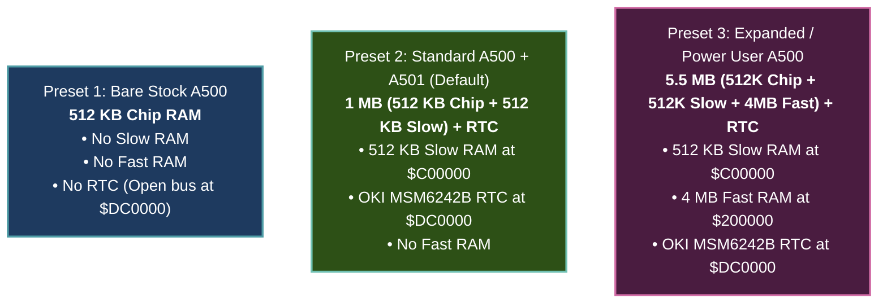

# Amiga 500 Configuration Specification (`A500Config`)

> [!NOTE]
> All ROM binaries, disk images, and memory configurations are injected into the core externally as raw byte slices (`&[u8]`), preserving WASM portability and system independence (see [AGENTS.md](../../../AGENTS.md)).
> Implementation resides in the dedicated foundational crate [`crates/config`](../../../crates/config).
> Physical memory layout is applied in [Physical Memory.md](Physical%20Memory.md), motherboard routing in [MemoryBus.md](MemoryBus.md), RTC models in [RTC.md](RTC.md), chipset variants in [Agnus.md](Agnus.md) and [Denise.md](Denise.md), and system coordinator setup in [Machine Loop.md](Machine%20Loop.md).

The shared [address bounds](../../../crates/config/src/address_map.rs) define
CIA banks `$A0-$BF` and custom banks `$DE-$DF` for all presets. Physical-memory
classification and the production router import these same definitions.
[MemoryBus](MemoryBus.md#cia-and-boot-overlay) owns register selection and
transaction acceptance; these constants do not instantiate devices.

Beam position remains in [Agnus](Agnus.md#motherboard-transport-boundary)
as its `hpos`/`vpos` counters and field/line state. Configuration retains hardware presets,
register definitions, the shared mutation queue and `big_array` Serde support.
The array helper is below subsystem crates and has no dependency on the
high-level [save format](Application/SaveState.md).

---

## 1. Focused Scope: 3 Canonical Hardware Presets

To achieve cycle-exact emulation and eliminate configuration explosion, the emulator core is configured exclusively through **three canonical hardware presets**:

1. **Preset 1 (`Bare512k`)**: Factory unexpanded 1987 A500. 512 KB Chip RAM only, no expansions, open bus `$FF` at `$DC0000`.
2. **Preset 2 (`Standard1Mb`, Default)**: The golden standard for >90% of Amiga 500 games and demoscene productions. 512 KB Chip + 512 KB Slow RAM (`$C00000`) + OKI MSM6242B RTC at `$DC0000`.
3. **Preset 3 (`ExpandedPowerUser`)**: 512 KB Chip + 512 KB Slow + 4 MB Auto-Config Fast RAM (`$200000`) + OKI MSM6242B RTC. Ideal for Workbench productivity, WHDLoad, and compilers.

---

## 2. Configuration Immutability & Data Structure

`A500Config` enforces strict encapsulation:
* **Read-Only**: Internal fields are private and accessible solely via public getters (`active_preset()`, `chip_ram()`, `slow_ram()`, `fast_ram()`, `rtc()`, `video_standard()`).
* **Single Mutation Vector**: Configuration can only be modified atomically via `apply_preset(preset)`.
* **RTC Model**: Held internally as an explicit `RtcModel` enum.

The master configuration is encapsulated in [`A500Config`](../../../crates/config/src/config.rs), which strictly enforces immutability and single-point mutation:
- **Encapsulated Types (Defined directly in [`crates/config/src/config.rs`](../../../crates/config/src/config.rs)):**
  - **`A500Preset`**: Canonical hardware presets (`Bare512k`, `Standard1Mb`, `ExpandedPowerUser`).
  - **`VideoStandard`**: Display timing standard (`Pal` at ~50 Hz / 3.546895 MHz CCK, `Ntsc` at ~60 Hz / 3.579545 MHz CCK).
  - **`ChipRamSize`**: Chip RAM sizing (`Kb512`).
  - **`SlowRamSize`**: Trapdoor pseudo-fast RAM (`None`, `Kb512` at `$C00000`).
  - **`FastRamSize`**: Auto-config expansion RAM (`None`, `Mb4` at `$200000`).
  - **`RtcModel`**: Real-time clock hardware (`None` [floating open bus `$FF`], `Msm6242b` [OKI MSM6242B at `$DC0000`]).
- **Constructors & Mutation**:
  - Constructors: `A500Config::bare_512k(video)`, `standard_1mb(video)`, `expanded_power_user(video)`, or `from_preset(preset, video)`.
  - Mutation Vector: Atomic preset application via `config.apply_preset(preset)`. All fields are accessed externally via read-only getters (`active_preset()`, `chip_ram()`, `slow_ram()`, `fast_ram()`, `rtc()`, `video_standard()`).

---

## 3. ROM & Image Injection Interfaces

Because the emulator core is system-agnostic and decoupled from the host filesystem, all ROMs and disk images are injected strictly as external byte slices (`&[u8]`):
- **Kickstart ROM Injection**: All presets support exactly 256 KiB (262144 bytes), matching the factory Kickstart 1.2/1.3 configuration. ROM injection through `PhysicalMemory::write_bytes_debug()` rejects every other image length before changing memory. The debugger and GUI propagate this error; larger upgraded ROMs are outside the supported configuration.
- **Floppy ADF Injection**: Disk drives accept ADF images as raw byte slices `&[u8]`, enabling seamless operation in both desktop environments and WebAssembly canvas contexts.
- **Zero Host I/O in Core**: No `std::fs` operations exist inside the core emulation engine.

---

## 4. Standard Preset Profiles

1. **Stock Amiga 500 (1987 baseline):**
   - PAL 50Hz, 512 KB Chip RAM, No Slow RAM, No Fast RAM.
   - Port 1: Mouse, Port 2: Joystick.
   - Agnus OCS 8371, Denise OCS 8362, Kickstart 1.2 or 1.3 (256 KB).
2. **Classic 1 MB Gaming Setup (Most common A500):**
   - PAL 50Hz, 512 KB Chip RAM + 512 KB Slow RAM (A501 trapdoor).
   - Port 1: Mouse, Port 2: Joystick.
   - Agnus OCS 8371, Denise OCS 8362, Kickstart 1.3.
3. **Productivity / Expanded Setup:**
   - PAL 50Hz, 512 KB Chip RAM + 512 KB Slow RAM + 4 MB Fast RAM.
   - Kickstart 1.3.

---

## 5. Deferred Peripheral Extension

Extended peripherals remain deferred; see the [deferred peripheral work](../../../ROADMAP.md#deferred-bus-and-peripherals).

---

## Shared propagation state

The foundational crate owns the serializable [MutationQueue](../../../crates/config/src/mutation.rs), shared by custom chips and CIA. Fixed storage holds an occupied prefix in retained issue order. The queue keeps its count private and exposes pending entries through a read-only slice. Each tick scans only occupied entries; capacity checks use the count. Pipeline entries coexist. OverwritePending replaces only the same destination and mode, placing the replacement after retained entries even when the queue is full. Zero delay and insertion without available capacity are refused without applying the write early. CIA retains its separate falling-E capture and bus acceptance contract. [MemoryBus](MemoryBus.md#custom-registers-and-specialized-chips) owns custom-register delays and recipient routing.

A tick first extracts every matured pair into reusable inline storage and compacts the pending prefix. The chip then applies those pairs at its existing phase. A newly staged write cannot join that tick's due set. Custom chip steps return all committed pairs as a borrowed slice, valid until the next mutable chip access. Staging leaves the observation intact; the next tick replaces it. No full-capacity result array is initialized, returned or scanned on an empty tick.

Only the pending sequence is logical snapshot state. Serialization omits unused storage, the derived count and the last due observation. Loading derives the count and rejects excessive capacity or zero remaining delay. Clone preserves pending writes and discards the observation; reset cancels both. Equality compares pending entries, so inactive storage and already committed pairs do not affect snapshot equality. The old array of optional entries has no compatibility parser under the pre-release snapshot policy.

## 6. Reference Documentation & Upstream Ground Truth

- [Amiga Hardware Reference Manual: Appendix D (System Memory Map)](../Reference/Hardware%20Reference%20Manual/12%20-%20Appendix%20D%20-%20System%20Memory%20Map.md): Memory map boundaries for 512 KB Chip, 512 KB Slow, and 8 MB Auto-Config address spaces.
- [A500/A2000 Technical Reference Manual: Section 1 (Summary of Differences)](../Reference/A500%20A2000%20Technical%20Reference%20Manual/01%20-%20Section%201%20Summary%20of%20Differences.md): Motherboard revision differences, video timing selection, and expansion bus options.
- [Configuration Subsystem Implementation Source](../../../crates/config/src/config.rs): Rust implementation of `A500Config`, hardware presets (`Bare512k`, `Standard1Mb`, `ExpandedPowerUser`), and video standards.
- [Mutation queue](../../../crates/config/src/mutation.rs): Fixed storage, issue ordering, due observations and pending-state serialization shared by custom chips and CIA.
