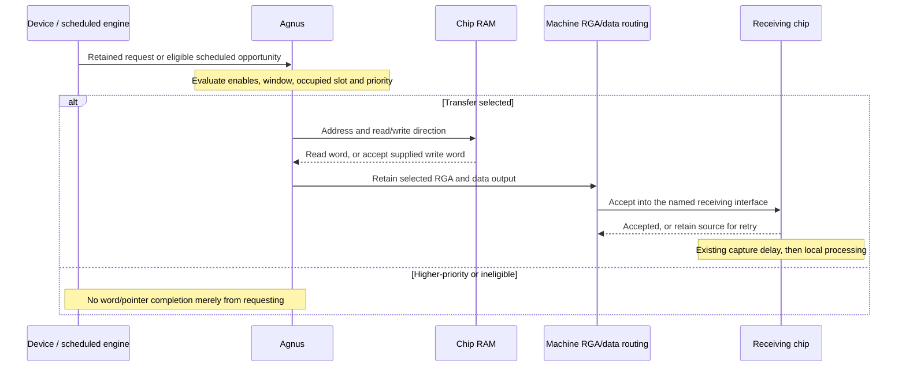

# Agnus DMA Scheduling

DMA is part of [Agnus](Agnus.md). It schedules access to the Chip RAM bus shared
with the CPU, deciding which requester may use each available memory slot.

For a DMA transfer, Agnus drives the memory address on the Chip RAM address bus
and the destination register address on its internal register address (RGA) bus.
DMA selection signals and register strobes travel over the modeled electrical
connections. The selected chip recognizes its signal and latches or supplies the
word on the shared data bus. [MemoryBus.md](MemoryBus.md) describes CPU contention;
the [cross-chip signal catalog](Cross-Chip%20Signals%20and%20Action%20Dispatch%20Catalog.md)
describes the connections between chips.

This document is a detailed chapter of [Agnus](Agnus.md). The `agnus::dma` module and its component tests belong to the `agnus` crate.

## From an opportunity to a transfer

Some DMA activity starts with a request from the device that needs data, such as
an audio or disk channel. Other opportunities follow the beam position and an
enabled display function: bitplane and sprite fetching have scheduled places in
the line, while memory refresh occurs independently of a device data request.
An allocated opportunity does not by itself mean that a word is transferred.
If the relevant channel has no work, its opportunity can be used by another
eligible bus user.

Audio DMA control follows this signal flow:

| Stage | Paula | Agnus |
| :--- | :--- | :--- |
| `DMACON` write | Retains only `DMAEN`, `DSKEN`, and `AUD0EN`–`AUD3EN` from the shared register bus for its audio and disk DMA control. | Latches the full `DMACON` state for DMA control. |
| Audio DMA request | When a channel needs data, asserts its request on `DMAL` only if `DMAEN` and that channel's `AUDxEN` are enabled in Paula's retained control bits. | Responds only if `DMAEN` and the requested channel's `AUDxEN` are enabled in Agnus's copy of `DMACON`; then schedules the transfer in an eligible slot. |

Display DMA follows a different path:

| Stage | [Denise](Denise.md) | Agnus |
| :--- | :--- | :--- |
| `DMACON` write | Takes no action. | Latches the full `DMACON` state; `DMAEN`, `BPLEN`, and `SPREN` gate display DMA. |
| Display window write | Latches the horizontal fields of `DIWSTRT` and `DIWSTOP` for pixel clipping. | Latches their vertical fields to gate bitplane DMA by line. |
| Display fetch | Does not request DMA. | Uses the vertical display window and `DDFSTRT`/`DDFSTOP` horizontal fetch interval for bitplanes; sprite slots are scheduled separately. `DMAEN` and the relevant channel enable must also be set. |
| Data transfer | Latches the selected `BPLxDAT` or sprite register from the shared data bus. | Reads Chip RAM and selects the destination register on `RGA`. |

There is no Denise-to-Agnus request or separate grant signal in this display
DMA model. The `RGA` register selection and shared data bus deliver the fetched
word to Denise; this is not the Paula `DMAL` request path.

When a channel is granted a memory cycle, Agnus selects its Chip RAM address and
the destination on the shared custom-chip bus. For a read, Chip RAM supplies a
word and the selected display or audio circuit latches it. For a disk write or
other memory-bound operation, the data flows in the opposite direction under
the same Agnus-controlled address and bus grant. The transfer then advances
the channel's position in its data stream; completion or a need for more data
is signaled by the responsible component. Refresh is different: it occupies a
memory opportunity but does not deliver a word to a peripheral.

## Arbitration and complete-exchange requirements

These are hardware/protocol requirements for the reconstructed engines. The
previous engine code is not certified by its presence. [HRM Chapter 6,
Blitter Operations and System DMA](../Reference/Hardware%20Reference%20Manual/06%20-%20Chapter%206%20-%20Blitter%20Hardware.md)
gives the priority and bus-sharing rules; Chapters 2-5 give requester-specific
eligibility and completion. The reference-model slot coordinates below use the
same horizontal CCK convention as the existing scheduler. They do not measure
sub-CCK bus edges or establish that its current eligibility algorithm is correct.

| User | Eligibility / opportunity | Transfer and advancement | Retention / competing work |
| --- | --- | --- | --- |
| Refresh | Periodic four refresh opportunities, independent of software DMA enables. | Agnus supplies DRAM row strobes; no receiving peripheral word. | Highest reserved memory work. Null RGA and refresh strobes differ from data delivery. |
| Disk | Master and DSKEN enabled; Paula's armed/active count, direction, sync state and word availability permit a request. Reference positions `$07/$09/$0B`. | Agnus addresses Chip RAM; read-from-drive uses Paula's DSKDATR supply and writes RAM, write-to-drive reads RAM into Paula's DSKDAT. Advance the pointer and count on a real transfer. | An unused opportunity is available to another eligible user. The request is not a completed word. Media execution remains later work; this stage checks only pins/register delivery. |
| Audio 0-3 | Master/channel enables plus the channel's retained data/restart request. Reference positions `$0D/$0F/$11/$13`, one word per channel opportunity. | Agnus chooses active or reload address, reads a word and selects AUDxDAT. Paula captures it and advances its local holding/count/reload state; later sample output is a separate operation. | A pending request survives until its matching transfer or a source-supported cancellation. Enabling alone must not fabricate a supplied word. Request snapshots and active-enable changes follow the channel transitions described in [Audio](Audio.md). |
| Sprites 0-7 | Master/SPREN plus sprite vertical/control state; two word opportunities per sprite, reference odd positions `$15-$33`. | Agnus selects pointer and POS/CTL or DATA/DATB destination; RAM supplies distinct words; Denise captures selected latches. Pointer/state advance follows each granted word. | Display fetches can preempt a sprite opportunity under the documented display overlap conditions. Whether a missed opportunity is retried follows sprite state, not a motherboard queue invented by the coordinator. |
| Bitplanes | Master/BPLEN, vertical DIW state, horizontal DDF window, resolution and plane count. | Agnus fetches selected planes, advances their pointers and applies the appropriate odd/even modulo at the line's final block. BPLxDAT captures data in Denise; BPL1DAT's local load/arm sequence and pixel shifting occur later. | Display priority can steal CPU/Copper/Blitter slots, and under overlap can outrank sprites. No return request/grant wire from Denise. The reconstructed shifter and fetch engines retain distinct ownership. |
| Copper | Master/COPEN, fetch state and beam/Blitter WAIT condition permit instruction words. | Chip RAM -> Copper instruction latches inside Agnus; a permitted MOVE emits retained RGA/data for common bus issue. PC advancement and WAIT/SKIP are engine state. | Below reserved display/peripheral work, above Blitter/CPU. WAIT retains state; BFD controls whether Blitter completion participates. SKIP decides the next instruction, rather than sending a motherboard cancellation signal. |
| Blitter | Master/BLTEN and active operation with a channel needing a source/destination cycle. | Source RAM -> A/B/C latches -> local logic -> D word -> RAM, under Agnus address ownership. Each granted channel cycle advances its own pointer/count; completion produces INT3*. | Below fixed/display DMA and Copper. With BLTPRI clear, three unsatisfied CPU memory requests require a CPU opportunity; BLTPRI set permits the Blitter to keep eligible remaining cycles. Local idle/pipeline cycles are not fabricated RAM transfers. |
| CPU | Pending memory cycle and a free eligible bus opportunity. | Production MemoryBus returns Ready only for the accepted access. A denied Chip RAM cycle returns WaitState without advancing the CPU's active bus micro-step or repeating a live-read effect. | Denial retains address, data and direction while the rest of the machine advances. Installed private RAM/ROM/peripheral timing is selected through MemoryBus, not indiscriminately blocked by Chip RAM ownership. |

The HRM describes CPU even-cycle access and display stealing. FPGA clocks and
the emulator's CCK coordinate conventions must be reconciled before equating
an odd/even test in one source with an edge on the original board. Minimig
explicitly supplies extra CPU opportunities and altered Blitter timing;
vAmiga uses a bus-owner schedule. Their differences remain model evidence.
PAL 8371 and NTSC 8370 share the request/data ownership and priority contracts;
line length, field timing and valid opportunities at line end need their
model-specific engine checks. Copper/Blitter dependencies stay internal to
Agnus. Gary's BLIT/DBR memory-request role and BLISS/BLS slowdown role are
different directions, not two interchangeable names for one signal.

### Sprite control and data production

Agnus compares each sprite's committed nine-bit start/stop coordinates. Start
sets its DMA-active state and stop clears it; stop selects the next POS/CTL
pair, allowing reuse after a gap. Active lines select DATA/DATB. Each grant
reads exactly one word, increments the OCS pointer and retains the RGA/data
output through the existing receiver-acceptance path. A blocked output cannot
be overwritten by a later grant. A missed scheduled opportunity does not
advance the pointer. Bitplane work retains priority over overlapping sprite
opportunities.

[HRM 4](../Reference/Hardware%20Reference%20Manual/04%20-%20Chapter%204%20-%20Sprite%20Hardware.md)
defines the control/data stream and blank line needed for reuse. The initial
control fetch uses PAL line 25 and NTSC line 19 from the local
[vAmiga Agnus model](../../../ref_src/vAmiga/Core/Components/Agnus/Agnus.cpp);
these coordinates are provisional model timing. Earlier vertical-blank lines
disable sprite fetching. Pointers are software-owned reload values: a new
field does not restore an old address automatically. Mid-line committed POS/CTL
changes participate in subsequent comparisons; pending words still deliver once.

## Paula request framing and state ownership

The reconstructed arbitration step selects one owner before any Copper fetch.
Its starvation counter counts denied CPU requests across higher-priority work;
a CPU grant or absence of a request clears the consecutive count. BLTPRI removes
the Blitter's yield obligation, without overriding other DMA priorities.
The production [MemoryBus](MemoryBus.md) latches an actual refused CPU access
and clears it on acceptance. The first refusal starts the count; subsequent
arbitration counts held requests once per CCK. Paula generates audio/disk requests and advances its own count and latch state
when granted words arrive through the shared bus.

Bitplane allocation follows HRM Figures 6-11 and 6-12. An eight-CCK group fetches
one word per low-resolution plane or two per high-resolution plane. DDFSTOP
finishes the final group; modulo applies only to each plane's last word.
The Chapter 3 standard windows `$38/$D0` and `$3C/$D4` consequently fetch 20
and 40 words per plane. The Copper uses its separate alternate opportunities
as described in [Copper](Copper.md#fetch-and-suspension-contract), and cannot
fetch a word in a slot awarded to bitplanes.

On the board, the active-high **single DMAL wire** carries a line-relative
request frame, not an address, data word or separate channel wires. RGA
horizontal strobes and related clocks establish the line reference. The
[catalog's request-position table](Cross-Chip%20Signals%20and%20Action%20Dispatch%20Catalog.md#paula-agnus-dma-request-timing)
separates measured disk positions from reconstructed audio semantics. In that
frame the first two positions are unused, positions 2-7 form three disk
direction/request pairs, and positions 8-15 form four audio restart/request
pairs. The cited physical disk capture shows requests at 3/5/7 and transfers
four CCK later at 7/9/11. The analogous audio timing and restart qualifiers
remain reference-model evidence, not measurements from that disk capture.

The reconstructed protocol must follow this complete sequence:

1. Agnus supplies the line synchronization. Paula's disk/audio engines retain
   their work and build the corresponding request bits at the defined line
   phase. Their memory addresses do not enter DMAL.
2. Machine Loop carries Paula's exposed DMAL level to the Agnus input. Agnus's
   receiver identifies the request from its position relative to the line,
   retaining channel/direction/restart information until the eligible transfer.
3. Agnus checks enables and arbitration, selects the owning pointer and RAM
   direction, then drives the matching RGA code. There is no additional
   motherboard grant wire: the matching register/data transfer is observable
   acceptance by the selected device.
4. For audio, the shared bus supplies AUDxDAT. For disk reads, Paula supplies
   the next queued word under the dummy early-read selection DSKDATR, and
   Agnus writes RAM. For disk writes, RAM supplies DSKDAT and Paula consumes
   it for serialization. CPU reads of the dummy address do not perform that DMA.
5. The responsible engines update pointer, count, holding/full state and reload
   request only on their documented transitions. Reset cancels requests and
   unaccepted output; an enable change does not retroactively duplicate or
   erase a word already accepted into a receiver queue. Unsatisfied requests follow the audio and disk engine enable rules.

| State | Authoritative owner |
| --- | --- |
| AUDxLC reload locations and active audio pointers | Agnus. The old audio object's bookkeeping is not a second permitted memory-address generator. |
| Audio length/reload/count, data/shift latches, request/restart conditions | Paula's audio engine. AUDxDR/AUDxDSR are logical conditions encoded on DMAL, not separate external wires. |
| Disk RAM pointer | Agnus. |
| Disk arming/count/direction, data FIFO, sync/serialization and DMAL request state | Paula; drive mechanics and magnetic track state belong to the drive. The drive exposes raw transitions and sense levels; it does not own Paula registers or DMA words. |
| Bitplane/sprite pointers and fetch/control state | Agnus; Denise owns receiving latches and later pixel consumption. |
| Copper PC/instruction and Blitter channel pointers/latches/counts | Contained Agnus engines, not motherboard peer chips. |
| Captured wire frame and pending delivery phase | Machine Loop, serialized separately from recipient processing. |

Audio now generates its four request/restart pairs from Paula channel state.
Agnus decodes the captured wire and supplies AUDxDAT in the owning slot, using
the reload address only when the qualifier is present. A held output prevents
another fetch until accepted. The current CCK model receives a line strobe at HPOS 2,
which supplies request-frame position 2; positions 0/1 are zero. The following
CCK input phase captures each driven bit, preserving request positions 9/11/13/15
and transfer positions 13/15/17/19. This is model phase alignment, not a new
measurement. Pointer increment belongs to the fetch; Paula length and sample
state advance when the receiver commits AUDxDAT.

STREQU, STRVBL and STRHOR each capture a new request frame, so audio and disk
DMA continue during vertical blanking. STRLONG leaves the active frame and
phase unchanged. The approved [Paula receiver model](Paula.md#rga-synchronization-and-vertb)
also derives VERTB from entry into STREQU; no decoded vertical event crosses
the motherboard route.
Disk requests now encode FIFO availability and direction in the same frame.
For a read with one, two or three words, the last one, two or three slots are
requested, matching the captured A500 frame. A disk read advances DSKPT after
Paula supplies a word and RAM accepts it; a write advances it when Agnus fetches
the word into the retained common output. Audio/sprite and deterministic disk
exchange tests cover these paths and snapshot continuation.
Working bitplane/Copper routes keep their existing queues. Full program exchanges remain named 2.5 work; disk-media and
firmware execution are later work and are not required to test those pins.

## Reference Documentation & Upstream Ground Truth

- [Three-reference signal comparison](Cross-Chip%20Signals%20and%20Action%20Dispatch%20Catalog.md#three-reference-comparison-and-selected-transport): Revision-aware comparison, physical DMAL encoding, source identities and missing internal reactions.
- [Machine input and register-delivery phases](Machine%20Loop.md#captured-connector-transport-and-pending-bus-words): Executed transport and save/restore contracts, distinct from the engine protocols described here.

- [Fat Agnus technical reference](../Reference/A500%20A2000%20Technical%20Reference%20Manual/11%20-%20Section%206%20-%20Fat%20Agnus%20Chip.md): Describes Agnus address generation and DMA signals.
- [Amiga Hardware Reference Manual, Chapter 3](../Reference/Hardware%20Reference%20Manual/03%20-%20Chapter%203%20-%20Playfield%20Hardware.md): Describes bitplane DMA and display data fetch.
- [Amiga Hardware Reference Manual, Chapter 4](../Reference/Hardware%20Reference%20Manual/04%20-%20Chapter%204%20-%20Sprite%20Hardware.md): Describes sprite DMA channels and automatic fetches.
- [Amiga Hardware Reference Manual, Chapter 5](../Reference/Hardware%20Reference%20Manual/05%20-%20Chapter%205%20-%20Audio%20Hardware.md): Describes audio channel enables and DMA requests.
- [Amiga Hardware Reference Manual, Chapter 6](../Reference/Hardware%20Reference%20Manual/06%20-%20Chapter%206%20-%20Blitter%20Hardware.md): Explains allocated memory opportunities and bus priority.
- [Amiga Hardware Reference Manual, Appendix B](../Reference/Hardware%20Reference%20Manual/10%20-%20Appendix%20B%20-%20Register%20Summary%20%28Address%20Order%29.md): Identifies the chips selected by `DMACON` writes and `DMACONR` reads.
- [DMA scheduler source](../../../crates/agnus/src/dma.rs): Implements the current arbitration model.
- [vAmiga Agnus register handling](../../../ref_src/vAmiga/Core/Components/Agnus/AgnusRegs.cpp) and [DMA events](../../../ref_src/vAmiga/Core/Components/Agnus/AgnusEvents.cpp): Reference implementation of `DMACON` gating and scheduled bitplane transfers.
