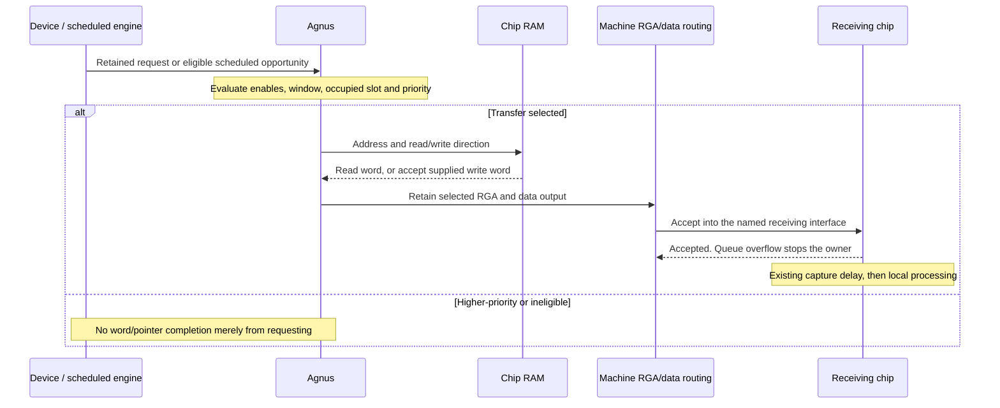

# Agnus DMA Scheduling

The DMA scheduler in Agnus decides which requester can use each available
slot on the Chip RAM bus it shares with the CPU. [Agnus](Agnus.md)

For a DMA transfer, Agnus drives the memory address on the Chip RAM address
bus and selects the destination register on its internal register address
(RGA) bus. The emulator carries DMA selection signals and register strobes
over modeled electrical connections. The selected chip recognizes its signal
and latches or supplies the word on the shared data bus.

MemoryBus describes what happens when the CPU and DMA compete for the bus.
[MemoryBus.md](MemoryBus.md)

The signal catalog describes the connections between chips.
[Cross-chip signal catalog](Cross-Chip%20Signals%20and%20Action%20Dispatch%20Catalog.md)

## From an opportunity to a transfer

An audio or disk channel can request a transfer when it needs data. Agnus
schedules bitplane and sprite fetches in each line according to the beam
position and the enabled display function. Memory refresh follows its own
schedule independently of device requests. An allocated slot gives a channel a
chance to transfer a word. If the channel has no work, another eligible bus
user can take the slot.

Paula and Agnus use the shared register write and the audio request as follows.

| Stage | Paula | Agnus |
| :--- | :--- | :--- |
| `DMACON` write | Retains only `DMAEN`, `DSKEN`, and `AUD0EN`–`AUD3EN` from the shared register bus for its audio and disk DMA control. | Latches the full `DMACON` state for DMA control. |
| Audio DMA request | When a channel needs data, asserts its request on `DMAL` only if `DMAEN` and that channel's `AUDxEN` are enabled in Paula's retained control bits. | Responds only if `DMAEN` and the requested channel's `AUDxEN` are enabled in Agnus's copy of `DMACON`; then schedules the transfer in an eligible slot. |

For display DMA, Denise and Agnus use different fields of the same display
window writes. Agnus schedules the fetch and sends the data to Denise.

| Stage | [Denise](Denise.md) | Agnus |
| :--- | :--- | :--- |
| `DMACON` write | Takes no action. | Latches the full `DMACON` state; `DMAEN`, `BPLEN`, and `SPREN` gate display DMA. |
| Display window write | Latches the horizontal fields of `DIWSTRT` and `DIWSTOP` for pixel clipping. | Latches their vertical fields to gate bitplane DMA by line. |
| Display fetch | Does not request DMA. | Uses the vertical display window and `DDFSTRT`/`DDFSTOP` horizontal fetch interval for bitplanes; sprite slots are scheduled separately. `DMAEN` and the relevant channel enable must also be set. |
| Data transfer | Latches the selected `BPLxDAT` or sprite register from the shared data bus. | Reads Chip RAM and selects the destination register on `RGA`. |

In this model, Agnus delivers the fetched word to Denise by selecting a
register on `RGA` and putting the word on the shared data bus. This completes
the transfer without a request from Denise or a separate grant signal. Paula
uses `DMAL` for its own requests.

When arbitration gives a channel a memory cycle, Agnus selects the Chip RAM
address and the destination on the shared custom-chip bus. On a read from RAM,
Chip RAM supplies a word and the selected display or audio circuit latches it.
For a disk write or other memory-bound operation, the word flows in the
opposite direction under the same Agnus-controlled address and bus grant.
After the transfer advances the channel's position in the stream, the
responsible component signals completion or a need for more data. Refresh
uses a memory slot without delivering a word to a peripheral.

## Arbitration and complete-exchange requirements

The reconstructed engines must follow the hardware and protocol requirements
below. Conformance requires evidence beyond the presence of earlier engine
code. Chapters 2-5 of the Hardware Reference Manual (HRM) describe when each
requester qualifies for a slot and what completes a transfer. Chapter 6
explains priority and bus sharing.
[HRM Chapter 6, Blitter Operations and System DMA](../Reference/Hardware%20Reference%20Manual/06%20-%20Chapter%206%20-%20Blitter%20Hardware.md)

The reference-model slot coordinates below use the same horizontal CCK
convention as the existing scheduler. Sub-CCK bus edge measurements fall outside
the scope of these coordinates, which also leave the scheduler's eligibility
algorithm unverified.

| User | Eligibility / opportunity | Transfer and advancement | Retention / competing work |
| --- | --- | --- | --- |
| Refresh | Periodic four refresh opportunities, independent of software DMA enables. | Agnus supplies DRAM row strobes; no receiving peripheral word. | Highest reserved memory work. Null RGA and refresh strobes differ from data delivery. |
| Disk | Master and DSKEN enabled; Paula's armed/active count, direction, sync state and word availability permit a request. Reference positions `$07/$09/$0B`. | Agnus addresses Chip RAM; read-from-drive uses Paula's DSKDATR supply and writes RAM, write-to-drive reads RAM into Paula's DSKDAT. Advance the pointer and count on a real transfer. | An unused opportunity is available to another eligible user. The request is not a completed word. Autonomous ADF reads also use this path; media writes remain unverified. |
| Audio 0-3 | Master/channel enables plus the channel's retained data/restart request. Reference positions `$0D/$0F/$11/$13`, one word per channel opportunity. | Agnus chooses active or reload address, reads a word and selects AUDxDAT. Paula captures it and advances its local holding/count/reload state; later sample output is a separate operation. | A pending request survives until its matching transfer or a source-supported cancellation. Enabling alone must not fabricate a supplied word. Request snapshots and active-enable changes follow the channel transitions described in [Audio](Audio.md). |
| Sprites 0-7 | Master/SPREN plus sprite vertical/control state; two word opportunities per sprite, reference odd positions `$15-$33`. | Agnus selects pointer and POS/CTL or DATA/DATB destination; RAM supplies distinct words; Denise captures selected latches. Pointer/state advance follows each granted word. | Display fetches can preempt a sprite opportunity under the documented display overlap conditions. Whether a missed opportunity is retried follows sprite state, not a motherboard queue invented by the coordinator. |
| Bitplanes | Master/BPLEN, vertical DIW state, horizontal DDF window, resolution and plane count. | Agnus fetches selected planes, advances their pointers and applies the appropriate odd/even modulo at the line's final block. BPLxDAT captures data in Denise; BPL1DAT's local load/arm sequence and pixel shifting occur later. | Display priority can steal CPU/Copper/Blitter slots, and under overlap can outrank sprites. No return request/grant wire from Denise. The reconstructed shifter and fetch engines retain distinct ownership. |
| Copper | Master/COPEN, fetch state and beam/Blitter WAIT condition permit instruction words. | Chip RAM -> Copper instruction latches inside Agnus; a permitted MOVE emits retained RGA/data for common bus issue. PC advancement and WAIT/SKIP are engine state. | Below reserved display/peripheral work, above Blitter/CPU. WAIT retains state; BFD controls whether Blitter completion participates. SKIP decides the next instruction, rather than sending a motherboard cancellation signal. |
| Blitter | Master/BLTEN and active operation with a channel needing a source/destination cycle. | Source RAM -> A/B/C latches -> local logic -> D word -> RAM, under Agnus address ownership. Each granted channel cycle advances its own pointer/count; completion produces INT3*. | Below fixed/display DMA and Copper. With BLTPRI clear, three unsatisfied CPU memory requests require a CPU opportunity; BLTPRI set permits the Blitter to keep eligible remaining cycles. Local idle/pipeline cycles are not fabricated RAM transfers. |
| CPU | Pending memory cycle and a free eligible bus opportunity. | Production MemoryBus returns Ready only for the accepted access. A denied Chip RAM cycle returns WaitState without advancing the CPU's active bus micro-step or repeating a live-read effect. | Denial retains address, data and direction while the rest of the machine advances. Installed private RAM/ROM/peripheral timing is selected through MemoryBus, not indiscriminately blocked by Chip RAM ownership. |

The HRM assigns the CPU even cycles and explains how display DMA takes some
of them. Before matching an odd/even test from a source to an edge on the
original board, reconcile the FPGA clocks with the emulator's CCK coordinates.
The models show different behavior. Minimig explicitly offers extra CPU
opportunities and alters Blitter timing. vAmiga uses a schedule of bus owners.

PAL 8371 and NTSC 8370 share the rules for request and data ownership and bus
priority. Each model needs its own engine checks for line length, field
timing and the slots available at the end of a line. Copper and Blitter
dependencies stay within Agnus. Gary's BLIT/DBR memory-request role and
BLISS/BLS slowdown role use different signal directions.

### Sprite control and data production

Agnus compares each sprite's committed nine-bit start and stop coordinates.
A start match sets the sprite's DMA-active state. A stop match clears it and
selects the next POS/CTL pair, allowing the sprite to be reused after a gap.
For active lines, Agnus selects DATA/DATB. Each grant reads exactly one word
and increments the OCS pointer. The existing delivery path holds the RGA/data
output until the receiver accepts it, preventing a later grant from replacing
the pending output. A missed slot leaves the pointer unchanged. Bitplane
fetches take priority where the slots overlap.

The HRM defines the stream of sprite control and data words and the blank
line needed for reuse. [HRM 4](../Reference/Hardware%20Reference%20Manual/04%20-%20Chapter%204%20-%20Sprite%20Hardware.md)
The initial control fetch uses PAL line 25 and NTSC line 19. These are
provisional timing coordinates from the local vAmiga model. [vAmiga Agnus model](../../../ref_src/vAmiga/Core/Components/Agnus/Agnus.cpp)
Sprite fetching is disabled on earlier vertical-blank lines. Software owns
the pointer reload values. A new field does not automatically restore an old
address. Subsequent comparisons use a mid-line POS/CTL change once it commits.
The receiver still gets each pending word once.

The implementation holds the vertical latches and uses an eight-channel mask
to track requests. It reuses the comparison result while the vertical
position, model control line and committed POS/CTL values stay the same.
An effective write invalidates the result. Reset and restore
rebuild it. The vertical latches update even when DMA is disabled or the
output is occupied. The current DMA enables and output availability gate the
mask independently. If the mask is empty, the implementation can return early
while preserving the fixed transfer opportunities.
[Sprite DMA implementation](../../../crates/agnus/src/dma_sprite.rs)

## Paula request framing and state ownership

The reconstructed arbitration selects one bus owner before any Copper fetch.
When higher-priority work denies a CPU request, the production MemoryBus
records the refusal and clears it when it accepts the access. The first
refusal starts the count. Later arbitration steps count the held request once
per CCK. A CPU grant or a cycle without a request clears the count. BLTPRI
lets the Blitter keep using eligible cycles without yielding to the CPU, while
the other DMA priorities still apply. [MemoryBus](MemoryBus.md)

Paula generates the audio and disk requests. When a grant brings a word over
the shared bus, Paula advances its own count and latch state.

Bitplane allocation follows HRM Figures 6-11 and 6-12. Each eight-CCK group
fetches one word per low-resolution plane or two per high-resolution plane.
In the retained DMA model, DDFSTOP requests a final complete group at the
next group boundary. If the comparison falls exactly on a boundary, that
boundary starts the final group. Modulo applies only to each plane's last
word in the final group. The Chapter 3 standard windows `$38/$D0` and
`$3C/$D4` consequently fetch 20 and 40 words per plane.

Workbench 1.3 also uses `$3C/$D0`. Ending the fetch with the group containing
the stop comparison gives each plane only 38 words. Each row then advances by
76 bytes instead of 80, and the image shifts farther on successive rows.
The final-group rule restores the native Workbench image and preserves the
`$38/$D0` Kickstart disk prompt. The rule follows the vAmiga model's stop
request and tracking of the last fetch unit.
[vAmiga's stop-request and last-unit state](../../../ref_src/vAmiga/Core/Components/Agnus/Sequencer/SequencerBpl.cpp)

The comparison establishes these reproduced firmware cases. The silicon phase
for unusual DDF combinations still needs hardware verification. The Chapter 3
register summary says H3 is respected only in hires. The selected reference
model handles a mid-group stop in both modes. That difference limits the
hardware claim, and the source manual is unchanged.

The Copper has its own alternate opportunities. It cannot fetch a word in a
slot awarded to bitplanes. [Copper](Copper.md#fetch-and-suspension-contract)

On the board, the channels share an active-high **single DMAL wire** for DMA
requests. Addresses and data travel over other connections. RGA horizontal
strobes and related clocks establish the line reference for each request
frame. The first two frame positions are unused. Positions 2-7 form three
disk direction/request pairs, and positions 8-15 form four audio
restart/request pairs. The physical disk capture shows requests at 3/5/7 and
transfers four CCK later at 7/9/11. The analogous audio timing and restart
qualifiers come from reference models. The catalog records the evidence for
each. [Catalog request-position table](Cross-Chip%20Signals%20and%20Action%20Dispatch%20Catalog.md#paula-agnus-dma-request-timing)

The reconstructed protocol must follow the full sequence below.

1. Agnus supplies line synchronization. Paula's disk and audio engines hold
   their work and build request bits at the defined line phase. DMAL carries
   only the request information, with no memory addresses.
2. Machine Loop carries the DMAL level exposed by Paula to the Agnus input.
   The Agnus receiver uses the position relative to the line to identify the
   request. It retains the channel, direction and restart information until
   the eligible transfer.
3. Agnus checks the enables and arbitration, selects the owning pointer and
   RAM direction, and then drives the matching RGA code. The matching
   register and data transfer show when the selected device accepts it.
   The motherboard uses no additional grant wire.
4. For audio, the shared bus supplies AUDxDAT. For disk reads, Paula supplies
   the next queued word at the dummy early-read selection DSKDATR, and Agnus
   writes it to RAM. For disk writes, RAM supplies DSKDAT and Paula consumes
   it for serialization. A CPU read of the dummy address leaves the DMA
   operation untouched.
5. The responsible engines update the pointer, count, holding/full state and
   reload request only on their documented transitions. Reset cancels
   requests and unaccepted output. An enable change leaves words already
   accepted into a receiver queue in place, without duplicating or erasing
   them. The audio and disk engine enable rules govern unsatisfied requests.

| State | Authoritative owner |
| --- | --- |
| AUDxLC reload locations and active audio pointers | Agnus. The old audio object's bookkeeping is not a second permitted memory-address generator. |
| Audio length/reload/count, data/shift latches, request/restart conditions | Paula's audio engine. AUDxDR/AUDxDSR are logical conditions encoded on DMAL, not separate external wires. |
| Disk RAM pointer | Agnus. |
| Disk arming/count/direction, data FIFO, sync/serialization and DMAL request state | Paula; drive mechanics and magnetic track state belong to the drive. The drive exposes raw transitions and sense levels; it does not own Paula registers or DMA words. |
| Bitplane/sprite pointers and fetch/control state | Agnus; Denise owns receiving latches and later pixel consumption. |
| Copper PC/instruction and Blitter channel pointers/latches/counts | Contained Agnus engines, not motherboard peer chips. |
| Captured wire frame and pending delivery phase | Machine Loop, serialized separately from recipient processing. |

Paula generates four audio request/restart pairs from its channel state.
Agnus decodes the captured DMAL level and supplies AUDxDAT in the channel's
slot. It uses the reload address only when the request carries the restart
qualifier. An outstanding output blocks another fetch until the receiver
accepts it. In the current CCK model, a line strobe at HPOS 2 supplies
request-frame position 2. Positions 0/1 are zero. The following CCK input
phase captures each driven bit, preserving request positions 9/11/13/15
and transfer positions 13/15/17/19. This alignment comes from the model.
Agnus increments the pointer on the fetch. Paula advances the length and
sample state when the receiver commits AUDxDAT.

STREQU, STRVBL and STRHOR each capture a new request frame, so audio and
disk DMA continue during vertical blanking. STRLONG leaves the active frame
and phase unchanged. The approved Paula receiver model also derives VERTB on
entry into STREQU. The motherboard route carries no decoded vertical event.
[Paula receiver model](Paula.md#rga-synchronization-and-vertb)

Disk requests encode FIFO availability and direction in the same frame. A read
of one, two or three words requests the last one, two or three slots,
respectively, as in the captured A500 frame. For a disk read, Paula supplies
a word and RAM accepts it before Agnus advances DSKPT. For a disk write, Agnus
advances DSKPT when it fetches the word into the retained common output. Audio
and sprite tests and deterministic disk exchange tests cover the corresponding
paths and continuation from snapshots. The working bitplane and Copper paths
use their existing queues.

The floppy drive model supplies timed ADF transitions through the same
connector. [Floppy](Floppy.md#autonomous-adf-reads-and-continuation)
The original cross1 boot test exercises the firmware and guest setup. The
broader native tests retain image comparisons and selected program-level
exchanges. Media boot evidence requires more than the deterministic pin
tests alone. [native tests](../../../ROADMAP.md#native-disk-verification)

## Reference Documentation & Upstream Ground Truth

- The signal comparison accounts for revisions and records physical DMAL encoding, source identities and missing internal reactions. [Three-reference signal comparison](Cross-Chip%20Signals%20and%20Action%20Dispatch%20Catalog.md#three-reference-comparison-and-selected-transport)
- The machine phases describe how the machine carries signals and handles pending transfers across save and restore. This page describes the engine protocols. [Machine input and register-delivery phases](Machine%20Loop.md#captured-connector-transport-and-pending-bus-words)
- The technical reference describes Agnus address generation and DMA signals. [Fat Agnus technical reference](../Reference/A500%20A2000%20Technical%20Reference%20Manual/11%20-%20Section%206%20-%20Fat%20Agnus%20Chip.md)
- The playfield chapter describes bitplane DMA and display data fetch. [Amiga Hardware Reference Manual, Chapter 3](../Reference/Hardware%20Reference%20Manual/03%20-%20Chapter%203%20-%20Playfield%20Hardware.md)
- The sprite chapter describes DMA channels and automatic fetches. [Amiga Hardware Reference Manual, Chapter 4](../Reference/Hardware%20Reference%20Manual/04%20-%20Chapter%204%20-%20Sprite%20Hardware.md)
- The audio chapter describes channel enables and DMA requests. [Amiga Hardware Reference Manual, Chapter 5](../Reference/Hardware%20Reference%20Manual/05%20-%20Chapter%205%20-%20Audio%20Hardware.md)
- The Blitter chapter explains allocated memory opportunities and bus priority. [Amiga Hardware Reference Manual, Chapter 6](../Reference/Hardware%20Reference%20Manual/06%20-%20Chapter%206%20-%20Blitter%20Hardware.md)
- The register summary identifies the chips selected by `DMACON` writes and `DMACONR` reads. [Amiga Hardware Reference Manual, Appendix B](../Reference/Hardware%20Reference%20Manual/10%20-%20Appendix%20B%20-%20Register%20Summary%20%28Address%20Order%29.md)
- The scheduler source implements the current arbitration model. [DMA scheduler source](../../../crates/agnus/src/dma.rs)
- The reference implementation shows `DMACON` gating and scheduled bitplane transfers. [vAmiga Agnus register handling](../../../ref_src/vAmiga/Core/Components/Agnus/AgnusRegs.cpp), [DMA events](../../../ref_src/vAmiga/Core/Components/Agnus/AgnusEvents.cpp)
- The reference model shows how a stop request relates to the final complete fetch group. [vAmiga bitplane sequencer](../../../ref_src/vAmiga/Core/Components/Agnus/Sequencer/SequencerBpl.cpp)
