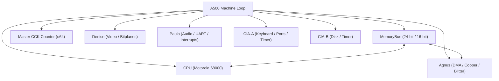
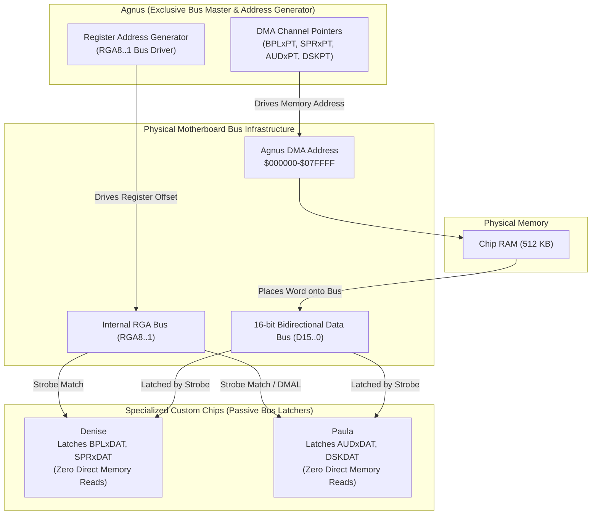

# Amiga 500 General System Architecture

> [!NOTE]
> Detailed inter-chip signal propagation rules are codified in [`hardware-bus-topology.md`](../../../.agents/rules/hardware-bus-topology.md) and [Cross-Chip Signals and Action Dispatch Catalog.md](Cross-Chip%20Signals%20and%20Action%20Dispatch%20Catalog.md).

---

## 1. System Block Diagram & Ownership

The emulator is organized around a top-level machine struct named A500, which owns all subsystems and manages coordination without circular handles:

- **Top-Level Machine (A500)**: Controls stepping (single CCK, multi-cycle, or full video frame), reset lines, and interrupt priority arbitration (IPL 1–6).
- **Decoupled Modules**: Subsystems do not hold references or callbacks to one another; signals and bus requests are driven in the main machine loop and MemoryBus.
- **Register Timing & Signal Propagation**: [MemoryBus](MemoryBus.md#custom-registers-and-specialized-chips) defines reference-model delays and the fallback for unresolved data writes, with immediate accepted reads and address strobes. [CIA](CIA.md#runtime-register-capture-and-bus-synchronization) retains its E-clock boundary. Motherboard delivery and downstream engine phases remain separate; these model policies do not establish every physical propagation delay.

### 1.1 Physical Bus Topology & Inter-Chip Isolation Invariant

In the physical Commodore Amiga 500 architecture, custom chips do not share an open software memory bus, nor do they communicate via dynamic callbacks or mutual references. The system strictly adheres to three immutable physical hardware rules:

1. **Strict Prohibition of Direct Cross-Chip Signal Smuggling:**
   - Custom chips (`Agnus`, `Denise`, `Paula`, `CIAs`, `CPU`) **must never** hold direct pointers or invoke mutating methods directly on each other.
   - All inter-chip interactions (DMA requests, interrupt lines, blanking, strobes) represent physical copper PCB traces coordinated through the machine loop and `MemoryBus`.
2. **Agnus as the Exclusive DMA Address Master:**
   - Agnus is the **sole bus master and address generator** for all autonomous Chip RAM DMA channels (Bitplanes, Sprites, Audio, Floppy Disk, Copper, and Blitter).
   - The supported 8370 and 8371 models address the lower 512 KB for DMA; all current machine presets install 512 KB of Chip RAM.
   - Agnus places the memory address onto the Chip RAM address bus and simultaneously asserts the target custom register offset onto the internal Register Address (`RGA`) bus.
3. **Specialized Custom Chips as Passive Bus Latchers (Zero Direct Memory Reads):**
   - Neither **Denise** nor **Paula** possesses DMA address generation circuits, and neither holds pointers to `PhysicalMemory`.
   - Specialized chips **never initiate autonomous memory reads**. During an assigned DMA slot, the memory system reads the 16-bit word from Chip RAM onto the shared data bus, and the receiving chip passively latches the word into its internal holding register (`BPLxDAT`, `SPRxDAT`, `AUDxDAT`, `DSKDAT`) upon matching its `RGA` strobe.
4. **`MachineLoop` as Motherboard PCB Simulator:**
   - The top-level `A500Machine` resolves wiring after producer work. Each recipient owns incoming inputs and samples them at the explicit [Machine Loop phases](Machine%20Loop.md#connections-advanced-within-the-step).
   - CIA IRQ, Agnus INT3, TOD, connector controls/status and RGA synchronization pass through that boundary. The receiver owns edge detection or input sampling; motherboard delivery does not substitute a register write for a physical pin.
   - Granted RGA/data words use the existing MemoryBus and register queues, retaining an output until acceptance. Disk and audio requests pass through DMAL, with register data accepted by the target chip. No chip notifies or mutates a peer directly.

---

## 2. Workspace Crate Architecture & Dependencies

The codebase is organized as a Cargo workspace with chip and peripheral crates located under `crates/`. Contained engines use Rust modules inside their owner; a detailed design chapter does not imply a separate Cargo package.

Direct dependencies between workspace crates must follow the explicit rules in
[`APPROVED_CRATE_DEPENDENCIES`](../../../tools/verification/checks/check_architecture.py).
Production, test and build dependencies have separate permissions. The architecture
test checks Cargo metadata, including aliases, optional dependencies and every
target platform. A new crate or dependency requires an explicit rule before it
can pass verification. Re-exports count as dependencies; removing an unused
dependency does not require keeping its declaration.

The [save format](Application/SaveState.md) is a higher-level consumer of the
[Machine Loop](Machine%20Loop.md). It owns JSON, file access and PNG previews;
the core owns pure snapshots and signal transport. No subsystem depends on the
save format. Beam counters belong to Agnus; receiver synchronization travels
as RGA events rather than an Agnus counter projection.

```mermaid
graph TD
    classDef top fill:#0f2537,stroke:#38ef7d,stroke-width:2px,color:#ffffff;
    classDef core fill:#1e3a5f,stroke:#4f9da6,stroke-width:2px,color:#ffffff;
    classDef chip fill:#2d1b4e,stroke:#9d4edd,stroke-width:2px,color:#ffffff;
    classDef subchip fill:#3b1e36,stroke:#f72585,stroke-width:1px,color:#ffffff;
    classDef periph fill:#1b3b22,stroke:#52b788,stroke-width:2px,color:#ffffff;
    classDef tool fill:#3d2c40,stroke:#d16ba5,stroke-width:2px,color:#ffffff;

    subgraph TopLevel["Top-Level Machine Chassis"]
        ML["machine_loop<br/><code>crates/machine_loop</code>"]:::top
    end

    subgraph MemoryAndCPU["Memory Storage & CPU Core"]
        CFG["config<br/><code>crates/config</code>"]:::core
        PMEM["physical_memory<br/><code>crates/physical_memory</code>"]:::core
        MBUS["memory_bus<br/><code>crates/memory_bus</code>"]:::core
        RTC["rtc<br/><code>crates/rtc</code>"]:::core
        CPU["m68000<br/><code>crates/cpu</code>"]:::core
    end

    subgraph CustomChips["Custom Chip Coordinators & Coprocessors"]
        AGNUS["agnus<br/><code>crates/agnus</code>"]:::chip
        COP["agnus::copper module<br/><code>crates/agnus/src/copper.rs</code>"]:::subchip
        BLT["agnus::blitter module<br/><code>crates/agnus/src/blitter.rs</code>"]:::subchip
        DMA["agnus::dma module<br/><code>crates/agnus/src/dma.rs</code>"]:::subchip

        DENISE["denise<br/><code>crates/denise</code>"]:::chip
        SPR["denise::sprites module<br/><code>crates/denise/src/sprites.rs</code>"]:::subchip
        FB["frame_builder<br/><code>crates/frame_builder</code>"]:::subchip

        PAULA["paula<br/><code>crates/paula</code>"]:::chip
        AUD["paula::audio module<br/><code>crates/paula/src/audio.rs</code>"]:::subchip
        INTR["paula::interrupts module<br/><code>crates/paula/src/interrupts.rs</code>"]:::subchip

        CIA["cia (A & B)<br/><code>crates/cia</code>"]:::chip
    end

    subgraph Peripherals["Peripherals & Input Devices"]
        GP["game_ports<br/><code>crates/game_ports</code>"]:::periph
        MOU["game_ports::mouse module<br/><code>crates/game_ports/src/mouse.rs</code>"]:::subchip
        JOY["game_ports::joystick module<br/><code>crates/game_ports/src/joystick.rs</code>"]:::subchip
        FLP["floppy<br/><code>crates/floppy</code>"]:::periph
        KBD["keyboard<br/><code>crates/keyboard</code>"]:::periph
    end

    subgraph Diagnostics["Diagnostics, Debugger & GUI"]
        DIS["disassembler<br/><code>crates/disassembler</code>"]:::tool
        DBG["debugger<br/><code>crates/debugger</code>"]:::tool
        SAVE["save_state<br/><code>crates/save_state</code>"]:::tool
        GUI["gui<br/><code>crates/gui</code>"]:::tool
        TR["test_runner<br/><code>crates/test_runner</code>"]:::tool
    end

    SAVE --> ML
    DBG --> SAVE

    %% Chassis Ownership & Routing
    ML --> CPU
    ML --> PMEM
    ML --> MBUS
    ML --> AGNUS
    ML --> DENISE
    ML --> PAULA
    ML --> CIA
    ML --> FLP
    ML --> KBD
    ML --> GP
    ML --> RTC

    %% Contained modules and the retained frame_builder crate
    AGNUS --> COP
    AGNUS --> BLT
    AGNUS --> DMA

    DENISE --> SPR
    DENISE --> FB

    PAULA --> AUD
    PAULA --> INTR

    GP --> MOU
    GP --> JOY

    %% Memory & Bus Connections
    PMEM --> CFG
    FLP --> CFG
    PAULA --> CFG
    PMEM --> RTC
    MBUS --> PMEM
    CPU --> PMEM

    %% Tooling Dependencies
    DBG --> CPU
    DBG --> PMEM
    DBG --> DIS
    GUI --> DBG
    TR --> CPU
    TR --> PMEM
    TR --> DIS
```

The diagram shows ownership and selected connections. Internal module nodes are not Cargo packages. The table below lists direct workspace dependencies; development-only dependencies are marked explicitly.

### Crate Descriptions & Responsibilities

| Crate | Path | Responsibility | Workspace Dependencies |
| :--- | :--- | :--- | :--- |
| **config** | [crates/config](../../../crates/config) | Encapsulated, read-only hardware presets (Bare512k, Standard1Mb, ExpandedPowerUser), chip models, RtcModel, video timings. | *None* |
| **agnus** | [crates/agnus](../../../crates/agnus) | Beam counters, DMA arbitration and address generation; internal Copper and Blitter engines. | config |
| **frame_builder** | [crates/frame_builder](../../../crates/frame_builder) | Storage of final ARGB pixels, field assembly and frame availability for host display. | config |
| **game_ports** | [crates/game_ports](../../../crates/game_ports) | Controller sockets and internal mouse/joystick device models; external connector levels and host input routing. | config |
| **denise** | [crates/denise](../../../crates/denise) | Bitplane and sprite serialization, palette, collisions, JOY counters and final pixel composition. | config, frame_builder |
| **floppy** | [crates/floppy](../../../crates/floppy) | Drive mechanics, connector controls and sense lines, inserted media buffers; disk registers remain in Paula. | config |
| **paula** | [crates/paula](../../../crates/paula) | Audio channels, disk data engine, UART, interrupt controller and shared DMAL request framing. | config |
| **keyboard** | [crates/keyboard](../../../crates/keyboard) | MOS 6500/1 keyboard microcontroller, scancode matrix, serial stream, and Ctrl-Amiga-Amiga reset. | *None* |
| **cia** | [crates/cia](../../../crates/cia) | MOS 8520 Complex Interface Adapter (Timers A & B, Ports A & B / parallel Centronics lines, TOD, SDR, ICR). | config |
| **rtc** | [crates/rtc](../../../crates/rtc) | OKI MSM6242B Real-Time Clock & Calendar emulation, BCD latches, civil calendar arithmetic. | config |
| **physical_memory** | [crates/physical_memory](../../../crates/physical_memory) | 24-bit physical address space, 256-entry 64KB bank table (`addr >> 16`), 2-phase CCK arbitration, open bus emulation. | config, rtc |
| **memory_bus** | [crates/memory_bus](../../../crates/memory_bus) | Routes CPU memory and register access through the actual chips and physical memory. | agnus, cia, config, denise, paula, physical_memory, rtc |
| **m68000** | [crates/cpu](../../../crates/cpu) | Cycle-exact Motorola 68000 CPU core, 65,536-entry compile-time static dispatch table, registers, ALU, prefetch queue. | physical_memory |
| **machine_loop** | [crates/machine_loop](../../../crates/machine_loop) | Owns chips and peripherals, advances the master CCK and routes motherboard signals and shared-bus transfers. | agnus, cia, config, cpu, denise, floppy, game_ports, keyboard, memory_bus, paula, physical_memory, rtc |
| **disassembler** | [crates/disassembler](../../../crates/disassembler) | Cycle-exact M68000 instruction disassembler. | *None* |
| **debugger** | [crates/debugger](../../../crates/debugger) | Headless inspection and debugging subsystem, temporal time-travel engine, breakpoints, and watchpoints. | config, cpu, disassembler, machine_loop, physical_memory, save_state |
| **save_state** | [crates/save_state](../../../crates/save_state) | Versioned file envelope, JSON persistence and PNG previews around the pure machine snapshot. | machine_loop; dev: config |
| **test_runner** | [crates/test_runner](../../../crates/test_runner) | Aggregate SingleStep verification with shared reporting helpers, automated validation against Tom Harte SingleStepTests, and whole-program CPU performance testing. | *None*; dev: agnus, cia, cpu, denise, disassembler, memory_bus, paula, physical_memory, rtc |
| **gui** | [crates/gui](../../../crates/gui) | Immediate-mode Developer Studio & Standalone GUI (egui/eframe), live CPU/memory inspection, temporal time-travel scrubber. | config, cpu, debugger, physical_memory, rtc |

### Chipset design chapters

[Agnus](Agnus.md) owns the [DMA](DMA.md), [Copper](Copper.md) and [Blitter](Blitter.md) chapters. [Denise](Denise.md) owns [Sprites](Sprites.md) and uses the separate [Frame Buffer](Frame%20Buffer.md) component. [Paula](Paula.md) owns [Audio](Audio.md) and [Interrupts](Interrupts.md). [Game Ports](Game%20Ports.md) owns [Mouse](Mouse.md) and [Joystick](Joystick.md). These chapters retain their hardware contracts and references, while their `tracked_paths` point to the owning crate's files and tests.

Source files stay flat within each crate. Multi-file engines prefix supporting filenames, for example `blitter_area.rs` and `audio_channel.rs`; public module paths remain `agnus::blitter` and `paula::audio`. The machine facade exposes the owning chips and peripherals. `floppy` and `frame_builder` remain separate packages.

---

## 3. External Interfaces & Data Flow

- **ROM & Disk Injection**: Kickstart ROM images and disk buffers are injected from the outside as raw byte slices (&[u8]).
- **Decoupled Host I/O**:
  - Video rendering outputs into a dedicated frame buffer.
  - Audio outputs into decoupled sample ring buffers.
  - Save states serialize full machine state to/from JSON (see [SaveState.md](Application/SaveState.md)).

---

## 4. Subsystem Reference Links

Hardware explanations in the subsystem notes describe the behavior to
reconstruct from the cited Amiga manuals. Links to Rust source show the
current implementation, whose coverage must be checked separately; a source
link does not establish that every described hardware path is implemented.

- [CPU Motorola M68000.md](CPU%20Motorola%20M68000.md): External CPU state, bus interface, prefetch, exceptions, interrupts, and startup.
- [CPU Micro-Step State Machine.md](CPU%20Micro-Step%20State%20Machine.md): Internal microsteps, CCK bus phases, waits, and execution state.
- [CPU SingleStepTests.md](Verification/CPU%20SingleStepTests.md): Verification suite against Tom Harte software-generated reference vectors.
- [CPU Instruction Benchmarking.md](Performance/CPU%20Instruction%20Benchmarking.md): CPU performance test workloads, measurement analysis, and compatible-run comparison limits.
- [Machine Loop.md](Machine%20Loop.md): Machine stepping, reset sequence, and interrupt arbitration.
- [MemoryBus.md](MemoryBus.md): 2-phase CCK arbitration, address decoding, and DMA contention.
- [Physical Memory.md](Physical%20Memory.md): Installed RAM and ROM banks, boot overlay, open-bus behavior, and CPU memory contention.
- [Agnus.md](Agnus.md): Master beam counters, DMA arbiter, Copper, and 4-channel Blitter.
- [Denise.md](Denise.md): Video pixel serializer, bitplanes, sprites, palette, and collisions.
- [Paula.md](Paula.md): 4-channel DMA audio, floppy disk MFM controller, serial UART, and central interrupt multiplexer.
- [CIA.md](CIA.md): Dual MOS 8520 Complex Interface Adapters (timers, TOD, SDR, parallel & control ports).
- [SaveState.md](Application/SaveState.md): State serialization model.
- [Configuration.md](Configuration.md): Machine configuration, RAM sizes, chipset models, and ROM injection.
- [Debugger.md](Application/Debugger.md): Headless debugger backend, stepping, breakpoints, and disassembler.
- [GUI.md](Application/GUI.md): Frontend role, game and debugger views, intended input and output paths, scaling, and themes.
- [Joystick.md](Joystick.md): Game port digital/analog joysticks, 4-player parallel adapter, and host gamepad mapping.
- [Game Ports.md](Game%20Ports.md): Dual 9-pin controller ports (Port 1 & Port 2), signal routing across Denise, Paula, and CIA-A, and host event routing.
- [Mouse.md](Mouse.md): Amiga 500 mouse connected to a game port.
- [Keyboard.md](Keyboard.md): Independent keyboard controller, CIA-A serial reading, A500 reset, and the power LED's audio-filter connection.
- [Floppy.md](Floppy.md): Drive behavior integrated with disk-related registers and signals from CIA-A, CIA-B, Paula, and Agnus.
- [RTC.md](RTC.md): OKI MSM6242B real-time clock, battery-backed registers, BCD calendar, and 24/12h timing.
- [Platform Quirks and Invariants Catalog.md](Platform%20Quirks%20and%20Invariants%20Catalog.md): Centralized master catalog of hardware idiosyncrasies, silicon timing traps, and anti-tamper invariants across CPU, chipset, and memory bus.
- [Cross-Chip Signals and Action Dispatch Catalog.md](Cross-Chip%20Signals%20and%20Action%20Dispatch%20Catalog.md): Closed silicon signal space, inter-chip bus propagation latencies, conflict resolution, and action dispatch matrix.
- [Custom Chip Register Ownership and Access Matrix.md](Custom%20Chip%20Register%20Ownership%20and%20Access%20Matrix.md): Column definitions and table format for documenting custom register ownership, access, propagation, and timing.
- [Testing Strategy and Quality Assurance.md](Verification/Testing%20Strategy%20and%20Quality%20Assurance.md): 3-Tier Testing Architecture, external tests/ architecture, and verification tooling.
