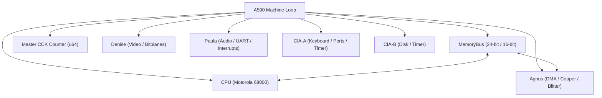
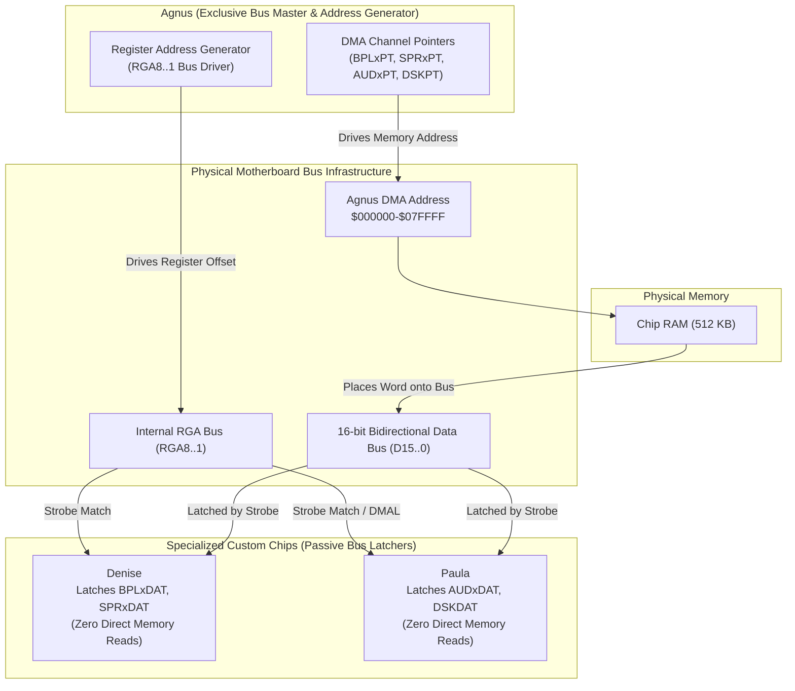

# Amiga 500 General System Architecture

> [!NOTE]
> The [physical bus topology](#11-physical-bus-topology--inter-chip-isolation-invariant) defines how chips stay isolated. The [cross-chip signal catalog](Cross-Chip%20Signals%20and%20Action%20Dispatch%20Catalog.md) defines signal directions and delivery phases.

---

## 1. System Block Diagram & Ownership

The top-level machine struct, A500, owns and coordinates all subsystems.
The diagram shows how the machine connects them without circular handles.

- **Top-Level Machine (A500)** controls stepping for a single CCK, multiple cycles or a full video frame. It also controls reset lines and resolves interrupt priorities (IPL 1–6).
- **Decoupled Modules** exchange signals and bus requests through the main machine loop and MemoryBus. Subsystems hold no references or callbacks to one another.
- **Register Timing & Signal Propagation** keeps motherboard signal delivery
  and downstream engine work in separate phases. [MemoryBus](MemoryBus.md#custom-registers-and-specialized-chips)
  defines delays derived from reference models and the fallback for data writes
  whose timing remains unresolved. It handles accepted reads and address strobes
  immediately. [CIA](CIA.md#runtime-register-capture-and-bus-synchronization)
  keeps its E-clock boundary. Some physical propagation delays remain
  unestablished under these model policies.

### 1.1 Physical Bus Topology & Inter-Chip Isolation Invariant

Before designing or implementing coordination between chips, DMA, the bus,
interrupts or peripherals, read the specifications for the components involved.
The [Machine Loop](Machine%20Loop.md) defines master CCK sequencing. The
[CPU bus-cycle specification](CPU%20Motorola%20M68000.md) defines the
four-clock, two-CCK transfer. [MemoryBus](MemoryBus.md) describes how
contention for Chip RAM keeps the active CPU micro-step pending. For
interfaces, use the
[register ownership matrix](Custom%20Chip%20Register%20Ownership%20and%20Access%20Matrix.md),
[cross-chip signal catalog](Cross-Chip%20Signals%20and%20Action%20Dispatch%20Catalog.md)
and [platform invariants](Platform%20Quirks%20and%20Invariants%20Catalog.md).
For unresolved hardware questions, follow the
[source provenance guide](../../../.agents/skills/TA-Hardware-research/references/provenance.md).

On the motherboard, shared address, data and control lines connect the chips.
The machine loop and memory bus model when signals travel along those lines.

1. **Strict Prohibition of Direct Cross-Chip Signal Smuggling:**
   - Custom chips (`Agnus`, `Denise`, `Paula`, `CIAs`, `CPU`) **must never** hold direct pointers to one another or call one another's mutating methods directly.
   - The machine loop and `MemoryBus` coordinate all inter-chip interactions, including DMA requests, interrupt lines, blanking and strobes. These interactions represent physical copper traces on the motherboard.
2. **Agnus as the Exclusive DMA Address Master:**
   - Agnus is the **sole bus master and address generator** for all autonomous Chip RAM DMA channels (Bitplanes, Sprites, Audio, Floppy Disk, Copper, and Blitter).
   - The supported 8370 and 8371 models address the lower 512 KB for DMA. The
     [Agnus specification](Agnus.md) defines the 18-bit OCS word addresses,
     their shared mask and the rules for the two register halves.
   - Agnus places the memory address on the Chip RAM address bus. At the same time, it asserts the target custom register offset on the internal Register Address (`RGA`) bus.
3. **Specialized Custom Chips as Passive Bus Latchers (Zero Direct Memory Reads):**
   - Denise and Paula own their receiving latches. Their implementations
     must not hold direct Chip RAM views or `PhysicalMemory` references. For
     [disk DMA](DMA.md), Agnus supplies the address in both directions. Paula
     supplies or receives the holding-register word.
   - Specialized chips **never initiate autonomous memory reads**. In an assigned DMA slot, the memory system reads a 16-bit word from Chip RAM and places it on the shared data bus. When the receiving chip sees a matching `RGA` strobe, it latches the word into its internal holding register (`BPLxDAT`, `SPRxDAT`, `AUDxDAT`, `DSKDAT`).
4. **`MachineLoop` as Motherboard PCB Simulator:**
   - After producers finish their work, the top-level `A500Machine` resolves the wired signals. Each recipient owns its incoming inputs and samples them at the explicit [Machine Loop phases](Machine%20Loop.md#connections-advanced-within-the-step).
   - CIA IRQ, Agnus INT3, TOD, connector controls and status, and RGA synchronization all cross that boundary. The receiver detects edges or samples input levels. The motherboard delivers the physical pin signal without substituting a register write.
   - Granted RGA/data words travel through the existing MemoryBus and register queues. The output is held until acceptance. Disk and audio requests travel through DMAL, and the target chip accepts the register data. Chips may neither notify peers directly nor mutate them directly.

---

## 2. Workspace Crate Architecture & Dependencies

The Cargo workspace keeps chip and peripheral crates under `crates/`.
Each contained engine is a Rust module within the crate that owns it.
An engine can have its own design chapter without a separate Cargo package.

Direct dependencies between workspace crates must follow the rules in
[`APPROVED_CRATE_DEPENDENCIES`](../../../tools/verification/checks/check_architecture.py).
The permissions distinguish production, test and build dependencies. The
architecture test checks Cargo metadata for each target platform, including
aliases and optional dependencies. Verification requires an explicit rule
for a new crate or dependency. Re-exports count as dependencies. If you remove
an unused dependency, you may also remove its declaration.

The [save format](Application/SaveState.md) uses the
[Machine Loop](Machine%20Loop.md) at a higher level. The save format handles JSON and PNG previews. Frontends handle file
access, and the core provides pure snapshots and transports signals. Subsystems have no dependency on the save
format. Agnus owns the beam counters. Receivers synchronize through RGA
events without receiving a projection of those counters.

```mermaid
graph TD
    classDef top fill:#0f2537,stroke:#38ef7d,stroke-width:2px,color:#ffffff;
    classDef core fill:#1e3a5f,stroke:#4f9da6,stroke-width:2px,color:#ffffff;
    classDef chip fill:#2d1b4e,stroke:#9d4edd,stroke-width:2px,color:#ffffff;
    classDef subchip fill:#3b1e36,stroke:#f72585,stroke-width:1px,color:#ffffff;
    classDef periph fill:#1b3b22,stroke:#52b788,stroke-width:2px,color:#ffffff;
    classDef tool fill:#3d2c40,stroke:#d16ba5,stroke-width:2px,color:#ffffff;

    subgraph TopLevel["Top-Level Machine Chassis"]
        ML["machine_loop<br/><code>crates/machine_loop</code>"]:::top
    end

    subgraph MemoryAndCPU["Memory Storage & CPU Core"]
        CFG["config<br/><code>crates/config</code>"]:::core
        PMEM["physical_memory<br/><code>crates/physical_memory</code>"]:::core
        MBUS["memory_bus<br/><code>crates/memory_bus</code>"]:::core
        RTC["rtc<br/><code>crates/rtc</code>"]:::core
        CPU["m68000<br/><code>crates/cpu</code>"]:::core
    end

    subgraph CustomChips["Custom Chip Coordinators & Coprocessors"]
        AGNUS["agnus<br/><code>crates/agnus</code>"]:::chip
        COP["agnus::copper module<br/><code>crates/agnus/src/copper.rs</code>"]:::subchip
        BLT["agnus::blitter module<br/><code>crates/agnus/src/blitter.rs</code>"]:::subchip
        DMA["agnus::dma module<br/><code>crates/agnus/src/dma.rs</code>"]:::subchip

        DENISE["denise<br/><code>crates/denise</code>"]:::chip
        SPR["denise::sprites module<br/><code>crates/denise/src/sprites.rs</code>"]:::subchip
        FB["frame_builder<br/><code>crates/frame_builder</code>"]:::subchip

        PAULA["paula<br/><code>crates/paula</code>"]:::chip
        AUD["paula::audio module<br/><code>crates/paula/src/audio.rs</code>"]:::subchip
        INTR["paula::interrupts module<br/><code>crates/paula/src/interrupts.rs</code>"]:::subchip

        CIA["cia (A & B)<br/><code>crates/cia</code>"]:::chip
    end

    subgraph Peripherals["Peripherals & Input Devices"]
        GP["game_ports<br/><code>crates/game_ports</code>"]:::periph
        MOU["game_ports::mouse module<br/><code>crates/game_ports/src/mouse.rs</code>"]:::subchip
        JOY["game_ports::joystick module<br/><code>crates/game_ports/src/joystick.rs</code>"]:::subchip
        FLP["floppy<br/><code>crates/floppy</code>"]:::periph
        KBD["keyboard<br/><code>crates/keyboard</code>"]:::periph
    end

    subgraph Diagnostics["Diagnostics, Debugger & GUI"]
        DIS["disassembler<br/><code>crates/disassembler</code>"]:::tool
        DBG["debugger<br/><code>crates/debugger</code>"]:::tool
        SAVE["save_state<br/><code>crates/save_state</code>"]:::tool
        GUI["gui<br/><code>crates/gui</code>"]:::tool
        TR["test_runner<br/><code>crates/test_runner</code>"]:::tool
    end

    SAVE --> ML
    DBG --> SAVE

    %% Chassis Ownership & Routing
    ML --> CPU
    ML --> PMEM
    ML --> MBUS
    ML --> AGNUS
    ML --> DENISE
    ML --> PAULA
    ML --> CIA
    ML --> FLP
    ML --> KBD
    ML --> GP
    ML --> RTC

    %% Contained modules and the retained frame_builder crate
    AGNUS --> COP
    AGNUS --> BLT
    AGNUS --> DMA

    DENISE --> SPR
    DENISE --> FB

    PAULA --> AUD
    PAULA --> INTR

    GP --> MOU
    GP --> JOY

    %% Memory & Bus Connections
    PMEM --> CFG
    FLP --> CFG
    PAULA --> CFG
    PMEM --> RTC
    MBUS --> PMEM
    CPU --> PMEM
    CPU --> CFG

    %% Tooling Dependencies
    DBG --> CPU
    DBG --> PMEM
    DBG --> DIS
    GUI --> DBG
    GUI --> KBD
    TR --> CPU
    TR --> PMEM
    TR --> DIS
```

The diagram shows ownership and selected connections. A node for an
internal module denotes part of its owning crate. For direct dependencies,
see the current Cargo manifests and the architecture check described above.

The GUI uses the keyboard's named modifier keycodes when it translates host
key events, so both share the same encodings. The machine owner still
applies all input events.

### Workspace layout

Keep crates flat under `crates/*`. Each library declares
`src/<crate_directory>.rs` as its Cargo target. Workspace crates and helper
tools use named roots. `lib.rs` is prohibited.

The machine facade exposes peer subsystems side by side to frontends.
Collaboration alone does not justify peer-to-peer re-exports. The shared
`config` crate provides a foundation for the workspace.

Put each contained engine in a module of its owner. Agnus owns Copper,
Blitter and DMA. Denise owns sprites. Paula owns audio and interrupts.
Game Ports owns mouse and joystick. Use flat source files with subsystem
prefixes. Re-export subsystem namespaces and useful primary types explicitly.
Glob exports are prohibited. Owners still re-export retained child crates,
such as Denise's `frame_builder`.

The [CPU instruction source layout](CPU%20Motorola%20M68000.md#instruction-source-layout)
defines the exact instruction file groupings. Follow the
[internal migration contract](../../../.agents/references/internal-migrations.md)
before changing an interface or generated format.

### Chipset design chapters

[Agnus](Agnus.md) owns the [DMA](DMA.md), [Copper](Copper.md) and
[Blitter](Blitter.md) chapters. [Denise](Denise.md) owns [Sprites](Sprites.md)
and uses the separate [Frame Buffer](Frame%20Buffer.md) component.
[Paula](Paula.md) owns [Audio](Audio.md) and [Interrupts](Interrupts.md).
[Game Ports](Game%20Ports.md) owns [Mouse](Mouse.md) and [Joystick](Joystick.md).
Each chapter retains the hardware contract and references for its part of
the design. Its `tracked_paths` point to files and tests in the owning crate.

---

## 3. External Interfaces & Data Flow

- **ROM & Disk Injection** supplies Kickstart ROM images and disk buffers from outside the emulator as raw byte slices (&[u8]).
- **Decoupled Host I/O**
  - The video renderer writes to a dedicated frame buffer.
  - Audio output goes to separate sample ring buffers.
  - Save states serialize machine state to JSON and restore it from JSON. They exclude the live [RTC](RTC.md) and its separately persisted battery offset. See [SaveState.md](Application/SaveState.md).

---

## 4. Subsystem Reference Links

The subsystem notes describe the hardware behavior to reconstruct and cite
the Amiga manuals that explain it. The Rust source links point to the
current implementation. Check what the implementation covers before drawing
conclusions about a hardware path described here.

- [CPU Motorola M68000.md](CPU%20Motorola%20M68000.md): External CPU state, bus interface, prefetch, exceptions, interrupts, and startup.
- [CPU Micro-Step State Machine.md](CPU%20Micro-Step%20State%20Machine.md): Internal microsteps, CCK bus phases, waits, and execution state.
- [CPU SingleStepTests.md](Verification/CPU%20SingleStepTests.md): Verification suite against Tom Harte software-generated reference vectors.
- [CPU Instruction Benchmarking.md](Performance/CPU%20Instruction%20Benchmarking.md): CPU performance test workloads, measurement analysis, and compatible-run comparison limits.
- [Machine Loop.md](Machine%20Loop.md): Machine stepping, reset sequence, and interrupt arbitration.
- [MemoryBus.md](MemoryBus.md): 2-phase CCK arbitration, address decoding, and DMA contention.
- [Physical Memory.md](Physical%20Memory.md): Installed RAM and ROM banks, boot overlay, open-bus behavior, and CPU memory contention.
- [Agnus.md](Agnus.md): Master beam counters, DMA arbiter, Copper, and 4-channel Blitter.
- [Denise.md](Denise.md): Video pixel serializer, bitplanes, sprites, palette, and collisions.
- [Paula.md](Paula.md): 4-channel DMA audio, floppy disk MFM controller, serial UART, and central interrupt multiplexer.
- [CIA.md](CIA.md): Dual MOS 8520 Complex Interface Adapters (timers, TOD, SDR, parallel & control ports).
- [SaveState.md](Application/SaveState.md): State serialization model.
- [Configuration.md](Configuration.md): Machine configuration, RAM sizes, chipset models, and ROM injection.
- [Debugger.md](Application/Debugger.md): Headless debugger backend, stepping, breakpoints, and disassembler.
- [GUI.md](Application/GUI.md): Frontend role, game and debugger views, intended input and output paths, scaling, and themes.
- [Joystick.md](Joystick.md): Game port digital/analog joysticks, 4-player parallel adapter, and host gamepad mapping.
- [Game Ports.md](Game%20Ports.md): Dual 9-pin controller ports (Port 1 & Port 2), signal routing across Denise, Paula, and CIA-A, and host event routing.
- [Mouse.md](Mouse.md): Amiga 500 mouse connected to a game port.
- [Keyboard.md](Keyboard.md): Independent keyboard controller, CIA-A serial reading, A500 reset, and the power LED's audio-filter connection.
- [Floppy.md](Floppy.md): Drive behavior integrated with disk-related registers and signals from CIA-A, CIA-B, Paula, and Agnus.
- [RTC.md](RTC.md): OKI MSM6242B real-time clock, battery-backed registers, BCD calendar, and 24/12h timing.
- [Platform Quirks and Invariants Catalog.md](Platform%20Quirks%20and%20Invariants%20Catalog.md): Centralized master catalog of hardware idiosyncrasies, silicon timing traps, and anti-tamper invariants across CPU, chipset, and memory bus.
- [Cross-Chip Signals and Action Dispatch Catalog.md](Cross-Chip%20Signals%20and%20Action%20Dispatch%20Catalog.md): Closed silicon signal space, inter-chip bus propagation latencies, conflict resolution, and action dispatch matrix.
- [Custom Chip Register Ownership and Access Matrix.md](Custom%20Chip%20Register%20Ownership%20and%20Access%20Matrix.md): Column definitions and table format for documenting custom register ownership, access, propagation, and timing.
- [Testing Strategy and Quality Assurance.md](Verification/Testing%20Strategy%20and%20Quality%20Assurance.md): 3-Tier Testing Architecture, external tests/ architecture, and verification tooling.
