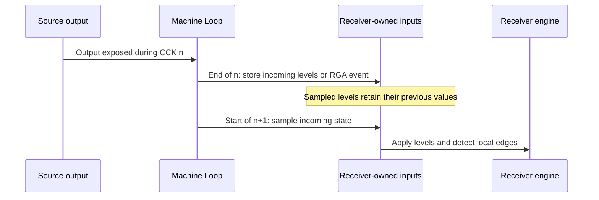

# Machine Loop

The machine loop advances the emulated Amiga 500 one Color Clock (CCK) at a
time. It also decides when to sample and deliver bus data, interrupt
requests, reset and peripheral pin levels, and other modeled signals.
Components exchange these signals through the machine loop and handle their
effects locally. Each component keeps ownership of its own behavior, and
the loop connects components without direct calls between them.
[`A500Machine`](../../../crates/machine_loop/src/machine_loop.rs)

The machine owns the CPU, physical memory, Agnus, Denise, Paula, both CIAs,
the RTC, floppy controller, keyboard, and game ports. Its `cck` field counts
executed Color Clock steps. It creates a temporary router over the owned
components for CPU accesses and Copper custom-register writes.
[`MemoryBus`](MemoryBus.md)

Agnus determines Chip RAM contention and DMA activity. The DMA specification
defines its slot schedule and arbitration. [Agnus](Agnus.md) and [DMA.md](DMA.md)

## One Color Clock

`A500Machine::step_cck()` runs the following operations in order.

1. Keep the previously captured `keyboard_reset_asserted` value locally.
   Increment the wrapping master `cck` counter and pass the new timestamp
   to shared memory. Then advance the non-CPU subsystems.
2. If the delivered motherboard keyboard reset input is asserted, perform a
   warm reset and return `false` without stepping the CPU in that call.
3. Otherwise, record the CPU's current `RESET` output, create a `MemoryBus`
   over the machine components, and advance the CPU by one CCK phase.
4. If the CPU newly asserted `RESET` during that phase, reset the external devices
   while preserving the CPU's registers and program counter.

The return value says whether the CPU completed an instruction during the
step. The non-CPU components continue to advance while the CPU is waiting
or stopped, subject to the keyboard reset path above. All stepping APIs
drive this same loop. `step_cycles`, `step_instruction`, `step_line`, and
`step_frame` repeat `step_cck()` until they reach their respective CCK count,
CPU instruction completion, Agnus line transition, or Agnus frame transition.

## Connections advanced within the step

After the producers finish CCK n, the coordinator captures and routes their
outputs. Recipients sample those values before their steps in n+1. This
applies to CIA IRQ to Paula INT2/INT6, Agnus completion to INT3,
synchronization clock edges to CIA TOD, drive control and status, keyboard
reset, and the previously captured disk, DMAL, and RGA paths. Once the
coordinator has routed a value, later changes at the source leave it intact.
Transport continues while the CPU is stopped or waiting. Each chip owns its
sampled levels and edge history.

The coordinator samples independent game-port direction and quadrature,
FIRE, and digital POT button levels directly during the current CCK input
phase. Their timestamps already represent arrival at the receiver pins.
They use no extra pending copy or wire-delay stage. The receiving chip
still handles decoding and protocol timing.

Paula applies due register writes, then samples its delivered active-low
interrupt inputs. If a CPU clear of INTREQ commits in the same CCK that
Paula samples an asserted input, the input reasserts INTREQ. Sampling a
released input leaves the request latch intact. Transport now supplies
the delay that the synthetic interrupt-register event used to provide.
That event and its reserved queue slot have been removed, and sampling
uses no additional one-CCK input queue. This order defines the CCK model.
Silicon timing for the race remains uncalibrated.

The CIA time-of-day counter (TOD) counts a delivered positive edge instead
of receiving a direct tick_tod call from the coordinator. The existing beam
engine provides CCK edge markers. Synchronization goes low at the final CCK
of a line or frame and returns high at the boundary. The same boundary
events still drive the counter, with the wire level and edge history now
represented explicitly. The marker widths describe digital events and omit
the analog video sync waveform. Full source timing and receiver synchronization
remain reconstruction work.

The Fat Agnus pin description defines INT3* as the completion output.
[Fat Agnus pin description](../Reference/A500%20A2000%20Technical%20Reference%20Manual/11%20-%20Section%206%20-%20Fat%20Agnus%20Chip.md)

The vAmiga slow Blitter schedules its BLIT request one DMA cycle later.
This supports an explicit model boundary and leaves the original board's
wire delay unmeasured.
[vAmiga slow Blitter](../../../ref_src/vAmiga/Core/Components/Agnus/Blitter/SlowBlitter.cpp)

The reconstructed Paula samples external interrupt inputs on its own clock
phases. Those phases describe that model. They do not establish silicon latency.
[Reconstructed Paula](../../../ref_src/amiga_replacement_project/paula/Paula.v)

The drive latches MTR when SEL activates, so the hardware manual requires
motor data before select. Tests therefore set MTR in a separate earlier
write and distinguish CIA commitment from connector reception. The one-CCK
sampling boundary defines the order in this model. The manuals give no
such constant for both wires.
[HRM Table 8-5](../Reference/Hardware%20Reference%20Manual/08%20-%20Chapter%208%20-%20Interface%20Hardware.md#table-8-5-disk-subsystem)

Each connection follows its specified delivery phase.

| Connection | Model delivery phase |
| --- | --- |
| Receiver-owned incoming inputs | Before receiver steps in the next CCK |
| Independent game-port digital inputs | At the current CCK input phase, before engine work |
| CIA-A PA0 to Gary OVL | After committed CIA output, before CPU bus access in that CCK |
| CIA-A PA1 to LED/filter indication | Derived on demand from committed PRA/DDRA; no cached board state |
| Paula IPL to CPU | After chip receiver work, before the CPU step in that CCK |
| CPU RESET output | Assertion edge after its CPU phase; reset peripherals once |

The machine stores one `keyboard_reset_asserted` boolean for delivery in
the next CCK. `step_cck()` retains it locally before subsystem work captures
the next source level. If the retained input is asserted, the machine performs
a warm reset before CPU execution. This one-CCK connection uses no second sampled
field or delay queue. The CPU alone holds the delivered IPL input.

Reset cancels pending inputs. Loading a snapshot leaves input sampling and
edge detection to the next modeled step. Paula derives VERTB locally from
the captured RGA sync address, without a decoded vertical-blank event or a
separate VERTB motherboard pin.

The former decoded disk status and request bridges and audio restart bridge
have been removed. Paula encodes requests on DMAL, Agnus owns grants and
addresses, and the common bus delivers audio and disk write words. For disk
reads, the coordinator completes a granted DSKDATR word from Paula into RAM
before advancing the disk pointer.

## Captured connector transport and pending bus words

After all producers finish CCK n, the coordinator resolves the wiring from
source outputs and stores the incoming values in the recipients. At the start
of n+1, it asks each recipient to sample its input before any engine advances.
Incoming values are separate from current levels and edge history. A change
at the source after routing therefore leaves the pending input intact.
Recipients hold these values individually, without a shared PendingPins frame
or per-frame countdown. [`signals.rs`](../../../crates/machine_loop/src/signals.rs)

Independent game-port levels bypass this retention. Once pending inputs and
connector drive levels arrive, the coordinator reads the current devices and
drives CIA-A FIRE, Denise direction and quadrature, and Paula digital POT
inputs. CIA-A drive-status bits still use captured delivery. Legacy decoded
POT counters still use their next-CCK bridge. Direct button sampling leaves
conversion timing and CIA/Paula output delivery on their existing schedule.

The coordinator owns the pending keyboard reset and determines when OVL
takes effect. The model can derive LED brightness and filter enable from CIA-A
PRA/DDRA on demand, without cached machine fields. The chips own interrupt
and TOD input history, disk inputs, game-port drive inputs, and RGA events.
The model still carries decoded POT counters through an explicit bridge
that adds no electrical pins.

The model has no parallel connector or attached parallel device. CIA-A PB
inputs and FLAG and CIA-B external parallel status inputs use released
levels. The motherboard still connects CIA-B PA0/SP and PA1/CNT. Committed
Port A and enabled serial drivers together determine each shared line
level. A driven low reaches both inputs in the next CCK. CIA port registers
and output drivers remain available.

The transport phase defines when a recipient samples a value within the CCK
model. The phase specifies a model boundary. Wire delay
measurements and FPGA synchronization are outside what it represents. The receiver engine has its own
latency. Captured events must hold through routing, and independent
game-port levels must hold through the input phase. Sub-CCK transitions
are below this resolution. CIA-B FLAG detects an INDEX falling edge once.
Acknowledging ICR while INDEX remains low does not trigger another event.

The serial connector is unconnected and has no serial pin state or
transport. Paula retains idle-high RXD in SERDATR, and CIA-B receives
inactive CTS/DSR/CD. UART registers and CIA-B port logic remain available.
The keyboard, CIA, UART, and quadrature engines handle their inputs locally.
Native disk verification checks selected interactions visible to guest
software. [Native disk verification](../../../ROADMAP.md#native-disk-verification)

Attached serial and parallel devices, connector transport, and full
communication verification remain deferred.
[12.4](../../../ROADMAP.md#serial-parallel-device-support)

The Copper, bitplane, and audio/sprite RGA outputs stay at their sources
until every required receiver accepts the delivery by inserting its queue
entry. Inserting all required entries acknowledges the source. Each recipient
then commits its entry after its existing register delay, with no additional
delay for input delivery. If any required slot is unavailable, the owner
stops immediately. The failed delivery leaves the source and every recipient
unchanged. Work already done in that CCK stands, and the failure stops
subsequent CCK work and publication of a completed field.

CPU and Copper writes still share fan-out, and the motherboard router
continues to protect live reads on retry. When a DMA producer has yet to be
reconstructed, tests supply distinct granted words. That establishes the
bus route and leaves the producer's scheduling algorithm unverified.
[MemoryBus](MemoryBus.md)

Snapshots preserve each receiver's incoming inputs, sampled levels,
edge history, and queues. They also preserve board reset state and
unaccepted bus outputs. Loading restores those values without polling,
consuming, delivering, or recapturing them. The next CCK resumes from the
saved boundary. Reset cancels in-flight deliveries and initializes released
inputs before sampling resumes.

Current JSON snapshots must provide every pin field. Construction and
reset initialize released levels. The decoder has no compatibility fallback
for missing fields. The snapshot stores no host handles.

Disk activity is observation metadata that travels separately from the
physical connector pins. After the CPU phase, or at the non-CPU stepping
boundary, the board reuses CIA-B's effective-output notification to record
control events and establish the recipients for subsequent Paula transfers.
Any disk activity from a CPU read in CCK n is recorded for the drives
designated before those controls were captured. Control decoding uses the
drive's motor latch and edge interpretation while leaving the mechanics on
their existing schedule.

Source counters keep events between publications, so the model needs no
activity collector each CCK. Host media changes refresh which recipients
are eligible without generating control events. The GUI owns sustained
indication and hold timing. [GUI](Application/GUI.md)

## RGA synchronization transport

Agnus keeps beam position in its `hpos`/`vpos` counters and field and line
state. In the first refresh slot it exposes an RGA strobe address, and a
long-line marker can occupy the second slot. The motherboard captures the
event after producers step and delivers it before the next receiver step,
at the existing provisional CCK phase.

Both Denise and Paula receive all four sync addresses. The approved Paula
model extends the manual's explicit STRHOR recipient listing. STRLONG
leaves Paula's line phase unchanged. The addresses trigger events. The
receivers get no position structure, persistent sync register values, or
dedicated horizontal-sync wire. [Approved Paula model](Paula.md#rga-synchronization-and-vertb)

Each receiver owns its synchronization state. Denise tracks its display
phase. Paula tracks the horizontal phase and equalization entry for DMAL
and VERTB. The strobe sequence drives those state changes. Instantaneous
beam coordinates would omit that sequence, and the model has no second
automatic beam-counter projection. Exact silicon edge calibration remains
open. [Denise](Denise.md#delivered-timing-and-controller-inputs)

CPU writes use the receiving chip's strobe interface. At accepted selection
they apply the same synchronization operations without a register queue
entry. Snapshots preserve the source output, captured event, recipient
inputs, and local synchronization state.

## Lifecycle around the loop

Construction creates the components from `A500Config` and resets the CPU
against physical memory. It captures released connector levels for the first
delivery and initializes the CPU interrupt level from Paula.

A cold `reset()` resets physical memory, the master counter, chips, and
devices before resetting the CPU. `reset_warm()` uses the physical-memory
warm-reset path to preserve RAM, restores the low-memory overlay, and
restarts the CPU and devices. The CPU asserts its reset output when it
executes a `RESET` instruction. After the CPU phase, the machine calls
`reset_external_devices()` once when it detects a new assertion. That
restores the Kickstart overlay and resets external chips and devices
while preserving RAM and CPU execution state.
[`machine_loop.rs`](../../../crates/machine_loop/src/machine_loop.rs)

All three reset paths stop drive motors while retaining mounted disks,
write protection, and mechanical head and rotation state. The floppy
subsystem owns that lifecycle. All three paths also retain the live RTC,
whose host UTC clock runs independently of CCK stepping.
[Floppy](Floppy.md#autonomous-adf-reads-and-continuation) and [RTC](RTC.md)

The machine owns the snapshots that `save_state()` creates. The snapshot
holds the master CCK, configuration, CPU, memory, chips, and peripherals as
pure values, except for the live RTC. `load_state()` restores those values,
including serialized pin levels and unconsumed output changes. The saved
events stay pending until routing resumes on the next modeled CCK.
Loading neither consumes pending events nor creates duplicates. The
restored configuration determines whether RTC hardware is present. RTC
time, battery offset, calendar latches, and controls remain independent.
[RTC](RTC.md)

The higher-level save_state crate handles version validation, JSON, and PNG
previews. Frontends handle file access. [SaveState.md](Application/SaveState.md)

Denise and the frame buffer component define how video buffers are produced.
[Denise.md](Denise.md) and [Frame Buffer.md](Frame%20Buffer.md)

## Reference Documentation & Upstream Ground Truth

- [`machine_loop.rs`](../../../crates/machine_loop/src/machine_loop.rs): Source of component ownership, CCK ordering, signal dispatch, resets, and stepping APIs described here.
- [`state.rs`](../../../crates/machine_loop/src/state.rs): Defines the pure machine snapshot.
- [`save_state`](../../../crates/save_state/src/save_state.rs): Owns the versioned file envelope, JSON and preview encoding.
- [`signals.rs`](../../../crates/machine_loop/src/signals.rs) and [transport tests](../../../crates/machine_loop/tests/test_signal_transport.rs): Fixed capture/delivery phases, connector direction and serialized continuation checks using deterministic endpoints.
- [General Architecture.md](General%20Architecture.md): Places the coordinator within the machine's component structure.
- [MemoryBus.md](MemoryBus.md): Describes address routing and bus access between the CPU and connected devices.
- [DMA.md](DMA.md): Owns the Agnus transfer schedule and Chip RAM arbitration details.
- [Cross-Chip Signals and Action Dispatch Catalog.md](Cross-Chip%20Signals%20and%20Action%20Dispatch%20Catalog.md): Records the wider set of modeled inter-chip connections.
