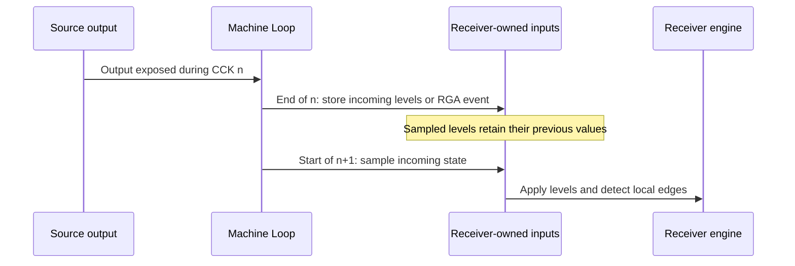

# Machine Loop

[`A500Machine`](../../../crates/machine_loop/src/machine_loop.rs) is the top-level owner and clock coordinator of the emulated Amiga 500. Its main loop advances the machine one Color Clock (CCK) at a time. It also carries outputs between components that do not directly own or call one another: bus data, interrupt requests, reset lines, peripheral pins, and other modeled hardware signals. The loop determines when those connections are sampled and delivered; each component implements its own internal behavior.

The machine owns the CPU, physical memory, Agnus, Denise, Paula, both CIAs, the RTC, floppy controller, keyboard, and game ports. Its `cck` field counts executed Color Clock steps. [`MemoryBus`](MemoryBus.md) is a temporary router over these owned components for CPU accesses and Copper custom-register writes. [Agnus](Agnus.md) determines Chip RAM contention and DMA activity; the slot schedule and arbitration belong to [DMA.md](DMA.md), not to this coordinator.

## One Color Clock

`A500Machine::step_cck()` is the common path used by the stepping APIs. It performs these operations in order:

1. Retain the previously captured `keyboard_reset_asserted` locally, increment the wrapping `cck` counter and call `step_subsystems_cck()`.
2. If the delivered motherboard keyboard reset input is asserted, perform a warm reset and return `false` without stepping the CPU in that call.
3. Otherwise, record the CPU's current `RESET` output, create a `MemoryBus` over the machine components, and advance the CPU by one CCK phase.
4. If that CPU phase newly asserted `RESET`, reset external devices while preserving the CPU's registers and program counter.

The return value says whether the CPU completed an instruction during this step. The non-CPU components advance even when the CPU is waiting or stopped, subject to the keyboard reset path above. `step_cycles`, `step_instruction`, `step_line`, and `step_frame` all repeat `step_cck()` until their respective count, CPU instruction, Agnus line transition, or Agnus frame transition condition is met. These are ways to drive the same machine loop, not separate execution models.

## Connections advanced within the step

The coordinator separates capture, delivery and receiver work. Incoming values routed
after producers finish CCK n are sampled by recipients before their steps in n+1.
This includes CIA IRQ to Paula INT2/INT6, Agnus completion to INT3, synchronization
clock edges to CIA TOD, drive control/status, keyboard reset and the previously
captured disk/DMAL/RGA paths. Independent game-port direction/quadrature, FIRE
and digital POT button levels are sampled directly at the input phase of the
current CCK. Their timestamps already mean arrival at the receiver pins, so
they have no extra pending copy or wire-delay stage. Chip-side decoding and
protocol timing remain receiver responsibilities.
Source changes after routing cannot change those incoming values. Stopped/waiting CPUs do
not stop chip transport. Receiver level and edge history remain chip-owned.

Paula applies due register writes and then samples its delivered active-low
interrupt inputs. A held request can reassert INTREQ after software clears it;
a released pin does not clear the request latch. Sampling after commitment makes
an asserted input win a coincident CPU clear in this CCK model. The old synthetic
interrupt-register event and its reserved queue slot are removed. Transport
replaces that old delay; it is not followed by another one-CCK input queue.
This ordering is explicit model policy, not a calibrated silicon race claim.

TOD counts a delivered positive edge, not a coordinator call to tick_tod.
The retained beam engine exposes CCK edge markers: synchronization goes low
at the final CCK of a line/frame and returns high at the boundary. This retains
the existing boundary-event source model while making its wire and edge history
explicit. Those marker widths do not reproduce the analog video sync waveform;
full source timing and receiver synchronization remain reconstruction work.

The [Fat Agnus pin description](../Reference/A500%20A2000%20Technical%20Reference%20Manual/11%20-%20Section%206%20-%20Fat%20Agnus%20Chip.md)
defines INT3* as the completion output. The [vAmiga slow Blitter](../../../ref_src/vAmiga/Core/Components/Agnus/Blitter/SlowBlitter.cpp)
schedules its BLIT request one DMA cycle later; that supports an explicit model
boundary but does not measure original-board wire delay. The [reconstructed
Paula](../../../ref_src/amiga_replacement_project/paula/Paula.v) also samples
external interrupt inputs on its own clock phases, which cannot be copied as
silicon latency. [HRM Table 8-5](../Reference/Hardware%20Reference%20Manual/08%20-%20Chapter%208%20-%20Interface%20Hardware.md#table-8-5-disk-subsystem)
requires motor data before select: the drive latches MTR when SEL activates.
Tests therefore establish MTR in a separate earlier write and distinguish CIA
commitment from connector reception. The one-CCK sampling boundary remains a CCK-model
ordering choice; the manuals do not specify that constant for both wires.

Some paths have another explicit phase rather than a blanket extra CCK:

| Connection | Model delivery phase |
| --- | --- |
| Receiver-owned incoming inputs | Before receiver steps in the next CCK |
| Independent game-port digital inputs | At the current CCK input phase, before engine work |
| CIA-A PA0 to Gary OVL | After committed CIA output, before CPU bus access in that CCK |
| CIA-A PA1 to LED/filter indication | Derived on demand from committed PRA/DDRA; no cached board state |
| Paula IPL to CPU | After chip receiver work, before the CPU step in that CCK |
| CPU RESET output | Assertion edge after its CPU phase; reset peripherals once |

The machine stores one `keyboard_reset_asserted` boolean for delivery in the
next CCK. `step_cck()` retains it locally before subsystem work captures the
next source level, then performs a warm reset before CPU execution if asserted.
There is no second sampled field or delay queue for this one-CCK connection.
The CPU owns its delivered IPL input; there is no second board copy.
Reset cancels pending inputs; loading a snapshot neither samples an input nor
replays an edge. The decoded vertical-blank event remains explicitly a model
bridge, captured and delivered without inventing a VERTB motherboard pin.
Existing decoded media/audio bridges remain unreconstructed engine interfaces;
they are not electrical wires or proof of complete disk/audio exchange.

## Captured connector transport and pending bus words

[`signals.rs`](../../../crates/machine_loop/src/signals.rs) connects source
outputs to receiver-owned incoming inputs. After all producers finish CCK n,
the coordinator resolves wiring and stores each recipient's incoming values in
that recipient. At the start of n+1 it invokes each recipient's input sampling
before any engine advances. Current levels and edge history stay separate from
incoming values, so source changes after routing cannot alter a pending input.
The independent game-port levels bypass this retention: after pending inputs
and connector drive levels arrive, the coordinator reads the current devices
and drives CIA-A FIRE, Denise direction/quadrature and Paula digital POT inputs.
Drive-status bits on CIA-A keep their captured delivery. Legacy decoded POT
counters also retain their next-CCK bridge; direct button sampling does not
change conversion timing or accelerate CIA/Paula output delivery.
There is no shared PendingPins frame or per-frame countdown.

The coordinator owns the pending keyboard reset and OVL phase. LED brightness
and filter enable can be derived from CIA-A PRA/DDRA when needed; they have no
cached machine fields. Chips own interrupt/TOD input history, disk inputs, game-port drive
inputs and RGA events. Legacy decoded POT counters and the vertical event remain
explicit local bridges, not additional electrical pins. No parallel connector
or attached parallel device is implemented. CIA-A PB inputs and FLAG and CIA-B
external parallel status inputs use released levels. CIA-B PA0/SP and PA1/CNT
remain connected on the motherboard: committed Port A and enabled serial drivers
resolve each shared line, with a driven low delivered to both inputs next CCK.
CIA port registers and output drivers remain available.

The CCK phase establishes deterministic ordering, not a measured delay for every
wire or an FPGA synchronizer model. Receiver engine latency remains separate.
Captured events must hold through routing; independent game-port levels must
hold through the input phase. Sub-CCK transitions remain outside this
resolution. CIA-B FLAG detects an INDEX falling edge once; a held low does
not retrigger after ICR acknowledgment. The serial connector is unconnected,
with no serial pin state or transport: Paula retains idle-high RXD in SERDATR
and CIA-B receives inactive CTS/DSR/CD. UART registers and CIA-B port logic
remain available. Missing keyboard/CIA/UART and quadrature reactions
belong to [2.4](../../../ROADMAP.md#chipset-reconstruction), including complete
UART and CIA parallel port/strobe/FLAG logic with disconnected inputs.
Attached serial/parallel devices, connector transport and full communication
verification remain deferred to [12.4](../../../ROADMAP.md#serial-parallel-device-support).

Register delivery has a separate acceptance contract: Copper, bitplane and
audio/sprite RGA outputs remain in their source until every required receiver
accepts. Queue insertion acknowledges the source, while commitment occurs only
after the existing recipient delay. A receiver with no capacity leaves the
output untouched; other chips, incoming inputs and CPU waiting still advance.
No extra input delay is added to those register queues. The shared
CPU/Copper fan-out and live-read retry protection from [MemoryBus](MemoryBus.md)
remain unchanged. Tests use distinct granted words when a DMA producer is still
unreconstructed; that proves the bus route, not its scheduling algorithm.

Snapshots include receiver-owned incoming inputs, sampled levels and edge
history, board reset state and unaccepted bus outputs, together with
recipient queues. Loading
does not poll, consume, deliver or recapture them; the next CCK resumes at the
same boundary. Reset cancels in-flight deliveries and initializes released
inputs before further sampling. Current JSON snapshots must contain all pin
fields; there is no fallback for snapshots that omit them. Released levels
come from construction/reset, not a compatibility decoder. There are no
serialized host handles.

## RGA synchronization transport

Agnus retains beam position in its `hpos`/`vpos` counters and field/line state.
Denise and Paula do not receive a position structure. Agnus exposes an RGA strobe address
in its first refresh slot; a long-line marker can occupy the second slot.
The motherboard captures that event after producers step and delivers it
before the next receiver step, preserving the existing provisional CCK phase.
STREQU/STRVBL/STRHOR reach Denise; STRLONG is a separate event. The documented
STRHOR recipient also includes Paula. These are address-triggered events,
not four persistent register values or a dedicated horizontal-sync wire.

Each receiver owns its synchronization state. A minimal local cursor preserves
the existing rendering boundary; full equalization, field and pixel timing
remain chipset reconstruction work. CPU writes use named strobe interfaces
and apply the same receiver synchronization operations at accepted selection,
without a register queue entry.
There is no second automatic beam-counter projection. The source output, captured
event, recipient inputs and local synchronization state all belong to snapshots.
Instantaneous beam coordinates and a stream of strobes are not interchangeable.

## Lifecycle around the loop

Construction creates the components from `A500Config`, resets the CPU against physical memory, captures released connector levels for the first delivery, and initializes the CPU interrupt level from Paula. A cold `reset()` resets physical memory, the master counter, chips, and devices before resetting the CPU. `reset_warm()` preserves RAM through the physical-memory warm-reset path and restarts the CPU and devices with the low-memory overlay restored. A CPU `RESET` instruction takes a narrower path: `reset_external_devices()` re-engages the Kickstart overlay and resets external chips and devices without clearing RAM or resetting CPU execution state. These are distinct operations in [`machine_loop.rs`](../../../crates/machine_loop/src/machine_loop.rs).

The machine also owns whole-machine snapshots: `save_state()` captures the clock, configuration, CPU, memory, chips, and peripherals as pure values; `load_state()` restores those components, and retains serialized pin levels and unconsumed output changes. Output routing resumes on the next modeled CCK; loading does not consume an event or synthesize a second one. The higher-level save_state crate owns version validation, JSON/files and PNG previews; its boundary is described in [SaveState.md](Application/SaveState.md). Video buffer production belongs to [Denise.md](Denise.md) and [Frame Buffer.md](Frame%20Buffer.md).

## Reference Documentation & Upstream Ground Truth

- [`machine_loop.rs`](../../../crates/machine_loop/src/machine_loop.rs): Source of component ownership, CCK ordering, signal dispatch, resets, and stepping APIs described here.
- [`state.rs`](../../../crates/machine_loop/src/state.rs): Defines the pure machine snapshot.
- [`save_state`](../../../crates/save_state/src/save_state.rs): Owns the versioned file envelope, JSON, file I/O and preview encoding.
- [`signals.rs`](../../../crates/machine_loop/src/signals.rs) and [transport tests](../../../crates/machine_loop/tests/test_signal_transport.rs): Fixed capture/delivery phases, connector direction and serialized continuation checks using deterministic endpoints.
- [General Architecture.md](General%20Architecture.md): Places the coordinator within the machine's component structure.
- [MemoryBus.md](MemoryBus.md): Describes address routing and bus access between the CPU and connected devices.
- [DMA.md](DMA.md): Owns the Agnus transfer schedule and Chip RAM arbitration details.
- [Cross-Chip Signals and Action Dispatch Catalog.md](Cross-Chip%20Signals%20and%20Action%20Dispatch%20Catalog.md): Records the wider set of modeled inter-chip connections.
