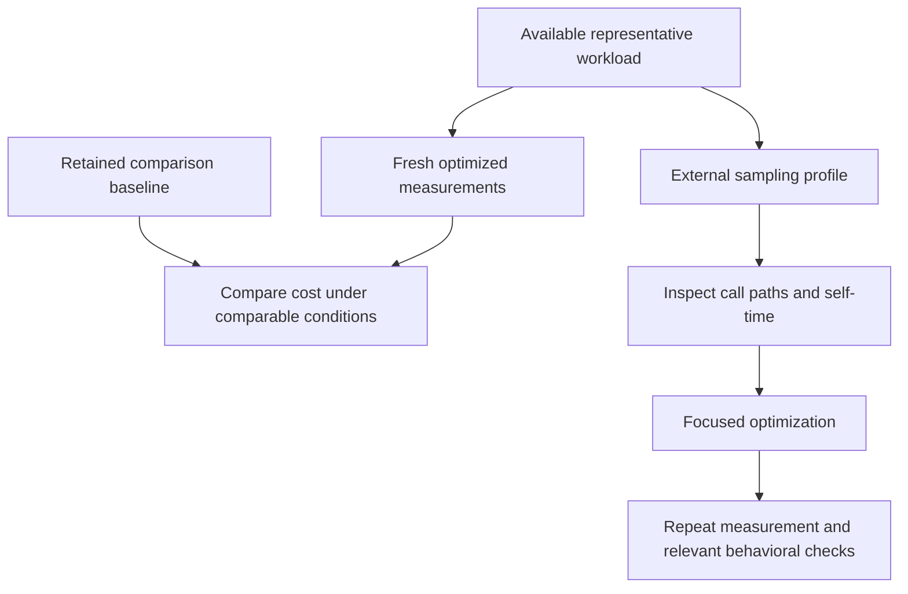

# Performance Profiling & Optimization Strategy

Performance evidence combines fresh workload measurements with sampling profiles.
Measurements answer how much host time a workload consumes; profiles help explain
where it is spent. Neither establishes emulated timing correctness, which belongs
to behavioral and silicon assertions. Shared obligations are in
[AGENTS.md](../../../../AGENTS.md).

## Available Workloads and Boundaries

CPU instruction measurements use the Cargo benchmark target in
[`crates/test_runner/benches/bench_instructions`](../../../../crates/test_runner/benches/bench_instructions).
Program generation, timing, statistics and report persistence follow
[CPU Instruction Benchmarking](CPU%20Instruction%20Benchmarking.md).
The approved CSV and JSON baseline in `benchmarks/` records the first complete
default-parameter CPU performance test catalog run. Comparable completed, locally available
full runs provide previous-run timing comparisons. The former decoder-derived
baseline remains in Git history and is incompatible with CPU performance test workloads.
Later reference changes require the same evidence and explicit approval.

The previous vAmigaTS execution harness, dependent chipset benchmark and chipset
baseline have been removed. There is currently no executable chipset throughput
comparison or recording command, and no automatic throughput gate in commit or
milestone verification. Whole-machine performance investigation first needs a
representative executable workload that reaches the subsystem being optimized.
CPU-only measurements cannot establish production chipset throughput or FPS.

## Measurement and Sampling Architecture

The profiling launcher builds the optimized Cargo benchmark without execution,
selects the executable reported by that build, and runs it under `samply`.
It stops on build failure or a missing artifact. The launcher is
[profile_benchmark.py](../../../../tools/verification/profile_benchmark.py);
commands and interpretation belong to the
[profile-external skill](../../../../.agents/skills/profile-external/SKILL.md).
Profiling runs explicitly for a requested investigation or optimization rather
than after ordinary edits or as an additional milestone obligation.

## Preserve the Production Execution Path

Core emulation has no host wall-clock I/O. Keep host timers and profiling probes
outside per-CCK CPU, bus and chip execution. Sampling observes the optimized host
program without adding measurement code to those paths. Its own overhead and
sampling variation remain part of interpreting the profile.

Color Clock phases and machine coordination follow
[General Architecture](../General%20Architecture.md) and
[Machine Loop](../Machine%20Loop.md). A host profile cannot prove those phases.

## Interpret Cost and Validate Improvements

Record the source snapshot, host, workload, measurement profile and relevant
settings. Use the same workload and comparable conditions before and after a
change. Confirm that the workload exercises the target subsystem before treating
its results as evidence for that optimization.

Filter sample call paths by symbols present in the profile. Crate boundaries
help locate CPU execution, Agnus coprocessors, Denise video, Paula peripherals
and CIA activity when the workload executes them. Flamegraph width describes
sample share; inverted call trees help separate self-time from caller costs.
The retained method aggregator provides a configured mapping of emulator entry
methods, not automatic coverage of every function. Inspect unmatched samples.

For a measured throughput comparison, the relative change is:

$$\Delta\% = \frac{T_{current} - T_{reference}}{T_{reference}} \times 100$$

Here $T$ is throughput measured for the same workload. A lower percentage share
in a profile is insufficient to establish a gain: compare fresh elapsed cost or
throughput and account for variation. Thresholds and baseline normalization for
CPU measurements belong to the CPU benchmark design; the retired chipset
threshold is not an active gate.

After a focused optimization, repeat the measurements and relevant behavioral
checks. Commit and milestone profiles follow the existing testing policy; they
do not automatically run performance measurements or unavailable capture suites.
Report the measured outcome, checked behavior and remaining workload limits.

Baseline replacement is a separate reference change requiring evidence and
explicit approval under
[spec-compliance.md](../../../../.agents/rules/spec-compliance.md).
The aggregator's retained legacy writing option does not recreate the removed
chipset runner or its baseline. Keep ordinary analysis outputs in ignored
artifact directories.

## Reference Documentation & Upstream Ground Truth

- [CPU Instruction Benchmarking](CPU%20Instruction%20Benchmarking.md): Measurement engine, CPU comparison baselines, statistics and report formats.
- [General Architecture](../General%20Architecture.md): Physical Color Clock synchronization and crate boundaries.
- [Machine Loop](../Machine%20Loop.md): Production machine coordination and execution phases.
- [Profiling Skill](../../../../.agents/skills/profile-external/SKILL.md): Available commands and external profile interpretation.
- [vAmiga Core Architecture Reference](../../../../ref_src/vAmiga-4.5/Core/VAmiga.cpp): Reference machine loop for future whole-machine workload analysis.
