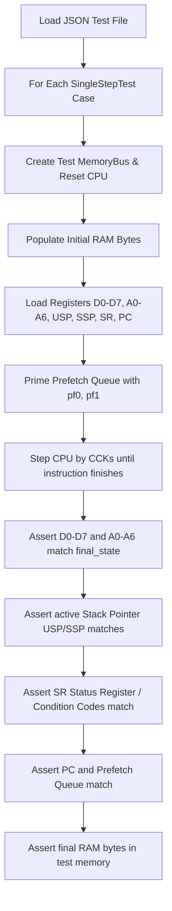

# M68000 SingleStepTests Suite Specification

- **Parent Specification:** [CPU Motorola M68000.md](../CPU%20Motorola%20M68000.md) | [CPU Micro-Step State Machine.md](../CPU%20Micro-Step%20State%20Machine.md)
- **Module Location:** `crates/test_runner/`
- **Engineering Guidelines:** Follow systems rules in [AGENTS.md](../../../../AGENTS.md).

> [!NOTE]
> Operational test running, command shortcuts, and debugging checklists are documented in the [m68k-singlestep-test](../../../../.agents/skills/m68k-singlestep-test/SKILL.md) skill.
> Step-by-step instruction implementation is guided by [add-m68k-instruction](../../../../.agents/skills/add-m68k-instruction/SKILL.md).

This document defines the complete specification and Rust data structures for running the **SingleStepTests** test suites against the M68000 CPU emulator. It specifies validation against:
- The **Tom Harte SingleStepTests-680x0 suite** in [`ref_src/SingleStepTests-680x0/68000/v1/`](../../../../ref_src/SingleStepTests-680x0/68000/v1) (124 `.json` files, ~1,000,000 tests captured directly from physical 68000 silicon pins).

---

## 1. Physical Hardware Silicon Test Suite Overview

To ensure robust, ground-truth verification, the M68000 CPU emulator is validated directly against physical hardware captures:

| Feature | Tom Harte SingleStepTests (Hardware) |
| :--- | :--- |
| **Path** | [`ref_src/SingleStepTests-680x0/68000/v1/`](../../../../ref_src/SingleStepTests-680x0/68000/v1) |
| **File Format** | Plain `.json` |
| **Suite Count** | **124 test files** |
| **Test Scale** | ~8,000+ tests per file (~1,000,000 total) |
| **Origin** | Tom Harte's CLK processor test generator captured on physical 68000 silicon pins |
| **Unique Strengths** | Massive randomized test coverage; independently verified against real hardware |
| **`TAS` Indivisible RMW** | Recorded as explicit `"t"` bus intervals in the reference |
| **`TRAPV` $S$-bit** | ✅ Standard 68000 behavior |
| **Mode Coverage** | 99% Supervisor mode, 1% User mode |

### 1.1 Opcode Packaging Quirk: CMP and CMPM
In the test suite, there are **no separate `CMPM.b.json`, `CMPM.w.json`, or `CMPM.l.json` files**. Instead, all `CMPM (Ay)+, (Ax)+` test cases are bundled together inside `CMP.b.json`, `CMP.w.json`, and `CMP.l.json` alongside standard `CMP <ea>, Dn`.

- The test runner provides [`is_cmpm_postinc_opcode`](../../../../crates/test_runner/tests/common/singlestep_runner.rs) (`(op & 0xF138) == 0xB108`) to isolate `CMPM` cases when specific post-increment testing is required.
- Standard `CMP`, `CMPA`, `CMPI` and isolated `CMPM` cases have tests in [`crates/test_runner/tests/test_singlestep.rs`](../../../../crates/test_runner/tests/test_singlestep.rs). Their presence and earlier state-focused results do not establish a passing result under the current complete comparison path.

### 1.2 Input Scope and Complete Verification

Every executed vector uses one complete comparison path: CPU registers and listed
RAM bytes, instruction clock total and timed bus transactions. The former mode
selector has been removed. Sampling controls input count only; full input selection
removes the ordinary per-suite limit. All 124 JSON files have named tests, including
MOVEP word and long. The old PEA-only stronger-mode sample is redundant and removed.
No vector is counted as passed without execution, including the formerly skipped
ASL byte cases.

Reviewed reference corrections live in the tracked
[`overrides/singlestep/` catalog](../../../../crates/test_runner/tests/overrides/singlestep/README.md).
The [shared vector loader](../../../../crates/test_runner/tests/common/singlestep_vectors.rs)
checks the supported original record's SHA-256 identity and applies only listed
final-state fields before SingleStep filtering or sampling. Missing, ambiguous or changed targets fail loading. The two ASL.b
corrections retain the upstream initial state, RAM, prefetch, transactions and
clock total; the normal comparator executes their corrected vectors. Suite JSON
lists executed override names and summary Markdown counts them separately.
The catalog records the user approval, byte-operation evidence and independent
MAME comparison; the original reference files remain untouched.

The driver steps `Cpu::step_cck` and timestamps memory callbacks from observed CPU
clock progress. Read callbacks occur at the end of CCK1, writes at CCK2 in the core
bus model. Reference internal events advance the expected timeline rather than
being discarded. The matcher checks each callback's phase, direction, address,
size and data; instruction clocks are compared independently with JSON `length`.
Correct total clocks cannot compensate for a misplaced internal delay.

These timestamps observe the existing AddressBus callbacks at CCK resolution.
They do not capture electrical pin edges or function-code signals, which this
interface does not expose. Word/byte strobes are derived from access size and
address; TAS-specific pins and error-cycle pin activity are not independently
observed. Report these boundaries rather than equating the abstract callbacks
with a full hardware pin trace.

The shared comparator primes the initial prefetch state but does not independently
compare final prefetch words. PC can match directly or with the current
four-byte pipeline allowance. Existing RAM exceptions include masked stack-frame
fields and skipped bytes around `SSP`; some address-based exceptions lack a guard
for the specific exception frame. These are current comparison limits, not proof
that differences in all those situations are valid hardware variation. Review
and narrow them only with a focused reproduction and the reference-conflict
procedure in [spec-compliance.md](../../../../.agents/rules/spec-compliance.md).
The implementation is
[`singlestep_runner.rs`](../../../../crates/test_runner/tests/common/singlestep_runner.rs).

Ordinary CPU waiting tests are described in [Section 8](#8-ordinary-cpu-wait-state-tests).
They use an isolated PhysicalMemory-backed fixture; production MemoryBus and
Agnus arbitration require separate integration evidence.

---

## 2. JSON Test Schema

Each `.json` file contains a JSON array of individual test cases: `[ { ... }, { ... } ]`.

SingleStep accepts only this silicon-vector contract. The
[upstream format definition](../../../../ref_src/SingleStepTests-680x0/68000/v1/README.md)
gives `name` no formal meaning; brackets or other description syntax never select
CPU setup or data interpretation.

### 2.1 Example JSON Test Object

The first vector in the authoritative `NOP.json` file illustrates the silicon
format, including its formal PC and six-field read transaction.

```json
{
  "name": "4e71 [NOP] 1",
  "initial": {
    "d0": 1684444070,
    "d1": 4226060612,
    "d2": 137500923,
    "d3": 3212466008,
    "d4": 1847830577,
    "d5": 2468019811,
    "d6": 3045547996,
    "d7": 1084745099,
    "a0": 2743876300,
    "a1": 350947502,
    "a2": 3169095864,
    "a3": 3299346581,
    "a4": 928099050,
    "a5": 1518786414,
    "a6": 2013915490,
    "usp": 1469987768,
    "ssp": 2048,
    "sr": 9985,
    "pc": 3072,
    "prefetch": [
      20081,
      10835
    ],
    "ram": [
      [
        3077,
        121
      ],
      [
        3076,
        6
      ]
    ]
  },
  "final": {
    "d0": 1684444070,
    "d1": 4226060612,
    "d2": 137500923,
    "d3": 3212466008,
    "d4": 1847830577,
    "d5": 2468019811,
    "d6": 3045547996,
    "d7": 1084745099,
    "a0": 2743876300,
    "a1": 350947502,
    "a2": 3169095864,
    "a3": 3299346581,
    "a4": 928099050,
    "a5": 1518786414,
    "a6": 2013915490,
    "usp": 1469987768,
    "ssp": 2048,
    "sr": 9985,
    "pc": 3074,
    "prefetch": [
      10835,
      1657
    ],
    "ram": [
      [
        3077,
        121
      ],
      [
        3076,
        6
      ]
    ]
  },
  "length": 4,
  "transactions": [
    [
      "r",
      4,
      6,
      3076,
      ".w",
      1657
    ]
  ]
}
```

### 2.2 Field Descriptions
| Field | Type | Description |
| :--- | :--- | :--- |
| `name` | `String` | Human-readable description with no execution semantics |
| `initial` | `Object` | CPU state and memory before execution |
| `final` | `Object` | Expected CPU state and memory after execution |
| `transactions` | `Array` | Log of cycle bus transactions (see Section 2.3) |
| `length` | `u32` | Total number of clock cycles taken (assuming immediate DTACK) |

#### State Object Fields (`initial` and `final`):
- `d0`–`d7`: Data registers (`u32`)
- `a0`–`a6`: Address registers (`u32`)
- `usp`: User Stack Pointer (`u32`)
- `ssp`: Supervisor Stack Pointer (`u32`)
- `sr`: Status Register (`u16`) containing condition codes and system flags
- `pc`: Formal Program Counter (`u32`, points to the opcode address at entry and the next instruction at exit). With the two-word prefetch queue primed, the SingleStep fixture sets the initial internal PC to `initial.pc.wrapping_add(4)` and `instruction_pc` to `initial.pc`.
- `prefetch`: Two 16-bit words (`[u32; 2]`) in the CPU prefetch queue (`pf0`, `pf1`)
- `ram`: Array of `[address, byte_value]` pairs (`Vec<[u32; 2]>`)

### 2.3 Bus Transaction Format (`ref_src/SingleStepTests-680x0/`)

The physical hardware test suite logs bus activity as a structured transaction array:

- **Bus Cycle:** `[type, duration, fc, addr, size, data]`
  - `type`: `"r"` (read), `"w"` (write), or `"t"` (**TAS indivisible read-modify-write cycle**).
  - `duration`: Transaction length in clock cycles (typically 4 cycles).
  - `fc`: Function code bits (`bit 0 = FC0, bit 1 = FC1, bit 2 = FC2`).
  - `addr`: 24-bit physical address.
  - `size`: `".b"` (byte) or `".w"` (word).
  - `data`: Value on the data bus (0–255 for byte, 0–65535 for word). For `"t"`, records final byte written.
  - Byte values use the same 0–255 representation at even and odd addresses. UDS/LDS are inferred from size and address, rather than supplied as extra fields or independently observed by the callback recorder.
- **Internal / Idle Cycle:** `["n", duration]`
  - CPU internal execution phases without external bus activity.

The parser extracts the fields needed for comparison from the supplied silicon
records; extra fields are ignored.

### 2.4 Input Contract
The harness assumes the current silicon dataset. Serde requires the declared
fields and value types; unknown object keys are ignored. Transaction arrays are
read according to Section 2.3, without format detection or additional tag and
record-length validation.


---

## 3. Rust Deserialization Data Structures

The structs in [`crates/test_runner/tests/common/schema.rs`](../../../../crates/test_runner/tests/common/schema.rs) derive `Deserialize`:
- **`SingleStepTest`**: Encapsulates test `name`, `initial: CpuTestState`, `final_state: CpuTestState`, `transactions: Vec<serde_json::Value>`, and expected execution `length: u32`.
- **`CpuTestState`**: Deserializes registers `d0..d7`, `a0..a6`, `usp`, `ssp`, `sr`, `pc`, `prefetch: [u32; 2]`, and initial/final `ram: Vec<[u32; 2]>` (`[address, byte]`).

---

## 4. Test Execution Loop

Each test case is executed independently in an isolated test harness:



### 4.1 Step-by-Step Test Runner Logic

1. **Memory Initialization:**
   - Use a lightweight test memory model (e.g. flat byte array or sparse hash map `HashMap<u32, u8>`).
   - Populate test memory with all `[address, byte]` pairs from `initial.ram`.
2. **CPU State Setup:**
   - Load $D_0-D_7$ and $A_0-A_6$.
   - Load $USP$ and $SSP$. Set active $A_7$ based on the Supervisor bit ($S$) in $SR$.
   - Set $SR$, the primed internal $PC$ to `initial.pc.wrapping_add(4)` and the instruction address to `initial.pc`.
   - Prime the internal prefetch buffer: `initial.prefetch[0]` into `cpu.state.ir` and `initial.prefetch[1]` into `cpu.state.prefetch`.
3. **Execute Instruction:**
   - Step the CPU cycle-by-cycle (or CCK-by-CCK) until the current instruction completes.
   - Guard against infinite loops with a timeout threshold (e.g., `length * 2` cycles or max 1,000 cycles).
4. **State Verification:**
   - **Data Registers:** Assert `cpu.d(i) == final_state.d[i]` for $i \in 0..7$.
   - **Address Registers:** Assert `cpu.a(i) == final_state.a[i]` for $i \in 0..6$.
   - **Stack Pointers:** Assert `cpu.usp == final_state.usp` and `cpu.ssp == final_state.ssp`.
   - **Status Register (SR / CCR):** Assert `cpu.sr == final_state.sr`.
   - **Program Counter:** Assert `cpu.pc == final_state.pc`.
   - **Prefetch Queue:** Assert `cpu.prefetch == final_state.prefetch`.
   - **RAM Verification:** Iterate through all `[address, expected_byte]` pairs in `final_state.ram` and assert that the test memory contains the exact byte.
5. **Cycle-by-Cycle Bus Transaction Assertion:**
   - Parse `test.transactions` (`[type, duration, fc, addr, size, data]`) and retain idle intervals in the expected CPU-clock timeline.
   - Compare successful memory callbacks for time, address, access size, direction and data. Reads occur in CCK1 and writes in CCK2; one CCK advances two CPU clocks.
   - UDS/LDS follow address and size; the recorder does not observe these pins independently. Idle intervals constrain callback times rather than asserting pin levels.
6. **Address Error & Exception Handling:**
   - If the test triggers an address error (unaligned word/long access), verify that the CPU:
     1. Pushes the Address Error stack frame (Function Code, Access Address, Instruction Register, Status Register, PC).
     2. Sets the Supervisor bit $S$ in $SR$.
     3. Fetches the exception handler address from Vector 3 (`$00000C`).

---

## 5. Rust Test Harness Implementation (`crates/test_runner`)

The test harness lives in `tests/common/`, shared by the integration test targets of the dedicated workspace package [`crates/test_runner`](../../../../crates/test_runner). It executes test vectors directly against `cpu::Cpu` and a dedicated flat test bus (`TestMemoryBus::new_flat()`):

### 5.1 Module Structure
- **[`schema.rs`](../../../../crates/test_runner/tests/common/schema.rs):** Deserialization of the expected `SingleStepTest` and `CpuTestState` fields from reference JSON.
- **[`singlestep_runner.rs`](../../../../crates/test_runner/tests/common/singlestep_runner.rs):** Test execution loop, CPU prefetch priming, state comparison, cycle count validation, and RAM byte validation:
  - `run_single_test_detail(test, file_path, index) -> Result<(), TestFailure>`: Executes a single case with complete state, clock and timed transaction verification.
  - `run_test_file(path, limit) -> Result<(usize, usize), Box<dyn Error>>`: Reads plain `.json` test suites, running up to `limit` cases with the same complete comparison path.
  - `run_test_file_filtered(path, limit, selection, filter)`: Filters input cases without weakening complete verification and assigns a distinct report identity.
- **[`transactions.rs`](../../../../crates/test_runner/tests/common/transactions.rs):** Parses Tom Harte logs and compares timed memory callbacks, direction, address, size and data. Function codes are parsed but not compared; special TAS and electrical signal limits follow Section 1.2.
- **[`diagnostic.rs`](../../../../crates/test_runner/tests/common/diagnostic.rs):** Human-readable failure reporting, full CCR flag decomposition ($T, S, I, X, N, Z, V, C$), clock/CCK cycle metrics, and transaction diff formatting.
- **[`reporting.rs`](../../../../crates/test_runner/tests/common/reporting.rs):** Shared test helper for persistent results recording in `.agent/tmp/singlestep/`, differential regression detection, and global summary generation. The aggregate test calls it once after all selected instruction groups finish.
- **[`benchmark/`](../../../../crates/test_runner/benches/bench_instructions):** Automated per-opcode instruction micro-benchmarking engine, programmatic unrolled block synthesis ($K = 700$), P-core affinity pinning, and anomaly classifier (see [CPU Instruction Benchmarking.md](../Performance/CPU%20Instruction%20Benchmarking.md)).

### 5.2 CPU State Setup & Execution Flow
Implemented directly in [`crates/test_runner/tests/common/singlestep_runner.rs`](../../../../crates/test_runner/tests/common/singlestep_runner.rs):
- Instantiates a clean [`TestMemoryBus`](../../../../crates/test_runner/tests/common/test_memory_bus.rs) and injects initial RAM vectors via `bus.load_test_ram()`.
- Primes CPU registers $D_0-D_7$, $A_0-A_6$, $USP$, $SSP$, $SR$, and Program Counter (accounting for Tom Harte's $+4$ prefetch offset).
- Initializes `instruction_pc` to the opcode address (`pc - 4` after priming) in SingleStep fixtures, so exception frames preserve the instruction address even on the first executed instruction.
- Primes prefetch queue registers `ir` and `prefetch`.
- Drives SingleStep execution CCK-by-CCK via `cpu.step_cck(&mut bus)` to record observed callback clocks.

---

## 6. Integration Test Suite Structure (`tests/test_singlestep.rs`)

Integration tests reside in [`crates/test_runner/tests/test_singlestep.rs`](../../../../crates/test_runner/tests/test_singlestep.rs). Rather than scattering tests across dozens of individual files, tests use the hardware test helper `run_test("<OPCODE>", limit)`, running and asserting zero failures against:
- **Tom Harte real silicon test suite** (`ref_src/SingleStepTests-680x0/68000/v1/<OPCODE>.json`).

Tests are grouped into cohesive categories within `test_singlestep.rs`:
- **System & Control Flow:** `test_nop`, `test_rts`, `test_trap`, `test_bcc`, `test_jmp`, `test_jsr`
- **Data Movement:** `test_move_b/w/l`, `test_movea_w/l`
- **Integer Arithmetic:** `test_add_b/w/l`, `test_adda_w/l`, `test_sub_b/w/l`, `test_suba_w/l`
- **Logic & Bit Manipulation:** `test_and_b/w/l`, `test_or_b/w/l`, `test_btst`, `test_bset`, `test_bclr`, `test_bchg`
- **Shifts & Rotates:** `test_asl_b/w/l`, `test_asr_b/w/l`, `test_lsl_b/w/l`, `test_lsr_b/w/l`

---

## 7. Running Tests & CLI Commands

Tests execute through Cargo test targets or the verification frontend; SingleStep has one aggregate `#[test]` entry point. Dedicated SingleStep verification uses an optimized `verification` profile with debug assertions, overflow checks and debug symbols enabled. The explicit generic Rust target retains the unoptimized `test` profile for step debugging. Both launcher paths run selected groups in parallel and finalize reports once inside Rust before the final assertion; ordinary crate tests retain their existing profiles. Profile and report invocation details belong to the [verification reference](../../../../tools/verification/README.md#saved-singlestep-reports).

```powershell
# Run all single-step integration tests with default fast sample limit (50 vectors per suite)
python tools/verification/verify.py test rust crate test_runner suite test_singlestep

# Run every vector from all 124 reference files
python tools/verification/verify.py test runner singlestep full

# Run tests with a custom vector limit per suite
$env:SINGLESTEP_LIMIT = "500"; python tools/verification/verify.py test rust crate test_runner suite test_singlestep

# Run sampled SingleStep groups for a specific opcode
python tools/verification/verify.py test rust crate test_runner suite test_singlestep case test_add_b
python tools/verification/verify.py test rust crate test_runner suite test_singlestep case test_move_w
python tools/verification/verify.py test rust crate test_runner suite test_singlestep case test_nop

# Run automated architectural compliance suite
python tools/verification/verify.py check architecture

# Run sampled SingleStep tests for one opcode with saved complete failure diagnostics
python tools/verification/verify.py test runner singlestep case test_add_b sample 50
```

---

## 8. Ordinary CPU Wait-State Tests

CPU waiting runs as ordinary crate coverage in
[`test_cck_bus.rs`](../../../../crates/cpu/tests/test_cck_bus.rs) and
[`test_micro_archetypes.rs`](../../../../crates/cpu/tests/test_micro_archetypes.rs).
The [recording fixture](../../../../crates/cpu/tests/common/mod.rs) wraps
PhysicalMemory and scripts refusals by transfer identity and occurrence.
It records attempts separately from successful transfers, rejecting wrong
address, direction, size, data, order, extra transfers and unused scripts.

Direct handler tables check unchanged latches/state/memory on each refusal and
correct values after release. Engine tests check reads waiting in CCK1, writes
waiting in CCK2 and no memory access in the idle phase. Zero, one and three
refusals exercise no waiting, a single retry and repeated retries. Real
instruction cases cover long halves, postincrement/predecrement, extension and
branch prefetch, stack/exception transfers, RMW, MOVEM and MOVEP. Later transfers
can wait again after earlier successful work. Entry ALU effects must not repeat.
The first refusal can include legitimate setup or MOVEM dummy-state selection;
subsequent refusals retain active state, including step and countdown.

Expected transfers are authored in each fixture, not discovered by a clean run.
Tests count actual bus refusals and require documented base clocks plus two CPU
clocks per refusal. They do not replay every opcode/vector or enumerate memory
placements and DMA schedules. The former Cartesian suite and its exclusive
classification/inversion support are removed. This deliberately reduces vector
and schedule breadth; isolated CPU waits do not establish production arbitration.

```powershell
python tools/verification/verify.py test rust crate cpu
```

## 9. Physical Hardware Silicon Verification & Discrepancy Diagnosis

Physical captures provide independent expected states and bus intervals. Passing selected vectors establishes only the properties and cases actually compared; the observation and assertion limits in Section 1.2 remain applicable:

### 9.1 Key Hardware Invariants Verified by Tom Harte Vectors
| Subsystem / Operation | Physical Silicon Hardware Behavior |
| :--- | :--- |
| **Standard ALU Operations** | Cycle-exact execution across 124 opcodes (~8,000 cases each). |
| **`TAS` Indivisible RMW** | Verified via explicit `"t"` bus transactions with uninterrupted bus ownership. |
| **`ASR` Shift Count > Width** | Shift register exhaustion forces both $C = 0$ and $X = 0$ when $count \ge width$. |
| **`(An)+` Address Error AGU** | $A_n$ increments in AGU as read begins; unaligned read commits incremented $A_n$ before exception trap. |
| **`-(An)` MOVE.l Write Ordering** | Low word decrements to $A_n - 2$ then high word to $A_n - 4$; unaligned write leaves $A_n - 2$. |
| **`LINK A7` Pushed SP** | $SP$ decrements before write latch, correctly pushing $SP - 4$. |
| **`CHK` Flag Preservation** | Prior $N$ flag is preserved when no exception occurs ($N$ undefined in PRM). |

### 9.2 Failure Diagnosis Protocol
When diagnosing a single-step test failure:
1. **Register State Mismatch:** Inspect the reported diff (e.g. `diff == 1` or sign-extension). Verify whether ALU calculation, prefetch queue, or pre/post-increment commitment order is at fault.
2. **Condition Code Register (CCR):** Use the detailed CCR flags decomposition ($X, N, Z, V, C$) to pinpoint exact flag logic.
3. **Cycle Timing Mismatch:** Cross-reference micro-step durations against [CPU Micro-Step State Machine.md](../CPU%20Micro-Step%20State%20Machine.md).

### 9.3 Automated Single-Step Integration Test Matrix
The integration suite in [`crates/test_runner/tests/test_singlestep.rs`](../../../../crates/test_runner/tests/test_singlestep.rs) compares hardware vectors when this target is selected. Commit verification excludes it; milestone and explicit diagnostic commands select it. Each ordinary opcode test invokes `run_test("<OPCODE>", limit)` against:
- **Tom Harte Real 68k Suite** (`ref_src/SingleStepTests-680x0/68000/v1/<OPCODE>.json`)

Currently active tests cover all implemented instructions:
- **System & Control**: `NOP`, `RTS`, `TRAP`, `Bcc` (`BRA`), `JMP`, `JSR`
- **Data Movement**: `MOVE.b`, `MOVE.w`, `MOVE.l`, `MOVEA.w`, `MOVEA.l`
- **Arithmetic**: `ADD.b`, `ADD.w`, `ADD.l`, `ADDA.w`, `ADDA.l`, `SUB.b`, `SUB.w`, `SUB.l`, `SUBA.w`, `SUBA.l`
- **Logic**: `AND.b`, `AND.w`, `AND.l`, `OR.b`, `OR.w`, `OR.l`
- **Bit Manipulation**: `BTST`, `BSET`, `BCLR`, `BCHG`
- **Shifts & Rotates**: `ASL.b`, `ASL.w`, `ASL.l`, `ASR.b`, `ASR.w`, `ASR.l`, `LSL.b`, `LSL.w`, `LSL.l`, `LSR.b`, `LSR.w`, `LSR.l`

---

## 10. Diagnostic Logging & Regression Tracking Architecture

To support autonomous developer and agent workflows, the test runner implements cycle-level diagnostic failure logging and persistent differential regression tracking.

### 10.1 Diagnostic Failure Reports
Whenever a test case fails, the runner produces a formatted diagnostic report containing:
- **Test Identification:** Opcode name, source JSON/GZ file, test vector index.
- **Cycle & Timing:** Exact test length in CPU clock cycles and Amiga CCK cycles ($1\ \text{CCK} = 2\ \text{CPU clocks}$).
- **Decomposed CCR Analysis:** Status Register decoded into human-readable flags ($T, S, I, X, N, Z, V, C$) indicating specifically which flags are unexpectedly SET or CLEARED.
- **Register & Memory Diffs:** Detailed expected vs actual values with decimal offsets for registers ($D_0-D_7, A_0-A_7, PC$) and RAM byte addresses.

### 10.2 Differential Regression Tracker (`.agent/tmp/singlestep/`)
Test outcomes are persisted across runs in the `.agent/tmp/singlestep/` workspace directory:
- `.agent/tmp/singlestep/latest/<suite>.json`: Full test results and failing test names from the most recent run.
- `.agent/tmp/singlestep/previous/<suite>.json`: Prior run snapshot rotated upon execution.
- `.agent/tmp/singlestep/summary.json`: Aggregated repository coverage matrix with pass rates and active failure cases.
- `.agent/tmp/singlestep/summary.md`: Readable summary with totals, all suites, and all failing case names.
- `.agent/tmp/singlestep/diff.md`: Status changes against each suite's previous result and suites without a baseline.

Suite writers persist their own results and rotate their histories without rebuilding global reports. The [aggregate suite helper](../../../../crates/test_runner/tests/common/singlestep_suite.rs) runs the selected instruction groups on bounded worker threads and catches group assertions so failures do not prevent other groups from finishing. It calls the shared reporting function exactly once after workers join, then returns failure to the top-level test if a group or finalization failed. The [SingleStep launcher](../../../../tools/verification/run_singlestep.py) only builds and launches that test, captures diagnostics and checks Rust completion metadata. A killed or aborted process cannot finalize reports; its execution is incomplete. Saved totals may combine executions, while current status and current report/vector counts are identified separately through run metadata.

Full CMP and filtered CMPM use distinct report identities, such as `Real68k::CMP.b` and `Real68k::CMP.b::CMPM`. Differential comparisons require matching selection identities and sample limits. Legacy reports with unidentified selections are retained through history rotation and marked incomparable, including old colliding CMP reports. This prevents an old filtered result from becoming a full-suite baseline.

#### Regression & Improvement Detection:
- 🔴 **Regressions:** Tests that previously passed in `.agent/tmp/singlestep/previous/` but failed in the current run are immediately flagged with `⚠️ [REGRESSION DETECTED]` in the terminal.
- 🟢 **Improvements:** Tests that previously failed but now pass are flagged with `🎉 [PROGRESS / FIX]`.

### 10.3 Automatic Reports and Focused Execution
Open the generated `summary.md` and `diff.md` directly to inspect saved results.
The `test_runner` crate contains integration tests, shared helpers in `tests/common/` and benchmarks. Direct Cargo execution of `test_singlestep` also aggregates reports automatically. The standard libtest runner sees one aggregate test; group filtering uses `SINGLESTEP_CASE`, supplied by the existing verify `case` selector. The [verification reference](../../../../tools/verification/README.md#saved-singlestep-reports) owns exact invocation, parallelism and report-directory isolation.

```powershell
# Run sampled SingleStep tests for one opcode
python tools/verification/verify.py test runner singlestep case test_add_b sample 50
```

---

## 11. Reference Documentation & Upstream Ground Truth

- [68000 User's Manual: Section 8 (16-Bit Instruction Execution Timing & Bus Tables)](../../Reference/68000%20User%27s%20Manual/08%20-%20Section%208%20-%2016-Bit%20Instruction%20Execution%20Timing%20%26%20Bus%20Tables.md): Standard instruction timings and bus operation counts.
- [Tom Harte SingleStepTests-680x0 Suite](../../../../ref_src/SingleStepTests-680x0/68000/v1): Comprehensive randomized test vectors for 68000 CPU.
- [CPU Motorola M68000 Design Specification](../CPU%20Motorola%20M68000.md): Register architecture, condition codes, and processor status.
- [CPU Micro-Step State Machine Specification](../CPU%20Micro-Step%20State%20Machine.md): Color Clock cycle decomposition and microcode execution.
- [SingleStep Test Runner Implementation](../../../../crates/test_runner/tests/common/singlestep_runner.rs): Test loading, memory bus fixture, and assertion logic.
- [Reviewed SingleStep overrides](../../../../crates/test_runner/tests/overrides/singlestep/README.md): Exact-record corrections, their evidence and shared loader contract.
- [SingleStep Integration Test Suite](../../../../crates/test_runner/tests/test_singlestep.rs): Silicon instruction regression tests.
- [SingleStep launcher](../../../../tools/verification/run_singlestep.py): Builds optimized test artifacts, launches the aggregate test and checks Rust completion metadata.
- [Aggregate SingleStep suite](../../../../crates/test_runner/tests/common/singlestep_suite.rs): Joins group workers and calls final report aggregation before returning the overall result.
- [SingleStep reporting helpers](../../../../crates/test_runner/tests/common/reporting.rs): Persist group results and aggregate saved history with current-run metadata.
- [Ordinary CPU Wait Tests](../../../../crates/cpu/tests/test_micro_archetypes.rs): Phase, retry, state and independently counted waiting cost.

