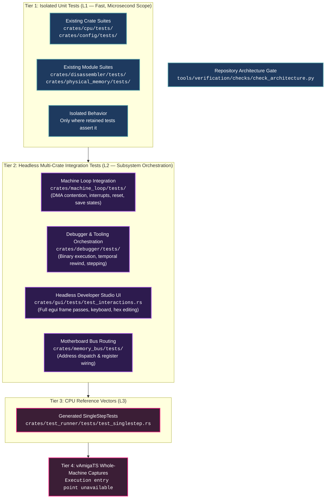

# Amiga 500 Testing Strategy and Quality Assurance

## Completion entry point

Completion uses [verify.py](../../../../tools/verification/verify.py) with
`commit` for ordinary crate tests with coverage, quality gates, all available
standard harness suites, all Python tool contracts and the full English audit.
Standard harness selection excludes the aggregate `test_singlestep` target.
Transaction checker regressions, SingleStep override contracts and the bounded
[JSON mutation pilot](../../../../crates/test_runner/tests/test_singlestep_mutations.rs)
are standard suites. The pilot checks the verifier using selected SingleStep cases;
it does not run the full external suite. If no
standard suites remain, it schedules no Cargo test command. Python contracts
are discovered separately for bootstrap, shared conversion, PDF conversion,
book review, the RAG MCP adapter and verification tooling.

The separate `milestone` profile always runs full SingleStepTests
and the full English audit, including on a clean tree. It does not repeat
commit checks. Stage closure requires both commands once for the same snapshot.
Standalone `test runner singlestep` selects full reference-vector verification for explicit diagnosis or user requests. This synthetic suite uses
TestMemoryBus rather than the production machine.

The [selection implementation](../../../../tools/verification/commands.py)
owns execution profiles; the [test execution reference](../../../../tools/verification/README.md#completion-verification)
describes commands and environment settings. Staging is optional, and completion
evidence must match the final committed source. Ordinary `test python` runs only
contracts affected by changed tool inputs or shared dependencies; explicit
directory selection runs that suite regardless of changed paths.

Scoped design review, vault checks and workflow maintenance use their owning
skills. Milestone semantic review follows [audit-semantic-parity](../../../../.agents/skills/audit-semantic-parity/SKILL.md).
English audit scope and vocabulary approval follow the [language policy](../../../../.agents/rules/language-policy.md).
The aggregate SingleStep test finalizes reports inside Rust after all selected groups finish;
vAmigaTS captures require a future execution entry point. Manual tier commands below are diagnostics,
not additional completion obligations.

## 1. Architectural Purpose & Testing Pyramid

The four tiers describe different evidence boundaries. Ordinary crate and integration tests, external CPU vectors and ordinary CPU wait checks are available. Whole-machine capture execution is deferred until a new entry point exists. Passing one tier establishes only the properties its fixtures and assertions check. Runtime code and external test suites remain separate:

---

## 2. Unit, Integration, and CPU/Bus Verification

Ordinary CPU tests cover phase-specific waiting, stable retries, counted delay,
and transfer side effects through PhysicalMemory and a small recording wrapper.
They do not enumerate SingleStep vectors or DMA schedules; production arbitration
is tested separately. See [CPU wait coverage](CPU%20SingleStepTests.md#8-ordinary-cpu-wait-state-tests).

### Tier 1: Isolated Unit Tests (L1 — Fast, Unit Scope)
- **Scope**: Single crate, single module in complete isolation. Zero multi-chip machine state.
- **Execution Speed**: Depends on the remaining selected crate suites.
- **Execution Command**: `python tools/verification/verify.py test rust unit`
- **Responsibilities**:
  - Bitwise operations, register reads/writes, wrapping arithmetic, and state transitions.
  - Disassembler opcode parsing, effective address modes, and Fibonacci branch heuristics ([`crates/disassembler/tests/`](../../../../crates/disassembler/tests)).
  - CPU instruction, memory, wait-state, and exception behavior ([`crates/cpu/tests/`](../../../../crates/cpu/tests)).
  - Configuration and physical memory behavior ([`crates/config/tests/`](../../../../crates/config/tests), [`crates/physical_memory/tests/`](../../../../crates/physical_memory/tests)).

Custom-chip and peripheral tests should check register behavior, algorithms,
and boundary conditions against HRM-derived expectations in isolated fixtures.
Production-machine integration tests check the cross-chip interactions they
assert, but do not establish those isolated behaviors. [Roadmap step 2.5](../../../../ROADMAP.md)
plans the subsystem coverage.

### Tier 2: Headless Multi-Crate Integration Tests (L2 — Subsystem Orchestration)
- **Scope**: Multi-crate interaction, bus routing, and system loop orchestration.
- **Execution Speed**: 3 to 15 seconds.
- **Execution Command**: `python tools/verification/verify.py test rust integration`
- **Primary Integration Hubs**:
  1. **Machine Loop Nexus ([`crates/machine_loop/tests/`](../../../../crates/machine_loop/tests))**:
     - Step the production machine in CCKs and check CPU progress, bus wait states, register propagation, and DMA contention.
     - Drive Copper, Blitter, Denise, and Paula through machine-visible registers and Chip RAM; check their memory, display, audio, and interrupt effects.
     - Check `DMACON` gating, cross-chip action and signal routing, interrupt priority, and keyboard-to-CIA-to-CPU delivery.
     - Check cold and warm reset, the CPU RESET instruction, RTC stepping, and machine-state save and restore.

#### The 4-Question Integration Checklist (When Tier 2 Tests are Mandatory)

Whenever any custom chip, coprocessor, peripheral device, or interrupt line is added, modified, or refactored:
1. **Control & Strobe Mutation:** Does changing register bits (e.g. `DMACON`, `INTENA`, `COPCON`) gate or trigger execution?
2. **Autonomous Memory Transfer:** Does the subsystem read or write Chip RAM over multiple CCK cycles (Copper, Blitter, Denise, Audio, Floppy)?
3. **Cross-Chip Signal & Interrupt Routing:** Does the subsystem raise an interrupt line, latch status, or send electronic signals to other chips (Paula -> CPU, Agnus -> Denise, CIAs -> CPU)?
4. **Hardware Contention & Wait States:** Does the subsystem compete for Chip RAM slots or stall the CPU?

If any answer is **YES**, identify integration protection for that coordination. Reuse or extend an existing production fixture; add a test only for a demonstrated gap. A module change does not by itself require another test file. Expected results and runtime observation interfaces follow [unit-testing-policy.md](../../../../.agents/rules/unit-testing-policy.md).

#### The 4 Standardized Integration Test Archetypes

1. **Archetype A (Autonomous Progress):** Setup registers/memory -> trigger strobe -> step $N$ CCKs -> assert mutated Chip RAM buffer.
2. **Archetype B (Signal Escalation & CPU Autovector):** Trigger event -> step CCKs -> assert CPU IPL escalation and PC vector branch.
3. **Archetype C (DMA Gatekeeping):** Step with DMA bit set (assert progress) -> step with bit or master `DMAEN` cleared (assert zero progress).
4. **Archetype D (Contention & Concurrency):** Run active Chip RAM transfer -> assert CPU wait states on Chip RAM alongside zero wait states in Fast RAM.

#### Custom Chip Whole-Machine Verification Matrix

| Custom Chip | Integration Behavior to Verify |
| :--- | :--- |
| **Copper** | List execution, beam `WAIT`, `MOVE` to `COLOR00`, DMACON enable/disable, Level 3 IRQ, `SKIP` condition, `CDANG` danger mode |
| **Blitter** | 2D copy & fill in Chip RAM, `BLTSIZE` start, Level 3 `_BLITINT` assertion, CPU bus lockout, Blitter Nasty vs Fast RAM immunity |
| **Denise** | 32-color batch mutation, sprite vertical window, `SPRxDATA` arming, DMA toggling, 1-plane bitplane fetch, display window clipping |
| **Paula** | Audio DMA playback, period scaling, sample buffer generation, Level 4 `AUD0DSR`, multi-interrupt IPL 1-6 arbitration, INTENA masking |
| **DMA Arbiter** | Bitwise SET/CLR in `DMACON`, master `DMAEN` global halt, 1-2 CCK electronic delays, open bus `$FFFF` |
| **CIAs** | Keyboard serial shift to CIA-A `SDR`, Timer A/B underflow Level 2/6 IRQs, horizontal TOD (CIA-B), vertical TOD 50 Hz tick (CIA-A) |

  2. **Debugger & Tooling Nexus ([`crates/debugger/tests/`](../../../../crates/debugger/tests))**:
     - `test_debugger.rs` & `test_stepping_and_session.rs`: Debugger session stepping `machine_loop` and CPU core.
     - `test_sample_binaries.rs`: Injecting compiled M68000 test binaries into RAM and executing instructions.
     - `test_temporal_and_trace.rs`: Time-travel rewind buffer tracking full machine state history.
  3. **Headless Developer Studio UI ([`crates/gui/tests/`](../../../../crates/gui/tests))**:
     - `test_interactions.rs`: Headless UI interaction tests simulating mouse clicks, keyboard shortcuts, memory edits, time-travel scrubbing, view switching.
     - `test_gui.rs` & `test_persistence.rs`: Immediate-mode UI layout, theme loading, dock splits, and window state.
  4. **Motherboard Bus Routing ([`crates/memory_bus/tests/`](../../../../crates/memory_bus/tests))**:
     - `test_router.rs` & `test_register_wiring.rs`: Routing 24-bit physical addresses across chips and storage.

### Tier 3: Generated CPU Reference Vectors and Verification Harness (L3)
- **Scope**: CPU state, instruction clocks and timed callbacks against external 68000 vectors. Ordinary crate tests own focused waiting invariants.
- **Execution Commands**: `python tools/verification/verify.py test runner singlestep` for explicit diagnosis; automatic full-suite selection occurs at milestones.
- **Key Verification Suites**:
  - **Tom Harte SingleStepTests ([`crates/test_runner/tests/test_singlestep.rs`](../../../../crates/test_runner/tests/test_singlestep.rs))**: Every executed vector compares state, instruction clocks and timed bus callbacks. Sampling changes input count only; abstract callback and state-comparison limits remain explicit (see [CPU SingleStepTests.md](CPU%20SingleStepTests.md#12-input-scope-and-complete-verification)).

Repository architecture checks are a separate gate, implemented in
[`tools/verification/checks/check_architecture.py`](../../../../tools/verification/checks/check_architecture.py).
`verify.py check architecture [case FILTER]` runs source and repository inspection
without compiling Rust. Commit verification always includes all 17 controls.
The compiled opcode descriptor coverage check remains in
[`crates/cpu/tests/test_visibility.rs`](../../../../crates/cpu/tests/test_visibility.rs)
and runs with ordinary CPU tests.

---

## 3. Tier 4: Whole-Machine Hardware Capture Verification

Whole-machine verification should load an executable hardware workload, run it
for specified frames, extract the rendered 716 x 285 RGB24 viewport, and compare
it with the vAmigaTS reference images using a validated comparison method.
The execution and comparison entry point is still unavailable, so the reference
assets cannot yet certify current whole-machine output. Neither completion
profile executes captures or chipset throughput measurements.

A requested integration sweep uses the available production machine tests.
Classify failures by observed mechanism, repair demonstrated causes, and rerun
the affected tests. A passing crate or CPU suite cannot substitute for the
missing hardware comparison.

## 4. Diagnose Mechanisms Before Consolidating Fixes

A timing offset or local condition that makes one test pass can conceal the
wrong bus phase, signal propagation or state transition. Reproduce an isolated
failure and establish its mechanism before scaling a fix. Investigate a shared
cause when the evidence connects failures; unrelated defects need not collapse
into one hardware law. Preserve justified state-machine conditions while removing
temporary compensating patches.

When exploratory changes accumulate, compare symptoms, patch locations, and
applied mechanisms to determine whether they share an upstream cause. Scope,
reproduction and reference conflicts follow
[structural-root-cause.md](../../../../.agents/rules/structural-root-cause.md) and
[spec-compliance.md](../../../../.agents/rules/spec-compliance.md).

---

## 5. Select Evidence for the Changed Behavior

Select existing checks for the actual change. The following categories describe available evidence and remaining prerequisites; they are not a sequence to execute after every edit. Commit and milestone profiles use the triggers above.

| Level | Verification Tier | Primary Tool / Command | Pass Criteria |
| :---: | :--- | :--- | :--- |
| **L1** | **Crate Behavior** | `python tools/verification/verify.py test rust crate <crate>` | Selected behavior and failure-mode assertions pass |
| **L2** | **Production Integration** | `python tools/verification/verify.py test rust crate machine_loop` | Existing or extended fixtures protect the affected coordination |
| **L3** | **CPU Vectors and Synthetic Contention** | `python tools/verification/verify.py test runner singlestep` | Selected vectors pass state, clocks and timed bus comparisons; limits reported |
| **L4** | **Whole-Machine Captures** | Unavailable; needs a future execution and comparison entry point | Hardware workload and expected capture comparison |
| **Separate gate** | **Architecture and Quality** | Relevant `check` command; full profile before an authorized commit | Static constraints pass; source review remains necessary |

---

## 6. Structural Conventions & Invariants

1. **Dedicated External `tests/` Directory**:
   - Zero inline tests in `crates/*/src/` (`#[cfg(test)] mod tests` is strictly forbidden).
   - Keeps runtime production code clean, uncluttered, and $\le 800$ lines.
2. **Canonical Test Naming (`test_<name>.rs`)**:
   - In Cargo workspaces, every `.rs` file directly inside `crates/<crate>/tests/` compiles into an independent test binary.
   - All test files must strictly start with `test_` (e.g. `test_align.rs`, `test_singlestep.rs`).
   - Shared non-test helper modules must reside inside subdirectories (e.g. `tests/common/mod.rs`).
3. **Existing Module Suite Layout**:
   - The architecture gate retains required module-suite filenames for selected crates that still have isolated tests. Their presence does not prove behavioral coverage or require a new test file for every added submodule. Current examples:
     - `crates/disassembler`: `test_align.rs`, `test_alu.rs`, `test_branch.rs`, `test_data.rs`, `test_ea.rs`, `test_disassembler_facade.rs`.
     - `crates/config`: `test_config.rs`, `test_mutation.rs`.
     - `crates/physical_memory`: `test_address_bus.rs`, `test_map.rs`, `test_physical_memory.rs`, `test_presets.rs`.
4. **Behavior Coverage**:
   - Existing external test suites must contain an executable test. Crates without isolated suites depend on relevant integration fixtures until new domain tests are authored. Assess the behavior and failure modes actually checked; no assertion-count quota applies.

---

## 7. Automated Verification Tooling

| Tool / Script | Purpose | Enforcement Layer |
| :--- | :--- | :--- |
| [`tools/verification/verify.py`](../../../../tools/verification/verify.py) | Canonical commit/milestone quality gate and diagnostic frontend (`test rust`, `test python`, `test runner`, `check`, `runner`). | Explicit agent/developer command & CI |
| [`tools/verification/checks/check_architecture.py`](../../../../tools/verification/checks/check_architecture.py) | Python checks validating source constraints, test naming and retained required suite files; passing them does not prove behavioral coverage. | `verify.py check architecture` & commit verification gate |
| [`tools/verification/checks/audit_code_quality.py`](../../../../tools/verification/checks/audit_code_quality.py) | Checks dead code, test-only code and accessor conventions. Observed-caller visibility suggestions are advisory because external public API use is outside the repository scan. | `verify.py check code` & commit verification gate |
| [`$test-runner`](../../../../.agents/skills/test-runner/SKILL.md) | Standardized execution runner across tiers, writing snapshots to `.agent/tmp/singlestep/` and diffing regressions. | Codex skill |

---

## 8. Related Architecture Specifications

- [General Architecture.md](../General%20Architecture.md): Amiga 500 system block diagram and crate dependencies.
- [Machine Loop.md](../Machine%20Loop.md): Machine loop cycle stepping, reset sequencing, and interrupt arbitration.
- [CPU SingleStepTests.md](CPU%20SingleStepTests.md): Verification against software-generated instruction reference vectors.
- [CPU Instruction Benchmarking.md](../Performance/CPU%20Instruction%20Benchmarking.md): Host performance measurement framework and retained comparison baselines.
- [Platform Quirks and Invariants Catalog.md](../Platform%20Quirks%20and%20Invariants%20Catalog.md): Centralized master catalog of hardware idiosyncrasies and anti-tamper invariants.
