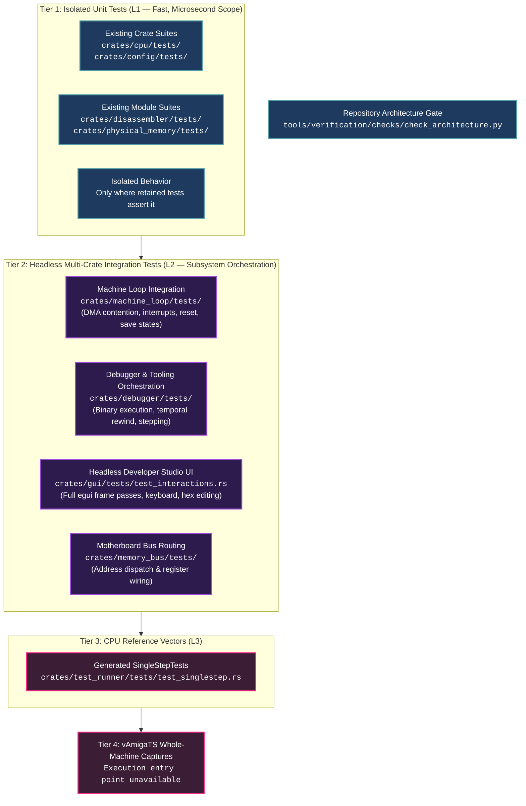

# Amiga 500 Testing Strategy and Quality Assurance

## Completion entry point

The engineer can run focused checks or select the `commit` or `milestone` profile.
The commit profile selects quality checks, the browser build, ordinary tests
and coverage. The milestone profile runs full SingleStep. The engineer can
also request the full vectors for diagnosis or run benchmarks as explicit
measurements. Commit, publication and plan closure are separate operations.
The whole-machine capture comparator is unavailable to either profile.
Select language scans separately through
`python tools/verification/verify.py check english`.

The verification reference defines the commands, profile contents, environment
requirements and failure handling. Its input selection rules determine which
packages and consumers to check, when to check the entire workspace and how
to select Python tool checks. The verifier considers the complete candidate.
That includes staged changes, unstaged changes, new nonignored files and both
paths of a rename. The other inputs stay in scope when the engineer stages a
change.
[Verification reference](../../../../tools/verification/README.md#completion-verification),
[input-selection contract](../../../../tools/verification/README.md#selection-from-changed-inputs)

- The verifier runs the selected ordinary crate tests once under coverage.
  Reports identify the packages, current source and build target. Execution
  coverage shows which code the run reached, with no percentage gate. It
  cannot establish whether assertions are meaningful, whether all platforms
  or branches are covered, or whether behavior matches hardware. The coverage
  criteria govern review of gaps, and the verification reference defines
  diagnostic measurements and artifacts.
  [Coverage criteria](../../../../.agents/references/testing-criteria.md#coverage-and-adequacy-assessment),
  [coverage reference](../../../../tools/verification/README.md#coverage-guided-testing)
- Failed, missing, interrupted or invalidated groups cannot count as passed.
  Each invocation reruns every selected check, even if a saved result shows
  that a group passed earlier. The caller keeps the tested source and execution
  conditions stable and reports interference. The final verdict applies only
  to the complete selected candidate.
- For integrated work, the main session identifies the delivered commit range and
  any selected working changes, including merge resolutions. Checks and reviews
  run in the selected checkout. Ordinary Git integration follows the
  [integration procedure](../../../../.agents/skills/TA-WF-Main-close-task/references/local-integration.md),
  without a frozen comparison copy, publication control record or commit bridge.
- Generated timing reports show how long the work took. Timing data cannot
  certify a pass. A passing verdict requires valid results from the selected
  checks. Build caches may remain. Stale coverage objects and saved SingleStep
  totals cannot establish that the verifier ran the current sources or the
  requested selection.
- Full formatting, Clippy, architecture, hardware/code and frontmatter
  gates remain required by the commit profile. Source discovery for quality checks
  includes production and test JavaScript callers. The production Wasm build
  retains its Nightly shared-memory configuration and lint-warning failure policy.
- The caller isolates shared build and coverage outputs because the verifier
  has no entry-point batch lock or saved-evidence protocol. After an
  interruption, the caller confirms that earlier processes have ended before
  reusing the outputs. The operation uses no lifecycle or Git hooks. The
  execution reference defines scheduling and failure handling.
  [Execution reference](../../../../tools/verification/README.md#bounded-parallel-execution)

When selected, behavior review checks specification compliance within its
assigned scope. A whole-stage parity assignment also covers affected code
and interactions that the change left untouched. It includes a static
comparison of semantics across the full workspace. Evidence from the broader
assignment can satisfy overlapping scoped requirements if it checks the same
requirements. A static pass alone cannot establish semantic parity.
[Behavior review](../../../../.agents/skills/TA-WF-Step-review-behavior/SKILL.md)

When selected, documentation review checks whether documents retain
source-backed knowledge and respect the authority of requirements. It also
performs the full recursive audit of Design links and metadata.
[Documentation review](../../../../.agents/skills/TA-WF-Step-review-docs/SKILL.md)

The mechanical verifier leaves these assessments to independent reviewers
working within the selected scope. They report findings. Repairs, subsequent
stages, and diary and roadmap closure are separate duties. Required gaps still
block readiness even if the caller did not select repairs.
[Independent review](../../../../.agents/references/review-common.md)

Engineers evaluate host pacing, FPS and the guest's graphical presentation
manually. The dedicated automated graphical execution and image campaigns are
retired. Independent CPU, chip, bus, input, host-lifecycle, display-state and
continuation tests remain available. Audio captures still have spectral and
attachment acceptance limits.

### Roadmap and milestone completion

The engineer chooses the scope and verification for milestone closure. The
report identifies completed and unfinished behavior and records the tests,
semantic assessments, documentation, diary and roadmap work actually done.
A passing test profile alone cannot establish that all intended behavior is
complete. Keep unfinished requirements when removing completed roadmap work.
If the engineer selects a stage-wide assessment, review interactions throughout
the stage. Checking only changed files cannot establish that wider coverage.

There is no fixed sequence of review lanes, checkpoints, frozen candidates or
publication receipts. Selected task delivery uses ordinary Git merge and
a separate closure operation. Run final tests and independent review on local
master and verify any corrective commits before closure. Closure preserves
outputs and context, removes the selected merged task resources and refreshes
the project Graphify structure on final master. Failed or incomplete final
evidence blocks closure. If the graph refresh fails, closure is partial and
the completed cleanup stands. The report records the freshness of document
semantics separately from the structural refresh.
[Task closure](../../../../.agents/skills/TA-WF-Main-close-task/SKILL.md)
[Milestone closure](../../../../.agents/skills/TA-WF-Main-close-milestone/SKILL.md) runs the
full milestone profile, removes the selected completed roadmap item after
success and compacts its settled diary history through
[diary compaction](../../../../.agents/skills/TA-WF-Step-compact-diary/SKILL.md).
It then uses [Report Word Usage](../../../../.agents/skills/TA-WF-Step-report-word-usage/SKILL.md)
to rank unusual words in the final project documentation, assess their use in
context and suggest vocabulary exclusions. This editorial report does not change
the test profile or set a word-frequency threshold for completion. The standalone
`verify.py milestone` command runs tests; the milestone skill includes the report.
Ordinary task commits require neither changelog entries nor diary compaction.
Use the artifact tool to preserve useful test reports and other local outputs
before removing the task worktree.
[Artifact tool](../../../../tools/artifacts/README.md)

## 1. Architectural Purpose & Testing Pyramid

Each of the four tiers checks specific properties using its own fixtures and
assertions. A passing result establishes only those properties. Ordinary
crate and integration tests, external CPU vectors and ordinary CPU wait
checks are available. Whole-machine capture execution requires a future
entry point. The emulator's runtime code and external test suites remain
separate.

---

## 2. Unit, Integration, and CPU/Bus Verification

Ordinary CPU tests use PhysicalMemory and a small wrapper that records transfers.
They check the phase in which the CPU waits, stable retries, the delay it counts
and transfer side effects. Their scope excludes SingleStep vectors and DMA
schedules. Separate tests cover production arbitration.
[CPU wait coverage](CPU%20SingleStepTests.md#8-ordinary-cpu-wait-state-tests)

### Tier 1: Isolated Unit Tests (L1 — Fast, Unit Scope)
- **Scope**: Single crate, single module in complete isolation. Zero multi-chip machine state.
- **Execution Speed**: Depends on the remaining selected crate suites.
- **Execution Command**: `python tools/verification/verify.py test rust unit`
- **Responsibilities**:
  - Bitwise operations, register reads/writes, wrapping arithmetic, and state transitions.
  - Disassembler opcode parsing, effective address modes, and Fibonacci branch heuristics ([`crates/disassembler/tests/`](../../../../crates/disassembler/tests)).
  - CPU instruction, memory, wait-state, and exception behavior ([`crates/cpu/tests/`](../../../../crates/cpu/tests)).
  - Configuration and physical memory behavior ([`crates/config/tests/`](../../../../crates/config/tests), [`crates/physical_memory/tests/`](../../../../crates/physical_memory/tests)).

Custom-chip and peripheral tests should use isolated fixtures to check
register behavior, algorithms and boundary conditions against expectations
drawn from the HRM. Production-machine integration tests establish only the
cross-chip interactions they assert. The native disk work extends component
coverage by checking machine outputs for selected original ADF programs
against independent expectations.
[Native disk verification](../../../../ROADMAP.md#native-disk-verification)

The BLEP generator tests cover the numerical helpers and regenerate all four
PAL curves in an isolated directory. They compare every CSV sample with the
accepted files under [`tools/blep_generator/output/`](../../../../tools/blep_generator/output/).
This regression check preserves the accepted curves without network access
or WinUAE sources. It supplies no independent evidence of hardware accuracy.
[BLEP generator tests](../../../../tools/blep_generator/tests/)

The generator can also produce an optional comparison chart when the caller
explicitly supplies a WinUAE table. [Generator reference](../../../../tools/blep_generator/README.md)

### Tier 2: Headless Multi-Crate Integration Tests (L2 — Subsystem Orchestration)
- **Scope**: Multi-crate interaction, bus routing, and system loop orchestration.
- **Execution Command**: `python tools/verification/verify.py test rust integration`
- **Primary Integration Hubs**:
  1. **Machine Loop Nexus ([`crates/machine_loop/tests/`](../../../../crates/machine_loop/tests))**:
     - Step the production machine in CCKs and check CPU progress, bus wait states, register propagation, and DMA contention.
     - Drive Copper, Blitter, Denise, and Paula through machine-visible registers and Chip RAM; check their memory, display, audio, and interrupt effects.
     - Check `DMACON` gating, cross-chip action and signal routing, interrupt priority, and keyboard-to-CIA-to-CPU delivery.
     - Check cold and warm reset, the CPU RESET instruction, RTC stepping, and machine-state save and restore.

#### The 4-Question Integration Checklist (When Tier 2 Tests are Mandatory)

Whenever any custom chip, coprocessor, peripheral device, or interrupt line is added, modified, or refactored:
1. **Control & Strobe Mutation:** Does changing register bits (e.g. `DMACON`, `INTENA`, `COPCON`) gate or trigger execution?
2. **Autonomous Memory Transfer:** Does the subsystem read or write Chip RAM over multiple CCK cycles (Copper, Blitter, Denise, Audio, Floppy)?
3. **Cross-Chip Signal & Interrupt Routing:** Does the subsystem raise an interrupt line, latch status, or send electronic signals to other chips (Paula -> CPU, Agnus -> Denise, CIAs -> CPU)?
4. **Hardware Contention & Wait States:** Does the subsystem compete for Chip RAM slots or stall the CPU?

If any answer is **YES**, identify integration protection for that coordination. Reuse or extend an existing production fixture; add a test only for a demonstrated gap. A module change does not by itself require another test file. Expected results and runtime observation interfaces follow [testing criteria](../../../../.agents/references/testing-criteria.md).

#### The 4 Standardized Integration Test Archetypes

1. **Archetype A (Autonomous Progress):** Setup registers/memory -> trigger strobe -> step $N$ CCKs -> assert mutated Chip RAM buffer.
2. **Archetype B (Signal Escalation & CPU Autovector):** Trigger event -> step CCKs -> assert CPU IPL escalation and PC vector branch.
3. **Archetype C (DMA Gatekeeping):** Step with DMA bit set (assert progress) -> step with bit or master `DMAEN` cleared (assert zero progress).
4. **Archetype D (Contention & Concurrency):** Run active Chip RAM transfer -> assert CPU wait states on Chip RAM alongside zero wait states in Fast RAM.

#### Custom Chip Whole-Machine Verification Matrix

| Custom Chip | Integration Behavior to Verify |
| :--- | :--- |
| **Copper** | List execution, beam `WAIT`, `MOVE` to `COLOR00`, DMACON enable/disable, Level 3 IRQ, `SKIP` condition, `CDANG` danger mode |
| **Blitter** | 2D copy & fill in Chip RAM, `BLTSIZE` start, Level 3 `_BLITINT` assertion, CPU bus lockout, Blitter Nasty vs Fast RAM immunity |
| **Denise** | 32-color batch mutation, sprite vertical window, `SPRxDATA` arming, DMA toggling, 1-plane bitplane fetch, display window clipping |
| **Paula** | Audio DMA playback, period scaling, sample buffer generation, Level 4 `AUD0DSR`, multi-interrupt IPL 1-6 arbitration, INTENA masking |
| **DMA Arbiter** | Bitwise SET/CLR in `DMACON`, master `DMAEN` global halt, 1-2 CCK electronic delays, open bus `$FFFF` |
| **CIAs** | Keyboard serial shift to CIA-A `SDR`, Timer A/B underflow Level 2/6 IRQs, horizontal TOD (CIA-B), vertical TOD 50 Hz tick (CIA-A) |

The debugger, GUI and MemoryBus crates each contain their own integration
suites. Each suite establishes only the interactions its tests assert.
Debugger history stores CPU states. Full-machine rewind remains pending.
[Debugger](../../../../crates/debugger/tests/), [GUI](../../../../crates/gui/tests/),
[MemoryBus](../../../../crates/memory_bus/tests/)

### Tier 3: Generated CPU Reference Vectors and Verification Harness (L3)
- **Scope**: CPU state, instruction clocks and timed callbacks against external 68000 vectors. Ordinary crate tests own focused waiting invariants.
- **Execution Commands**: `python tools/verification/verify.py test runner singlestep` for explicit diagnosis; automatic full-suite selection occurs at milestones.
- **Key Verification Suites**:
  - **Tom Harte SingleStepTests ([`crates/test_runner/tests/test_singlestep.rs`](../../../../crates/test_runner/tests/test_singlestep.rs))**: Every executed vector compares state, instruction clocks and timed bus callbacks. Sampling changes input count only; abstract callback and state-comparison limits remain explicit (see [CPU SingleStepTests.md](CPU%20SingleStepTests.md#12-input-scope-and-complete-verification)).

Repository architecture checks are a separate gate, implemented in
[`tools/verification/checks/check_architecture.py`](../../../../tools/verification/checks/check_architecture.py).
`verify.py check architecture [case FILTER]` runs source and repository inspection
without compiling Rust. Commit verification always includes all 18 controls.
The compiled opcode descriptor coverage check remains in
[`crates/cpu/tests/test_visibility.rs`](../../../../crates/cpu/tests/test_visibility.rs)
and runs with ordinary CPU tests.

---

## 3. Tier 4: Whole-Machine Hardware Capture Verification

Whole-machine verification should load an executable hardware workload and run
it for the specified number of frames. It should then extract the rendered
716 x 285 RGB24 viewport and compare it with the vAmigaTS reference images
using a validated method.

Whole-machine capture execution and comparison are still unavailable. Both
completion profiles exclude captures and chipset throughput measurements.
[External hardware verification work](../../../../ROADMAP.md#external-hardware-verification)

A requested integration sweep uses the available production machine tests.
Classify failures by observed mechanism, repair demonstrated causes, and rerun
the affected tests. A passing crate or CPU suite cannot substitute for the
missing hardware comparison.

## 4. Diagnose Mechanisms Before Consolidating Fixes

A timing offset or local condition that makes a test pass can conceal the
wrong bus phase, signal propagation or state transition. Isolate and reproduce
the failure and determine what causes it before extending the fix. Investigate
a shared cause when the evidence connects failures. Unrelated defects can
have separate hardware explanations. Keep justified state-machine conditions
when removing temporary patches that compensate for the defect.

When exploratory changes accumulate, compare symptoms, patch locations, and
applied mechanisms to determine whether they share an upstream cause. Scope,
reproduction and reference conflicts follow
[defect procedure](../../../../.agents/skills/TA-WF-Step-implement-change/references/defect-resolution.md) and
[spec-compliance.md](../../../../.agents/references/spec-compliance.md).

---

## 5. Select Evidence for the Changed Behavior

The table shows what each check can establish and what it requires. Use it to
choose only the existing checks that apply to the actual change. Follow the
triggers above for commit and milestone profiles.

| Level | Verification Tier | Primary Tool / Command | Pass Criteria |
| :---: | :--- | :--- | :--- |
| **L1** | **Crate Behavior** | `python tools/verification/verify.py test rust crate <crate>` | Selected behavior and failure-mode assertions pass |
| **L2** | **Production Integration** | `python tools/verification/verify.py test rust crate machine_loop` | Existing or extended fixtures protect the affected coordination |
| **L3** | **CPU Vectors and Synthetic Contention** | `python tools/verification/verify.py test runner singlestep` | Selected vectors pass state, clocks and timed bus comparisons; limits reported |
| **L4** | **Whole-Machine Captures** | Unavailable; needs a future execution and comparison entry point | Hardware workload and expected capture comparison |
| **Separate gate** | **Architecture and Quality** | Relevant `check` command. Run the full profile after commit during final master verification. | Static constraints pass; source review remains necessary |

---

## 6. Structural Conventions & Invariants

The testing criteria govern where external suites go and which behavior they
must protect. Use `test_` names for test files and subdirectories for shared
helpers. [Testing criteria](../../../../.agents/references/testing-criteria.md)

The architecture checker enforces naming and configured production file limits
and requires existing suites to be executable. The architecture criteria govern
review of semantic cohesion. The architecture gate's required suite filenames
are a structural check and do not require a new file for every module. To assess
behavioral coverage, evaluate each fixture's independently expected behavior
and failure modes.
[Architecture checker](../../../../tools/verification/checks/check_architecture.py),
[architecture criteria](../../../../.agents/references/architecture-criteria.md)

---

## 7. Automated Verification Tooling

| Tool / Script | Purpose | Enforcement Layer |
| :--- | :--- | :--- |
| [`tools/verification/verify.py`](../../../../tools/verification/verify.py) | Canonical commit/milestone quality gate and diagnostic frontend (`test rust`, `test python`, `test runner`, `check`, `runner`). | Explicit agent/developer command & CI |
| [`tools/verification/checks/check_architecture.py`](../../../../tools/verification/checks/check_architecture.py) | Python checks validating source constraints, test naming and retained required suite files; passing them does not prove behavioral coverage. | `verify.py check architecture` & commit verification gate |
| [`tools/verification/checks/audit_code_quality.py`](../../../../tools/verification/checks/audit_code_quality.py) | Checks dead code, test-only code and accessor conventions. Observed-caller visibility suggestions are advisory because external public API use is outside the repository scan. | `verify.py check code` & commit verification gate |

---

## 8. Related Architecture Specifications

- [General Architecture.md](../General%20Architecture.md): Amiga 500 system block diagram and crate dependencies.
- [Machine Loop.md](../Machine%20Loop.md): Machine loop cycle stepping, reset sequencing, and interrupt arbitration.
- [CPU SingleStepTests.md](CPU%20SingleStepTests.md): Verification against software-generated instruction reference vectors.
- [CPU Instruction Benchmarking.md](../Performance/CPU%20Instruction%20Benchmarking.md): Host performance measurement framework and retained comparison baselines.
- [Platform Quirks and Invariants Catalog.md](../Platform%20Quirks%20and%20Invariants%20Catalog.md): Centralized master catalog of hardware idiosyncrasies and anti-tamper invariants.
