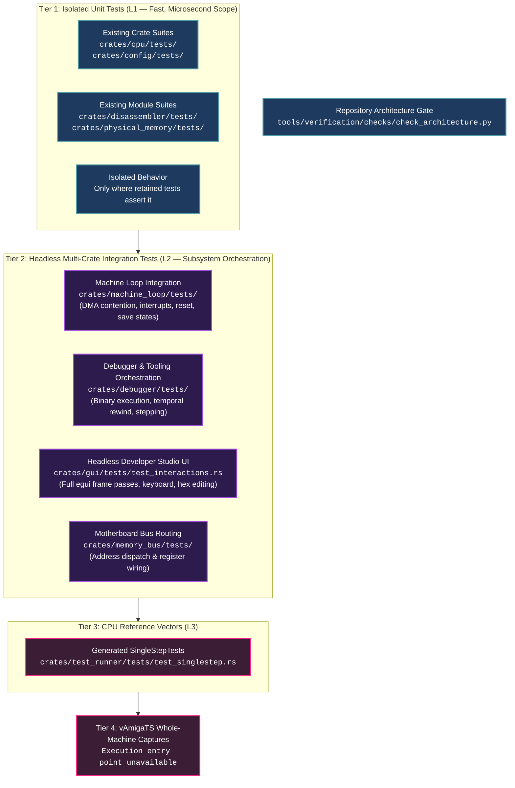

# Amiga 500 Testing Strategy and Quality Assurance

## Completion entry point

Ordinary work uses focused checks. Batch preparation runs
`python tools/verification/verify.py commit`; milestone closure also runs the
separate `milestone` profile for the same snapshot. The latter adds full
SingleStep and the English audit without repeating commit gates. Full vectors
remain available explicitly for diagnosis, and benchmarks remain explicit
measurements. No profile runs the unavailable whole-machine capture comparator.

The [verification reference](../../../../tools/verification/README.md#completion-verification)
owns commands, profile contents, environment requirements and failure handling.
Its [input-selection contract](../../../../tools/verification/README.md#selection-from-changed-inputs)
owns package/consumer selection, full-workspace fallbacks and Python-tool routing.
Selection covers the complete staged, unstaged and nonignored new candidate,
including both rename endpoints; staging does not isolate execution.

Retain these evidence boundaries:

- Ordinary selected crate tests run once under coverage. Reports identify their
  packages, current source and build target; execution coverage does not establish
  meaningful assertions, all platforms, branch coverage or hardware accuracy.
  [Coverage policy](../../../../.agents/rules/unit-testing-policy.md#coverage-during-development-and-review)
  owns gap review; the [coverage reference](../../../../tools/verification/README.md#coverage-guided-testing)
  owns diagnostic measurements and artifacts. There is no percentage gate.
- Failed, missing, interrupted or invalidated groups cannot count as passed.
  Continuation reuses only matching successful evidence with intact artifacts;
  it is not a cross-task cache. Source, index and execution conditions must remain
  stable. The final verdict covers the complete candidate, not intermediate commits.
- A changed HEAD starts a new batch. Approved integration compares the complete
  combined candidate against an immutable primary base; its narrow mechanical
  commit bridge and unverified working-commit/confirmed-fast-forward exceptions
  belong to the [integration rule](../../../../.agents/rules/git-merge-commits.md).
- Generated timing reports are outputs, not passing evidence. Build caches may
  remain, but stale coverage objects and saved SingleStep totals cannot establish
  that current sources or the requested selection ran.
- Full formatting, Clippy, architecture, hardware/code, frontmatter and language
  gates remain required by the commit profile. Source discovery for quality checks
  includes production and test JavaScript callers. The production Wasm build
  retains its Nightly shared-memory configuration and lint-warning failure policy.
- Bounded scheduling, locks, cancellation and reuse identity follow the
  [execution reference](../../../../tools/verification/README.md#bounded-parallel-execution).
  A surviving child after verifier termination is outside its checkout lock.
  No lifecycle or Git hooks are used.

[Scoped compliance](../../../../.agents/skills/TA-review-spec-compliance/SKILL.md),
[vault integrity](../../../../.agents/skills/TA-audit-vault-links/SKILL.md),
[semantic milestone review](../../../../.agents/skills/TA-review-semantic-parity/SKILL.md)
and [independent batch review](../../../../.agents/references/review-common.md)
retain their own triggers. The mechanical verifier does not execute or replace
those reviews. Each selected assessment returns findings without repairing them
or starting another operation. Diary and roadmap closure remain separate duties.
Required unresolved gaps still block readiness when the caller has not selected
their repair.

Host pacing, FPS and graphical guest presentation are evaluated manually;
dedicated automated graphical execution/image campaigns are retired. Independent
CPU, chip, bus, input, host-lifecycle, display-state and continuation tests remain
available. Audio captures retain their spectral and attachment acceptance limits.

## 1. Architectural Purpose & Testing Pyramid

The four tiers describe different evidence boundaries. Ordinary crate and integration tests, external CPU vectors and ordinary CPU wait checks are available. Whole-machine capture execution is deferred until a new entry point exists. Passing one tier establishes only the properties its fixtures and assertions check. Runtime code and external test suites remain separate:

---

## 2. Unit, Integration, and CPU/Bus Verification

Ordinary CPU tests cover phase-specific waiting, stable retries, counted delay,
and transfer side effects through PhysicalMemory and a small recording wrapper.
They do not enumerate SingleStep vectors or DMA schedules; production arbitration
is tested separately. See [CPU wait coverage](CPU%20SingleStepTests.md#8-ordinary-cpu-wait-state-tests).

### Tier 1: Isolated Unit Tests (L1 — Fast, Unit Scope)
- **Scope**: Single crate, single module in complete isolation. Zero multi-chip machine state.
- **Execution Speed**: Depends on the remaining selected crate suites.
- **Execution Command**: `python tools/verification/verify.py test rust unit`
- **Responsibilities**:
  - Bitwise operations, register reads/writes, wrapping arithmetic, and state transitions.
  - Disassembler opcode parsing, effective address modes, and Fibonacci branch heuristics ([`crates/disassembler/tests/`](../../../../crates/disassembler/tests)).
  - CPU instruction, memory, wait-state, and exception behavior ([`crates/cpu/tests/`](../../../../crates/cpu/tests)).
  - Configuration and physical memory behavior ([`crates/config/tests/`](../../../../crates/config/tests), [`crates/physical_memory/tests/`](../../../../crates/physical_memory/tests)).

Custom-chip and peripheral tests should check register behavior, algorithms,
and boundary conditions against HRM-derived expectations in isolated fixtures.
Production-machine integration tests check the cross-chip interactions they
assert, but do not establish those isolated behaviors.
[Native disk verification](../../../../ROADMAP.md#native-disk-verification)
extends component coverage to independently expected machine outputs for
the selected original ADF programs.

The [BLEP generator tests](../../../../tools/blep_generator/tests/) cover its
numerical helpers and regenerate all four PAL curves in an isolated directory.
Every CSV sample is compared with the accepted files under
[`tools/blep_generator/output/`](../../../../tools/blep_generator/output/).
This regression check preserves the accepted curves without network access or
WinUAE sources; it does not independently establish hardware accuracy. The
[generator reference](../../../../tools/blep_generator/README.md) describes the
separate optional comparison chart using an explicitly supplied WinUAE table.

### Tier 2: Headless Multi-Crate Integration Tests (L2 — Subsystem Orchestration)
- **Scope**: Multi-crate interaction, bus routing, and system loop orchestration.
- **Execution Command**: `python tools/verification/verify.py test rust integration`
- **Primary Integration Hubs**:
  1. **Machine Loop Nexus ([`crates/machine_loop/tests/`](../../../../crates/machine_loop/tests))**:
     - Step the production machine in CCKs and check CPU progress, bus wait states, register propagation, and DMA contention.
     - Drive Copper, Blitter, Denise, and Paula through machine-visible registers and Chip RAM; check their memory, display, audio, and interrupt effects.
     - Check `DMACON` gating, cross-chip action and signal routing, interrupt priority, and keyboard-to-CIA-to-CPU delivery.
     - Check cold and warm reset, the CPU RESET instruction, RTC stepping, and machine-state save and restore.

#### The 4-Question Integration Checklist (When Tier 2 Tests are Mandatory)

Whenever any custom chip, coprocessor, peripheral device, or interrupt line is added, modified, or refactored:
1. **Control & Strobe Mutation:** Does changing register bits (e.g. `DMACON`, `INTENA`, `COPCON`) gate or trigger execution?
2. **Autonomous Memory Transfer:** Does the subsystem read or write Chip RAM over multiple CCK cycles (Copper, Blitter, Denise, Audio, Floppy)?
3. **Cross-Chip Signal & Interrupt Routing:** Does the subsystem raise an interrupt line, latch status, or send electronic signals to other chips (Paula -> CPU, Agnus -> Denise, CIAs -> CPU)?
4. **Hardware Contention & Wait States:** Does the subsystem compete for Chip RAM slots or stall the CPU?

If any answer is **YES**, identify integration protection for that coordination. Reuse or extend an existing production fixture; add a test only for a demonstrated gap. A module change does not by itself require another test file. Expected results and runtime observation interfaces follow [unit-testing-policy.md](../../../../.agents/rules/unit-testing-policy.md).

#### The 4 Standardized Integration Test Archetypes

1. **Archetype A (Autonomous Progress):** Setup registers/memory -> trigger strobe -> step $N$ CCKs -> assert mutated Chip RAM buffer.
2. **Archetype B (Signal Escalation & CPU Autovector):** Trigger event -> step CCKs -> assert CPU IPL escalation and PC vector branch.
3. **Archetype C (DMA Gatekeeping):** Step with DMA bit set (assert progress) -> step with bit or master `DMAEN` cleared (assert zero progress).
4. **Archetype D (Contention & Concurrency):** Run active Chip RAM transfer -> assert CPU wait states on Chip RAM alongside zero wait states in Fast RAM.

#### Custom Chip Whole-Machine Verification Matrix

| Custom Chip | Integration Behavior to Verify |
| :--- | :--- |
| **Copper** | List execution, beam `WAIT`, `MOVE` to `COLOR00`, DMACON enable/disable, Level 3 IRQ, `SKIP` condition, `CDANG` danger mode |
| **Blitter** | 2D copy & fill in Chip RAM, `BLTSIZE` start, Level 3 `_BLITINT` assertion, CPU bus lockout, Blitter Nasty vs Fast RAM immunity |
| **Denise** | 32-color batch mutation, sprite vertical window, `SPRxDATA` arming, DMA toggling, 1-plane bitplane fetch, display window clipping |
| **Paula** | Audio DMA playback, period scaling, sample buffer generation, Level 4 `AUD0DSR`, multi-interrupt IPL 1-6 arbitration, INTENA masking |
| **DMA Arbiter** | Bitwise SET/CLR in `DMACON`, master `DMAEN` global halt, 1-2 CCK electronic delays, open bus `$FFFF` |
| **CIAs** | Keyboard serial shift to CIA-A `SDR`, Timer A/B underflow Level 2/6 IRQs, horizontal TOD (CIA-B), vertical TOD 50 Hz tick (CIA-A) |

Debugger, GUI and router integration suites live with their
[debugger](../../../../crates/debugger/tests/), [GUI](../../../../crates/gui/tests/)
and [MemoryBus](../../../../crates/memory_bus/tests/) owners. Their presence is
not evidence that every interaction is asserted. Debugger history stores CPU
states; full-machine rewind remains pending.

### Tier 3: Generated CPU Reference Vectors and Verification Harness (L3)
- **Scope**: CPU state, instruction clocks and timed callbacks against external 68000 vectors. Ordinary crate tests own focused waiting invariants.
- **Execution Commands**: `python tools/verification/verify.py test runner singlestep` for explicit diagnosis; automatic full-suite selection occurs at milestones.
- **Key Verification Suites**:
  - **Tom Harte SingleStepTests ([`crates/test_runner/tests/test_singlestep.rs`](../../../../crates/test_runner/tests/test_singlestep.rs))**: Every executed vector compares state, instruction clocks and timed bus callbacks. Sampling changes input count only; abstract callback and state-comparison limits remain explicit (see [CPU SingleStepTests.md](CPU%20SingleStepTests.md#12-input-scope-and-complete-verification)).

Repository architecture checks are a separate gate, implemented in
[`tools/verification/checks/check_architecture.py`](../../../../tools/verification/checks/check_architecture.py).
`verify.py check architecture [case FILTER]` runs source and repository inspection
without compiling Rust. Commit verification always includes all 18 controls.
The compiled opcode descriptor coverage check remains in
[`crates/cpu/tests/test_visibility.rs`](../../../../crates/cpu/tests/test_visibility.rs)
and runs with ordinary CPU tests.

---

## 3. Tier 4: Whole-Machine Hardware Capture Verification

Whole-machine verification should load an executable hardware workload, run it
for specified frames, extract the rendered 716 x 285 RGB24 viewport, and compare
it with the vAmigaTS reference images using a validated comparison method.

Whole-machine capture execution/comparison remains unavailable; see the
[external hardware verification work](../../../../ROADMAP.md#external-hardware-verification).
Neither completion profile executes captures or chipset throughput measurements.

A requested integration sweep uses the available production machine tests.
Classify failures by observed mechanism, repair demonstrated causes, and rerun
the affected tests. A passing crate or CPU suite cannot substitute for the
missing hardware comparison.

## 4. Diagnose Mechanisms Before Consolidating Fixes

A timing offset or local condition that makes one test pass can conceal the
wrong bus phase, signal propagation or state transition. Reproduce an isolated
failure and establish its mechanism before scaling a fix. Investigate a shared
cause when the evidence connects failures; unrelated defects need not collapse
into one hardware law. Preserve justified state-machine conditions while removing
temporary compensating patches.

When exploratory changes accumulate, compare symptoms, patch locations, and
applied mechanisms to determine whether they share an upstream cause. Scope,
reproduction and reference conflicts follow
[defect procedure](../../../../.agents/references/defect-resolution.md) and
[spec-compliance.md](../../../../.agents/rules/spec-compliance.md).

---

## 5. Select Evidence for the Changed Behavior

Select existing checks for the actual change. The following categories describe available evidence and remaining prerequisites; they are not a sequence to execute after every edit. Commit and milestone profiles use the triggers above.

| Level | Verification Tier | Primary Tool / Command | Pass Criteria |
| :---: | :--- | :--- | :--- |
| **L1** | **Crate Behavior** | `python tools/verification/verify.py test rust crate <crate>` | Selected behavior and failure-mode assertions pass |
| **L2** | **Production Integration** | `python tools/verification/verify.py test rust crate machine_loop` | Existing or extended fixtures protect the affected coordination |
| **L3** | **CPU Vectors and Synthetic Contention** | `python tools/verification/verify.py test runner singlestep` | Selected vectors pass state, clocks and timed bus comparisons; limits reported |
| **L4** | **Whole-Machine Captures** | Unavailable; needs a future execution and comparison entry point | Hardware workload and expected capture comparison |
| **Separate gate** | **Architecture and Quality** | Relevant `check` command; full profile before an authorized commit | Static constraints pass; source review remains necessary |

---

## 6. Structural Conventions & Invariants

[Testing policy](../../../../.agents/rules/unit-testing-policy.md) owns external
suite placement and behavioral protection. Use `test_` names for test files and
subdirectories for shared helpers. The
[architecture checker](../../../../tools/verification/checks/check_architecture.py)
enforces naming, executable existing suites and configured production file
limits; [architecture criteria](../../../../.agents/references/architecture-criteria.md)
own the semantic cohesion review. The architecture gate's required suite filenames do not prove
behavioral coverage or require a new file for every module. Evaluate each
fixture's independently expected behavior and failure modes.

---

## 7. Automated Verification Tooling

| Tool / Script | Purpose | Enforcement Layer |
| :--- | :--- | :--- |
| [`tools/verification/verify.py`](../../../../tools/verification/verify.py) | Canonical commit/milestone quality gate and diagnostic frontend (`test rust`, `test python`, `test runner`, `check`, `runner`). | Explicit agent/developer command & CI |
| [`tools/verification/checks/check_architecture.py`](../../../../tools/verification/checks/check_architecture.py) | Python checks validating source constraints, test naming and retained required suite files; passing them does not prove behavioral coverage. | `verify.py check architecture` & commit verification gate |
| [`tools/verification/checks/audit_code_quality.py`](../../../../tools/verification/checks/audit_code_quality.py) | Checks dead code, test-only code and accessor conventions. Observed-caller visibility suggestions are advisory because external public API use is outside the repository scan. | `verify.py check code` & commit verification gate |

---

## 8. Related Architecture Specifications

- [General Architecture.md](../General%20Architecture.md): Amiga 500 system block diagram and crate dependencies.
- [Machine Loop.md](../Machine%20Loop.md): Machine loop cycle stepping, reset sequencing, and interrupt arbitration.
- [CPU SingleStepTests.md](CPU%20SingleStepTests.md): Verification against software-generated instruction reference vectors.
- [CPU Instruction Benchmarking.md](../Performance/CPU%20Instruction%20Benchmarking.md): Host performance measurement framework and retained comparison baselines.
- [Platform Quirks and Invariants Catalog.md](../Platform%20Quirks%20and%20Invariants%20Catalog.md): Centralized master catalog of hardware idiosyncrasies and anti-tamper invariants.
