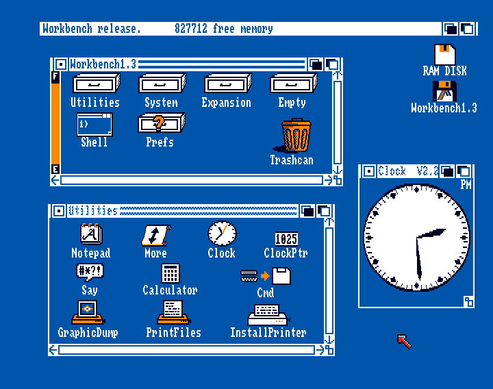
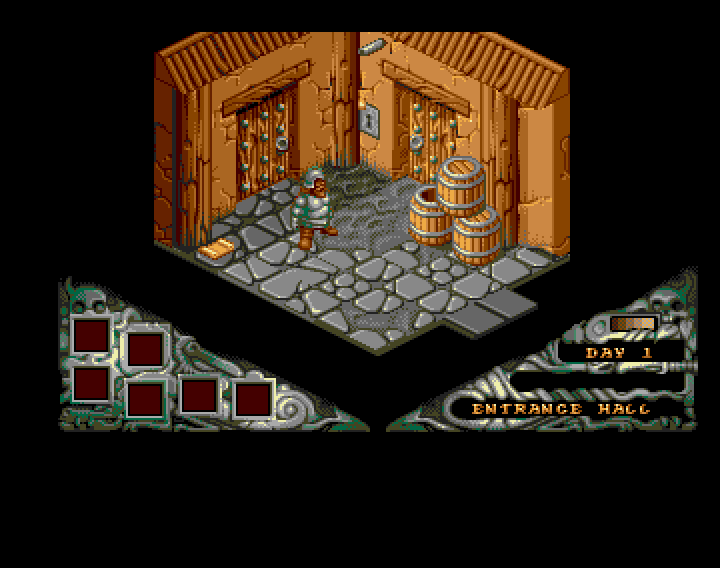

# Amiga 500 Cycle-Exact Emulator in Rust

A cycle-exact, high-performance emulator for the **Commodore Amiga 500** (OCS).
It is written in Rust and targets native desktops and WebAssembly.

The project focuses on playing games from floppy disk (`DF0:`, `.adf`). Hard
drives and larger expansions are outside its scope. The project grew through
human–AI pair programming and discussion of architectural choices. The
engineering story follows how the human guided development without writing
code and how the test harness evolved.
[**How This Emulator Was Written**](docs/how_this_emulator_was_written.md)

---

## Hardware Configurations Supported

- **Basic A500** has 512 KB Chip RAM, like the early stock model without memory
  expansion.
- **Classic A500 (Recommended)** has 512 KB Chip RAM + 512 KB Slow RAM
  (1 MB total). This is the default configuration and suits the vast
  majority of Amiga games.
- **Expanded A500** has 1 MB base RAM + 4 MB Fast RAM. It represents a
  configuration for power users and professionals running productivity
  software, multitasking in Workbench or running demanding demos.
- **Target Platforms** are native desktop executables for Windows, Linux and
  macOS, and WebAssembly for play directly in the browser.

---

## Current Status

The emulator is under active development. On Windows, the native app can boot
Workbench 1.3 with Kickstart 1.3 and run *Cadaver: The Last Supper* from an ADF
floppy disk image.



*Workbench 1.3 after booting from ADF, with Utilities and Clock open.*



*Cadaver: The Last Supper running from ADF, in the Entrance Hall on Day 1.*

The roadmap tracks the remaining implementation work. [Development roadmap](ROADMAP.md)

## Run the Emulator

### Native Desktop Application

From the repository root, build and launch the native app in release mode.

```powershell
cargo run --release -p gui
```

The desktop app opens the game library. Choose your library folder to find and
launch games. To boot a disk directly, open **Manual setup**, select your own
supported Kickstart ROM and ADF disk image, and choose **Start**.
[Game library and manual setup](docs/game-library.md)

### Web Browser

Use Trunk to run the WebAssembly build in a browser. [Trunk](https://trunkrs.dev)

```powershell
cargo install --locked trunk
rustup toolchain install nightly --component rust-src --target wasm32-unknown-unknown
./tools/web.ps1 serve
```

Open the address printed by Trunk to reach manual setup. The browser build uses
shared Wasm memory and a dedicated worker that runs the machine. The web launcher
rebuilds the Rust standard library with atomic support and serves the required
cross-origin isolation headers. `./tools/web.ps1 build` writes an
independent build under `.agent/tmp/web-dist`. [Web launcher](tools/web.ps1)

## Developer Studio & M68000 Debugger

Start a session with a supported Kickstart and a bootable disk in DF0. For a
display and audio demonstration, use the [mixed-scene disk](tests/mixed_scene/README.md).
Press **F12** in the session to open Developer Studio. The
[M68000 sample programs](examples/m68k/) are fixtures for the headless debugger
tests.

The debugger guide covers all controls and gives step-by-step instructions
for shortcuts and debugging workflows.
[**Developer Studio & Debugger Guide**](docs/debugger.md)

The developer guide provides an overview of the emulator, verification and
ways to work with the project.
[**Developer Guide & Technical Index**](docs/developers.md)

## Check Development Dependencies

Run this command with Python 3.11 or later from the checkout to see available
updates, installation differences and checks that could not finish.

```powershell
python tools/check_updates.py
```

The report covers development tools and packages declared in project files. It
shows versions alongside findings. Run the command with another Python
interpreter to inspect that interpreter's packages. The report leaves
dependencies and project files in place.
