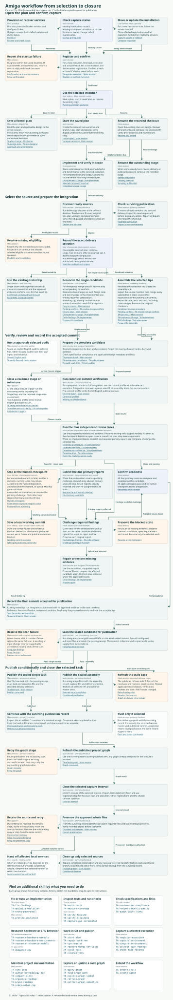

# Working with an AI Agent

This guide is for developers starting to work on the Amiga 500 emulator with an
AI coding agent. It explains how to frame a task, how the agent finds relevant
code and hardware evidence, and how to judge the result. You select a bounded
step and its scope; the main session routes it to the appropriate role or skill
and explains the result before the next choice. An explicit request can authorize
several steps' scope; the receiving session still waits for your selection before
starting the next operation.

## Find your way around the skills

The [workflow map](workflow-map.svg) follows a planned software change from its
task worktree through publication on local master. The lower half groups
additional operations by purpose.
Open the map on its own to follow a skill name to its instructions.



The upper path shows a planned change in an existing task worktree. The planner,
test designer and implementer hand the candidate back to the main session.
During preparation, check specification compliance and audit the Design vault's
metadata and links. Existing evidence can cover matching scope. Each of the four
batch review lanes then uses a fresh instance of the same reviewer role.
If a review or check fails, select the repair, prepare the revised candidate
and repeat the affected checks and reviews. A commit requires a passing canonical
verification of the prepared changes.
The [batch policy](../.agents/rules/git-commits.md#readiness-before-freeze)
lists the evidence to collect for the selected change.

An explicitly authorized temporary working commit can preserve pending work
before integration checks. Record that it awaits verification. It must take the
full integration path even if Git can advance master by fast-forward.

Before integration, agree on a plan with the user and record the current local
master commit (B). With that approval, a clean, unchanged
task tip that contains B can take the confirmed fast-forward path when closure
is committed and the exact tip has been confirmed as tested. If the branches
have diverged, the default is to merge B into the task branch. An explicitly
selected rebase also runs in the task worktree. Both routes require checking
the integrated result against B. If the tip already contains B but lacks the
required evidence or closure, go directly to preparation and full integration checks.
Include any fixes or closure changes in the
reviewed and verified candidate before creating the prepared commits. The same
specification, vault and repair steps apply to the integrated changes.
`TA-close-task` publishes the sealed final tip on local master, provided
master still equals B. See the [integration policy](../.agents/rules/git-merge-commits.md)
and [verification and publication commands](../tools/verification/README.md#local-integration).

Choose `TA-start-plan` when you need a new worktree and `TA-register-execution`
to register the task and its session for capture. The [capture guide](../tools/workflow/capture/README.md) explains how to start and control the collector and receiver.
For the conditions under which one skill can suggest another, see the
[recommendation matrix](workflow-skill-matrix.md).

For build and environment setup, use the [developer guide](developers.md).
For the project's development story and lessons learned, read
[How This Emulator Was Written](how_this_emulator_was_written.md).

## Start with a Concrete Task

Open an agent session in the repository root. [AGENTS.md](../AGENTS.md) is the
entry point for project instructions: it routes the agent to the rules and
procedures relevant to the task. You do not need to repeat the whole rule set in
each prompt.

Describe the behavior you want, the evidence you already have, and the boundaries
of the work. A failing test, a trace, a screenshot or a specific source location
is a useful starting point. State whether you want an explanation, a proposed
design, an implementation or an independent review.

For example:

> Investigate why this instruction takes two extra Color Clocks in the attached
> trace. Explain the failing phase before changing code, preserve the reference
> data, and run the relevant verification after the fix.

For a first session, an investigation is also useful:

> Explain how a blocked Chip RAM access reaches the CPU and which test verifies
> that the active micro-step does not advance. Show the relevant code and design
> references.

The first prompt requests a repair; the second requests investigation and an
explanation. That distinction determines whether the agent should edit files.
When scope or behavior is unclear, establish the intended model before asking
for implementation.

## Follow the Change from Evidence to Verification

Planning and test design precede implementation when the workflow handles a
software change. The selected roles inspect requirements, existing implementation
and reusable evidence, then define a few meaningful scenarios with independent
expected results. Implementation follows that agreed scope. For a defect, it
reproduces the failure before changing the mechanism. Expect it to explain the failing data
flow, clock phase or state transition, rather than adjusting values until a test
passes.

Hardware timing gives this project unusually concrete review criteria. A 68000
bus cycle spans two Color Clocks, blocked Chip RAM access must preserve the active
CPU micro-step, and peer chips coordinate through the machine loop and memory bus.
The [architecture overview](architecture.md) introduces these relationships;
[design specifications](../Obsidian/Amiga/Design/General%20Architecture.md) provide
the subsystem contracts. A conflict with a specification or protected reference
requires a decision from you before the agent changes that contract.

During implementation, keep the conversation focused on the current uncertainty:
what has been established, what remains unexplained, and what observation will
resolve it. You can correct assumptions or narrow the task while the agent works.
For extended tasks, execution plans live in `.agent/tasks/`; disposable captures
and diagnostics live in `.agent/tmp/`.

At completion, expect a reviewable diff and a report of the actual checks run,
their results, and any remaining limitations. Read the diff as well as the report.
Passing tests establish the behavior they exercise; they do not establish every
hardware property or prove that the chosen design is appropriate.

## How the Agent Finds Its Bearings

Two tools help the agent retrieve focused context instead of reading the entire
repository or a hardware manual into each session.

**RAG retrieves domain evidence.** The `rag_qdrant` CLI and optional Amiga RAG MCP
adapter search project specifications and imported Commodore/Motorola references.
The `amiga` source contains project and hardware material; `devnotes` is a separate
source of engineering guidance. Retrieved passages are evidence with provenance,
and the agent checks relevant source sections or diagrams when needed. See the
[source provenance](../.agents/skills/TA-research-hardware-manuals/references/provenance.md) and
[developer guide](developers.md) for scope and setup.

**Graphify navigates source relationships.** Its `project` graph covers our code and allowed documents; its independent
`reference` graph covers imported source code. Compare results separately and
use them to locate symbols, callers and dependencies. For example:

```powershell
python tools/graphify/read.py query "How does the CPU handle a blocked bus access?" --graph graphify-out/graph.json
python tools/graphify/read.py path "Cpu" "BusResult" --graph graphify-out/graph.json
```

The graph helps locate source; the implementation and tests provide the behavior.
Refresh behavior and execution options belong to the [Graphify tool reference](../tools/graphify/README.md).
The caller selects [query](../.agents/skills/TA-query-graph/SKILL.md),
[path](../.agents/skills/TA-find-graph-path/SKILL.md) or
[symbol explanation](../.agents/skills/TA-explain-graph-symbol/SKILL.md).
These read operations do not refresh either graph. Structural refresh and project
semantic extraction are separate selected operations.

Reference emulators and imported manuals are provisioned separately. Their
conversion is an initial setup operation; everyday agent sessions consume the
prepared sources. The [developer guide](developers.md) explains that setup.

## Use Skills for Repeatable Procedures

A skill packages one operation with inputs, a procedure and a stopping point.
All repository skill and role names begin with `TA-`. Browse
[`.agents/skills/`](../.agents/skills/) or name the operation in your request.
The shared contract and relevant advance rules define what an author needs before
designing the change; detailed result criteria belong to the assigned review lane.
Those standards still apply when their full checklist is outside the author's
default reading.

For example, `TA-diagnose-cpu` reports a selected vector mismatch without repairing
it, while `TA-fix-findings` implements explicitly selected findings. GUI capture
returns an image and its path; interpretation and selected repairs remain separate
assignments. The relevant `SKILL.md` defines the operation's scope and steps.

You can also request focused work from the configured roles in
[`.codex/agents/`](../.codex/agents/):

| Role | Useful when you need |
| --- | --- |
| `TA-planner` | A bounded implementation plan, acceptance criteria and unresolved decisions. |
| `TA-test-designer` | Meaningful scenarios, independent expectations and observation methods. |
| `TA-implementer` | Agreed implementation and tests, or selected finding repairs. |
| `TA-test-auditor` | Test and assertion assessment, or a separately requested coverage measurement. |
| `TA-code-reviewer` | One independent review lane or assigned specification/documentation assessment. |
| `TA-hardware-researcher` | Evidence from the selected manuals, reference models or measured hardware sources. |
| `TA-cpu-verifier` | Diagnosis of state, clock and bus differences in selected 68000 vectors. |

Delegation happens when requested by you or required by an applicable procedure.
Each helper receives a scoped assignment and reports back to the main session.
The [runtime settings tables](../.agents/references/workflow-runtime.md#model-and-reasoning-effort)
own the default model and reasoning effort for each role and the skill overrides.
You can choose either setting or both for one invocation. For example, you can
request `xhigh` for one finding repair or `gpt-6.2-astra` for
`TA-implement-change`; these are explicit user choices, not additional defaults.
The main session reports the role, skill and resolved settings before dispatch.
The same reference owns support checks and access limits. Declared write boundaries
remain binding when a parent supplies full access.

Prepared batches receive four independent review lanes covering behavior,
architecture, tests/evidence, and specifications/instructions. The
[review contract](../.agents/references/review-common.md) owns their isolation,
inputs and scoped approval rules. The main session dispatches four fresh instances
of `TA-code-reviewer`, each using its own fixed lane skill. Seven role definitions
do not mean seven calls on every task, and a test audit does not replace a lane.

Each invocation announces its scope and round limit, normally three and never
more than four. It returns both `result.json` and `result.md` under
`.agent/tmp/workflow-TA/<task-id>/<work-item-id>/<run-id>/`. The
[invocation contract](../.agents/references/workflow-contract.md) records candidate
and instruction identities, findings, actual checks, retained evidence and limits.
Use the [result tool](../tools/workflow/README.md) to inspect the selected skill's
schema, validate JSON and render matching text. A missing validator dependency is
a prerequisite gap; installation requires its own authorization.
A completed review may request changes. Missing evidence or an exhausted budget
returns control instead of starting repairs; a linked continuation needs actual
user authorization or a recorded delegation. Markdown budgets and write boundaries
are behavioral limits, not claims of hard runtime enforcement.

## Review and Record the Result

After an operation returns, the main session explains what happened, what it means
for the task and the most useful next step. It normally offers one to three
relevant options, each with its effect, prerequisites and a complete copyable
instruction naming the executor, skill and exact scope. Select an option by its
label or number in the conversation, paste its instruction, defer work or give
a different request. You do not need to read raw JSON or assemble a specialist
assignment. Completed work may need no next operation.

For example, when a focused test demonstrates a code defect, expect a repair
option naming `TA-implementer` and `TA-fix-findings`, the actual finding ID and
input references, affected files and round limit. The displayed instruction uses
those real inputs. If the cause is unknown, an investigation may be more useful;
a test audit is appropriate when the expectation itself is unresolved. A required
failure remains visible if you defer it. Permission to repair does not approve
weakening a test, and inability to repair is not evidence that the test is wrong.

The session keeps the worker's original report and stores its own explanation in
a linked text/JSON guidance pair. Only the current option set is selectable. Before
executing your selection, it checks that the inputs and candidate still match;
changed prerequisites produce refreshed choices instead of stale execution. This
check does not rerun tests. Recommendations and silence start nothing. The shared
[receiving procedure](../.agents/references/workflow-guidance.md) owns these steps.

The [skill matrix](workflow-skill-matrix.md) defines the standard recommendation
paths. Its source row is the skill that returned; each destination column is a
possible next skill. Cell codes state conditions, such as a ready plan, missing
test evidence or identified findings. The agent checks those conditions and offers
the useful options, rather than treating every marked cell as a required step.
An empty cell means the agent does not recommend that transition in the standard
workflow. You can still explicitly request another skill, subject to its normal
scope, authorization and prerequisites. The matrix is guidance, not a permission
system. After your directly selected operation, suggestions resume from its row.

Before a new implementation task, the agent names the current checkout and branch
and asks whether to continue there or create a new task worktree. An explicit
location instruction answers that question for the task. Bounded detached test
checkouts leave the real implementation in the selected location. The
[location rule](../AGENTS.md#choose-the-task-checkout)
defines this boundary.

Routine task completion leaves validated changes available for review. It does
not itself authorize staging or committing. Ask for a commit when the change is
ready, or request batch preparation to authorize staging without creating commits.
A commit request authorizes preparation and mechanical execution without another
confirmation. The agent identifies the included sessions and changes and splits
independent concerns into coherent commits automatically, reporting their count,
IDs and scopes. Roadmap closure retains its required completion commit under the
[commit policy](../.agents/rules/git-commits.md).

Prepare one complete candidate against `HEAD`, then repeat the command after corrections:

```powershell
python tools/verification/verify.py commit
```

Despite its name, this command verifies the working tree; it does not create a
commit. The [testing guide](testing.md) explains what its evidence establishes.
[Commit policy](../.agents/rules/git-commits.md) owns preparation, diary entries,
review, evidence continuation and freeze. Failed or missing required checks
prevent batch readiness, and results cover the combined candidate.

Local publication is a separate operation: `TA-close-task` consumes an already
prepared, verified, independently reviewed, committed and sealed candidate.
It conditionally advances the recorded local target or reports a stale/missing
prerequisite. It does not merge master, repair conflicts, run tests, create commits
or remove the worktree. `TA-cleanup-task` handles separately authorized cleanup
after confirmed publication and committed closure records.

Earlier steps have separate owners: `TA-sync-master`,
`TA-resolve-merge-conflicts`, `TA-sync-docs`, `TA-prepare-batch`,
`TA-verify-batch` and `TA-commit-batch`. A broad request may authorize their concrete
scope; existing authorization persists without repeated permission requests.
The next operation still follows your selection from the current guidance.
Commit-only requests do not authorize merging, pushing or worktree removal.
The [integration rule](../.agents/rules/git-merge-commits.md) and
[tool reference](../tools/verification/README.md#local-integration) preserve exact
source/target selection, the narrow confirmed-tested exception, conditional
publication and safe cleanup. Several sources still require one assembled and
verified combined candidate; independently publishing tested branches is insufficient.

If you are changing the agent infrastructure itself, use
[Maintaining Agent Tooling](../.agents/references/agent-tooling.md) for script ownership, configuration
and recording procedures.
