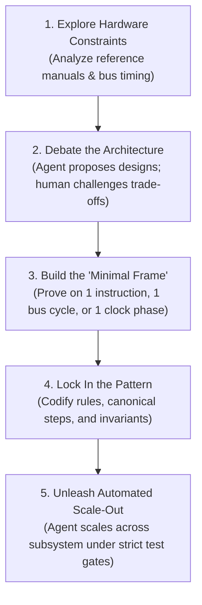
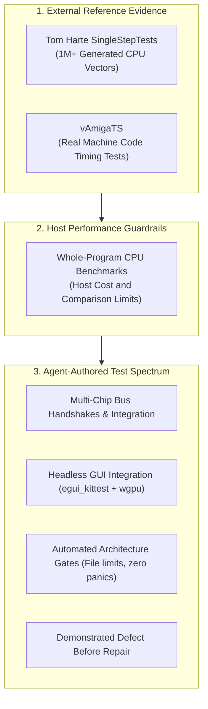

# How This Emulator Was Written: Pair-Programming with an AI Agent

This retrospective explains the collaboration and design choices used while building the emulator. It describes the development process; the [architecture](architecture.md), [testing](testing.md) and [agent collaboration](ai_agents.md) guides are the entry points for understanding and working with the current project.

Here is the honest breakdown of how this cycle-exact Amiga 500 emulator was built from scratch in Rust—and how an AI agent generated 100% of the implementation code, test suites, and documentation under human architectural direction.

---

## 1. Zero Hand-Written Code (and Zero Rust Experience)

Here is the defining fact about this project: **I did not write a single line of Rust code. Not one.**

I didn't write any of the implementation code. And just as importantly, **I never wrote, designed, or proposed a single test**—from unit tests and multi-chip integration suites to GUI harnesses and automated architecture gates. Every struct, every micro-step in the CPU state machine, every bus arbitration check, every co-processor pipeline, and every test suite was generated and verified by the AI agent.

And here is the even more candid reality: **I didn't know the hardware inside-out going in, and this project was my very first contact with Rust.**

I didn't have the retro hardware details memorized. Nor was I a seasoned Rust programmer—in all honesty, there are still aspects of Rust that I am learning today.

My role was serving as the **Architect, Constraint Setter, and Sparring Partner**. Rather than micromanaging syntax, I focused on high-level system boundaries, trade-off debates, and designing the verification harness.

---

## 2. The Methodology: The "Minimal Frame" Rule

When building complex systems with AI, asking a model to generate an entire subsystem from a large prompt almost always produces brittle, unmaintainable code.

Our approach was the opposite: **the agent was never unleashed on a subsystem until the architecture was proven on the smallest possible working slice—the "minimal frame."**

Before implementing hundreds of CPU instructions or complex co-processor pipelines, we first proved the minimal operational skeleton:
- How a bus cycle breaks down across discrete sub-clock phases.
- How the memory bus arbitrates wait states when co-processor DMA blocks the CPU.
- How decoupled chips communicate cleanly without circular reference handles (`Rc<RefCell<...>>`).
- How interrupt priority signals propagate into the CPU.

Once verified on a single instruction or clock phase, the pattern was locked into a recipe, and the agent scaled it out across the entire subsystem.

### When the AI Trips, Don't Touch the Code—Upgrade the Harness
Whenever the agent made a mistake or took a shortcut, the solution was never to step in and write code manually. Instead, we diagnosed the root cause: *What rule, skill, or architectural constraint was missing?*

Recurring failures led to updates in our operational rules (`.agents/rules/`),
skill recipes (`.agents/skills/`) and architecture checks. Those protections
reduced repeated mistakes; each change still needed evidence and review.

---

## 3. The Zero-Trust Verification Engine

LLMs excel at generating code that looks plausible, compiles cleanly, and passes basic smoke tests—yet breaks completely under real-world execution. To eliminate hallucinated hardware behavior, we established a three-tier verification harness:

### A. CPU Reference Vectors and Hardware Tests (Tom Harte & vAmigaTS)
- **1 Million+ Generated CPU Vectors:** We imported 124 SingleStep suites generated from a software 68000 implementation. The harness compares final CPU state, instruction clocks, and timed bus transactions against the reference records. A disagreement exposes a case to investigate; agreement does not establish that the behavior matches a physical 68000.
- **Hardware Timing Evidence:** External Amiga tests provide reference behavior for chipset synchronization, beam timing, bus priority and timers. The earlier capture/execution harness is retired; native guest bring-up and current automated acceptance have distinct, still-open roadmap gates. Historical comparisons do not certify the present chipset.

### B. Micro-Benchmarking Every Instruction
The earlier benchmark engine grouped findings into family-cost spikes,
addressing-mode differences and variation between runs. That diagnostic runner
and its Type A/B/C classification are retired. The current
[whole-program CPU benchmark](../Obsidian/Amiga/Design/Performance/CPU%20Instruction%20Benchmarking.md)
measures host cost separately from emulated clocks and states its comparison
limits. A timing spike or jitter alone does not establish a particular host
pipeline or branch-predictor cause.

### C. Autonomous Testing Spectrum
The agent authored and maintained the unit tests, multi-chip integration tests,
headless GUI tests and architecture checks. **Repro-First** means demonstrating
the defect before repair, using a focused test, trace or measurement suited to
the question. Regression tests protect meaningful behavior and identified risks.

---

## 4. Systems Architecture in Rust: Flat Layout, Rigorous Ownership

### Flat Code Layout, Rich Compile-Time Ownership
One foundational design choice was keeping the codebase structure intentionally flat:
- **Flat Crate Layout:** Crates live directly under `crates/*` (e.g. `crates/cpu`, `crates/memory_bus`, `crates/debugger`, `crates/gui`).
- **Flat Modules:** CPU instructions reside directly under `crates/cpu/src/instructions/<mnemonic>.rs` without nested directories.

While the file layout is flat, the ownership graph within is strict. Shared mutable pointers (`Rc<RefCell<...>>`) are strictly banned. The top-level machine struct owns subsystems directly, modeling bus contention and co-processor scheduling through unidirectional borrows and explicit event queues.

### Aspect-per-File Modularity
Modules are organized by cohesive behavioral capabilities rather than fragmented across dozens of micro-files. In [`crates/debugger/src/`](../crates/debugger/src/), for example, each file encapsulates an entire functional aspect: `assembler.rs` (parser), `breakpoints.rs` (evaluators and hit testing), `temporal.rs` (time-travel ring buffers), and `stepping.rs` (execution control).

> [!NOTE]
> **A DSP Detour: Standalone Anti-Aliasing (BLEP)**
> To eliminate digital audio aliasing from variable-rate sound channels, we implemented Band-Limited Steps (BLEP). We built a standalone Rust tool in [`tools/blep_generator`](../tools/blep_generator/) with zero external dependencies—deriving sinc pulses, minimum-phase transforms, and analog filter curves directly from mathematical first principles.

---

## Key Takeaways for Building with AI

1. **You Don't Need to Type Syntax or Tests:** An AI agent can generate 100% of production code, test suites, and documentation when directed with clear architectural constraints.
2. **Upgrade the Harness, Don't Fix Code:** When the AI stumbles, treat it as a harness failure. Refine operational rules, skills, and architecture tests so the mistake cannot recur.
3. **Anchor to Objective Ground Truth:** Compare behavior with independent hardware evidence and measure host performance separately; neither tests nor benchmarks prove complete hardware accuracy.
4. **Build the Minimal Frame First:** Never unleash an agent on an entire subsystem at once. Prove the architecture on one instruction or one bus cycle before scaling out.
5. **Flat Organization, Strict Ownership:** Keep directory hierarchies flat and navigable, while using Rust's compile-time ownership to eliminate circular references and runtime locks.
