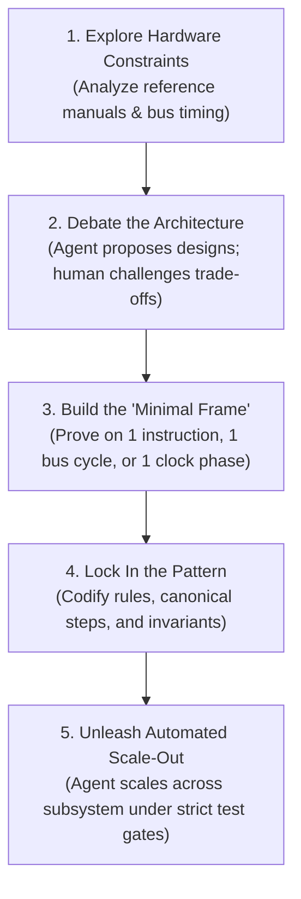
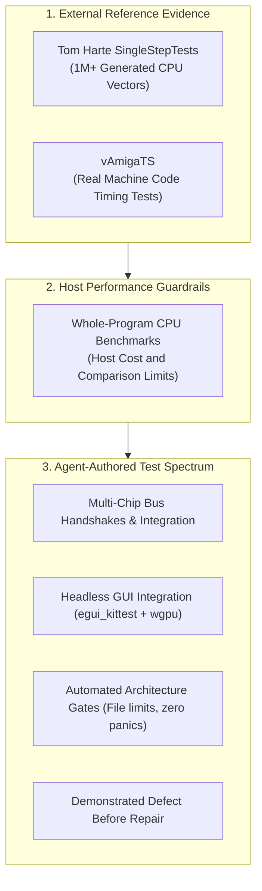

# How This Emulator Was Written: Pair-Programming with an AI Agent

We built this cycle-exact Amiga 500 emulator from scratch in Rust. I directed
the architecture, and an AI agent generated 100% of the implementation code, test
suites and documentation. This account describes how we worked and why we made
those design choices. For the current project, start with the
[architecture](architecture.md), [testing](testing.md) and [agent collaboration](ai_agents.md)
guides.

---

## 1. Zero Hand-Written Code (and Zero Rust Experience)

I did not write a single line of Rust for this project. The agent wrote all
of the implementation code. I never wrote, designed or proposed a single
test. That includes unit tests, multi-chip integration suites, GUI harnesses
and automated architecture gates. The AI agent generated and verified
every struct, every CPU state machine micro-step, every bus arbitration check,
every co-processor pipeline and every test suite.

When I started, I did not know the hardware inside and out or have its details
memorized. This project was my first experience with Rust, and I am still
learning parts of the language.

As **Architect, Constraint Setter, and Sparring Partner**, I set high-level
system boundaries, debated trade-offs and designed the verification harness.
The agent handled the syntax.

---

## 2. The Methodology: The "Minimal Frame" Rule

When building complex systems with AI, asking a model to generate a whole
subsystem from a large prompt almost always produces brittle code that is hard
to maintain. We called the smallest working slice the **"minimal frame."** The
agent expanded to the rest of a subsystem only after we proved the architecture
on that slice.

Before implementing hundreds of instructions or complex co-processor pipelines,
we proved a small set of behaviors.

- We followed a bus cycle through its discrete sub-clock phases.
- We showed how the memory bus handles wait states when co-processor DMA blocks the CPU.
- We showed how chips communicate without circular reference handles (`Rc<RefCell<...>>`).
- We traced how interrupt priority signals reach the CPU.

Once we verified a pattern on one instruction or clock phase, we wrote down the
steps and the agent applied them across the subsystem.

### When the AI Trips, Don't Touch the Code—Upgrade the Harness
When the agent made a mistake or took a shortcut, we looked for the missing rule,
skill or architectural constraint. I kept code changes with the agent.

For recurring failures, we updated our operational rules (`.agents/rules/`),
skill recipes (`.agents/skills/`) and architecture checks. Those changes reduced
repeated mistakes. Each change still needed evidence and review.

---

## 3. The Zero-Trust Verification Engine

LLMs can generate convincing code that compiles and passes basic smoke tests
but fails completely when running real workloads. We built a three-tier
verification harness to catch invented hardware behavior.

### A. CPU Reference Vectors and Hardware Tests (Tom Harte & vAmigaTS)
- **1 Million+ Generated CPU Vectors.** We imported 124 SingleStep suites generated from a software 68000 implementation. The harness compares final CPU state, instruction clocks and timed bus transactions against the reference records. A mismatch identifies a case to investigate. A match establishes agreement with the software reference for that case. A claim about a physical 68000 requires separate evidence.
- **Hardware Timing Evidence.** External Amiga tests provide reference behavior for chipset synchronization, beam timing, bus priority and timers. We retired the earlier capture/execution harness. The roadmap has separate open items for bringing up native guest execution and establishing current automated acceptance. Verifying the present chipset requires current evidence.

### B. Micro-Benchmarking Every Instruction
The earlier benchmark engine classified spikes in the cost of instruction
families, differences by addressing mode and variation between runs. We retired
that runner and its Type A/B/C classification. The current whole-program CPU
benchmark measures host cost separately from emulated clocks and documents the
limits of its comparisons. Identifying a particular host pipeline or
branch-predictor cause takes evidence beyond a timing spike or jitter.
[Whole-program CPU benchmark](../Obsidian/Amiga/Design/Performance/CPU%20Instruction%20Benchmarking.md)

### C. Autonomous Testing Spectrum
The agent authored and maintained the unit tests, multi-chip integration tests,
headless GUI tests and architecture checks. **Repro-First** means demonstrating
the defect before repair, using a focused test, trace or measurement suited to
the question. Regression tests protect meaningful behavior and identified risks.

---

## 4. Systems Architecture in Rust: Flat Layout, Rigorous Ownership

### Flat Code Layout, Rich Compile-Time Ownership
We deliberately kept the directory structure flat.
- **Flat Crate Layout:** Crates live directly under `crates/*` (e.g. `crates/cpu`, `crates/memory_bus`, `crates/debugger`, `crates/gui`).
- **Flat Modules:** CPU instructions reside directly under `crates/cpu/src/instructions/<mnemonic>.rs` without nested directories.

The top-level machine struct owns the subsystems directly. It models bus
contention and co-processor scheduling through one-way borrows and explicit
event queues. The ownership rules forbid shared mutable pointers (`Rc<RefCell<...>>`).

### Aspect-per-File Modularity
Each module keeps related behavior together in one file. In the debugger,
`assembler.rs` handles parsing. The `breakpoints.rs` module evaluates breakpoints
and checks for hits. The `temporal.rs` module manages time-travel ring buffers,
and `stepping.rs` controls execution. [`crates/debugger/src/`](../crates/debugger/src/)

> [!NOTE]
> **A DSP Detour: Standalone Anti-Aliasing (BLEP)**
> We implemented Band-Limited Steps (BLEP) to eliminate digital audio aliasing
> from variable-rate sound channels. Our standalone Rust tool has zero external
> dependencies. It derives sinc pulses, minimum-phase transforms and analog filter
> curves from first principles. [`tools/blep_generator`](../tools/blep_generator/)

---

## Key Takeaways for Building with AI

1. **You Don't Need to Type Syntax or Tests:** An AI agent can generate 100% of production code, test suites, and documentation when directed with clear architectural constraints.
2. **Upgrade the Harness, Don't Fix Code:** When the AI stumbles, treat it as a harness failure. Refine operational rules, skills, and architecture tests so the mistake cannot recur.
3. **Anchor to Objective Ground Truth:** Compare behavior with independent hardware evidence and measure host performance separately; neither tests nor benchmarks prove complete hardware accuracy.
4. **Build the Minimal Frame First:** Never unleash an agent on an entire subsystem at once. Prove the architecture on one instruction or one bus cycle before scaling out.
5. **Flat Organization, Strict Ownership:** Keep directory hierarchies flat and navigable, while using Rust's compile-time ownership to eliminate circular references and runtime locks.
