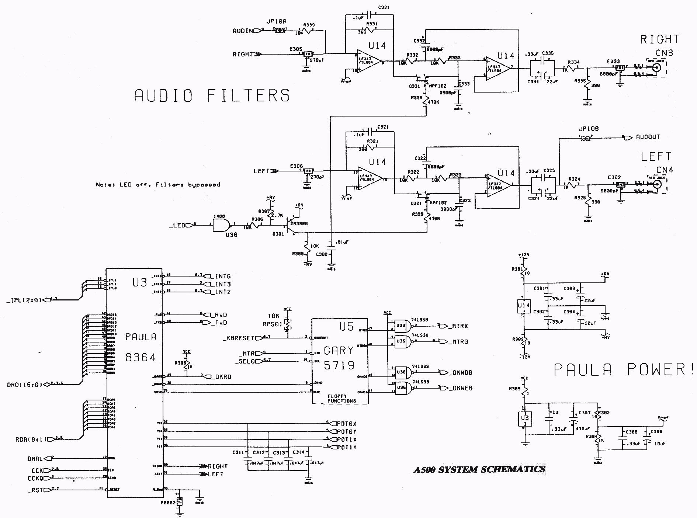

# Amiga Paula Audio BLEP Table Generator

This tool generates Band-Limited Step (BLEP) interpolation tables that Paula's
variable-rate audio channels use for cycle-accurate, anti-aliased sound synthesis.

## 1. Why Band-Limited Steps (BLEPs)?

The Commodore Amiga's Paula chip has 4 independent DMA audio channels. Each can
vary its sample playback rate, up to ~28 kHz on standard PAL screens. Changing
sample levels on arbitrary emulator clock cycles produces harsh high-frequency
harmonics (Nyquist aliasing). Oversampling the whole mixer at 3.54 MHz is a
costly way to address this. In BLEP synthesis, the renderer applies a precomputed
bandlimited step response each time the DAC changes level. This cancels alias
frequencies with minimal CPU overhead.

---

## 2. Mathematical Synthesis Pipeline

The generator approximates the Amiga 500 and Amiga 1200 filtering paths in six
stages. The circuit parameters and numerical comparison describe the model.
Measurements would be needed to establish the behavior of individual boards.

```
┌─────────────────┐     ┌───────────────┐     ┌───────────────────────┐
│ Bandlimited     │ ──> │ Kaiser Window │ ──> │ Minimum-Phase         │
│ Sinc Impulse    │     │ (Bessel I₀)   │     │ (Real Cepstrum FFT)   │
└─────────────────┘     └───────────────┘     └───────────────────────┘
                                                          │
┌─────────────────┐     ┌───────────────┐                 ▼
│ Quantization &  │ <── │ Numerical     │ <── ┌───────────────────────┐
│ Scaling (2¹⁷)   │     │ Integration   │     │ Analog Circuit IIR    │
└─────────────────┘     └───────────────┘     │ (RC & Sallen-Key LED) │
                                              └───────────────────────┘
```

1. **Bandlimited Sinc Impulse**: Sinc kernel with $f_c = 21\,\text{kHz}$ at DAC clock $F_s \approx 3.546895\,\text{MHz}$ (PAL).
2. **Kaiser Windowing**: Windows the 2048-sample kernel using modified Bessel function of the first kind $I_0(x)$ ($\beta = 8.0$ for A500, $\beta = 9.0$ for A1200).
3. **Minimum-Phase Reconstruction (Physical Causality & Pre-Ringing Removal)**:
   - **Why it's needed (Causality).** A standard mathematical sinc filter is symmetric (*linear phase*), so its impulse response starts oscillating before the event (*pre-ringing / anticausal components*). Physical audio hardware responds only after the DAC step transition.
   - **How it works.** Converting the filter to **minimum phase** via the real cepstrum moves all energy to $t \ge 0$. This removes all anticausal components (pre-ringing). The BLEP step response starts at the instant the DAC level switches.
     $$\text{cepstrum} = \text{IFFT}(\ln |\text{FFT}(h)|)$$
   - Before exponential inversion, the generator zeroes the anticausal components ($t < 0$) and doubles the causal components.
     $$h_{\text{min}} = \text{IFFT}(\exp(\text{FFT}(\text{cepstrum})))$$
4. **Analog Circuit Emulation (IIR Biquad Filters)**:
   - Discretized via the Bilinear Transform ($s \to z$ domain).
   - **Fixed Low-Pass**: 1st-order RC filter ($R_{331} / C_{331}$, $f_c \approx 4.9\,\text{kHz}$ on A500, $f_c \approx 32\,\text{kHz}$ on A1200).
   - **Switchable LED Filter**: 2nd-order Sallen-Key low-pass filter ($R_{332}, R_{333}, C_{332}, C_{333}$, $f_0 \approx 3275\,\text{Hz}$, $Q \approx 0.65$).



5. **Numerical Step Integration.** The generator integrates the impulse response to produce a step response.
   $$s[n] = -\sum_{k} h[k] + \sum_{k=0}^n h[k]$$
6. **Quantization & Scaling**: Normalizes and scales to 18-bit fixed point dynamic range ($2^{17} = 131072$).

---

## 3. Output Files and Regression Tests

Running `cargo run -p blep_generator` generates four PAL CSV files in
`tools/blep_generator/output/` and the runtime Rust module at
[`crates/paula/src/audio_tables.rs`](../../crates/paula/src/audio_tables.rs).

The four tracked CSV files are the accepted PAL regression baselines. Run
`python tools/verification/run_rust_tests.py -- cargo test -p blep_generator` to
regenerate all four curves in an isolated temporary directory and compare each
sample with the corresponding baseline. The test keeps the baselines intact and
runs without WinUAE sources or network access. The comparison establishes
numerical stability against the accepted curves. Hardware accuracy requires
independent evidence. Changes to the baseline curves require separate review.

### One-Time Reference Comparison

On 2026-11-08, all four generated tables matched the committed CSVs exactly.
The table records the differences observed against WinUAE's implementation
tables. Measurements of original hardware would provide a separate source of
evidence.
[WinUAE sinctable.cpp at revision f4e416cf973393c317ab02c012285fcda62a9a1f](https://github.com/tonioni/WinUAE/blob/f4e416cf973393c317ab02c012285fcda62a9a1f/sinctable.cpp)

| Hardware Target | Filter Switch | Generated CSV File | Max Error vs WinUAE | Relative Error (% FS) |
|---|---|---|---|---|
| **Amiga 500** | Filter OFF | `blep_a500_filter_off.csv` | **109** / 131072 | **0.0832%** |
| **Amiga 500** | Filter ON  | `blep_a500_filter_on.csv`  | **42** / 131072  | **0.0320%** |
| **Amiga 1200**| Filter OFF | `blep_a1200_filter_off.csv`| **342** / 131072 | **0.2609%** |
| **Amiga 1200**| Filter ON  | `blep_a1200_filter_on.csv` | **97** / 131072  | **0.0740%** |

### Rust Source Output for Paula Core
The runtime module contains A500 PAL and NTSC tables for both LED filter
settings. Each correction has 2,048 entries spaced one CCK apart at the
corresponding standard's clock rate. Its first entry is 131072 and its last is
zero. The renderer subtracts scaled step corrections from the current output
level. Its 44.1 kHz PCM clock is independent of the table spacing. The generator
uses the A1200 curves for comparison only.

The regression test also compares the complete generated Rust module, including
the NTSC tables. The module Paula reads directly replaces the former
`output/blep_tables.rs` artifact.

### Optional WinUAE Comparison Chart

The repository keeps the tracked `output/blep_comparison.svg` and its generator
in `src/comparator.rs`. Supply a local WinUAE `sinctable.cpp` explicitly to
regenerate the chart and print comparison metrics.

```powershell
cargo run -p blep_generator -- <path/to/sinctable.cpp>
```

That command also regenerates the CSV files and Rust module. If you omit the
reference argument, the generator writes only those tables and leaves the chart
intact. It relies on the WinUAE source supplied by the caller for the comparison
and never searches for or downloads it. A missing or malformed supplied reference
causes an error. The offline regression test uses only the committed CSV baselines.
